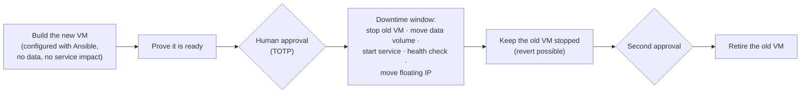
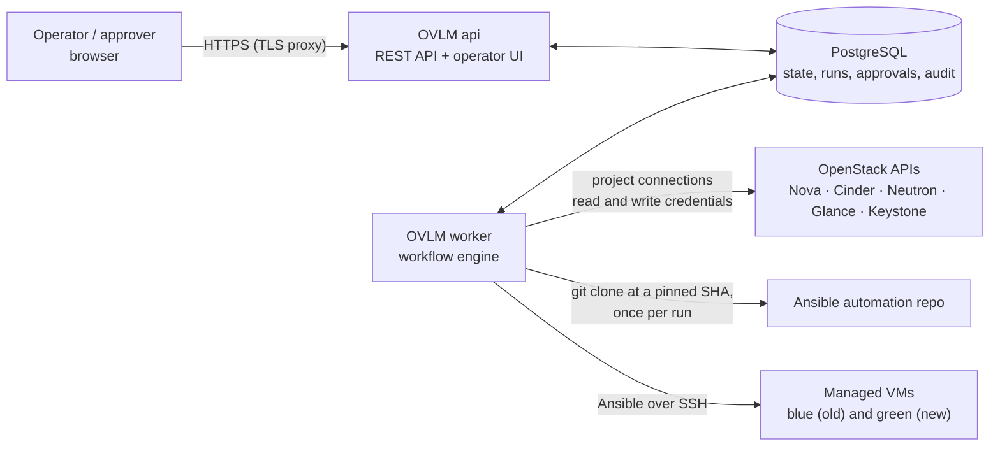
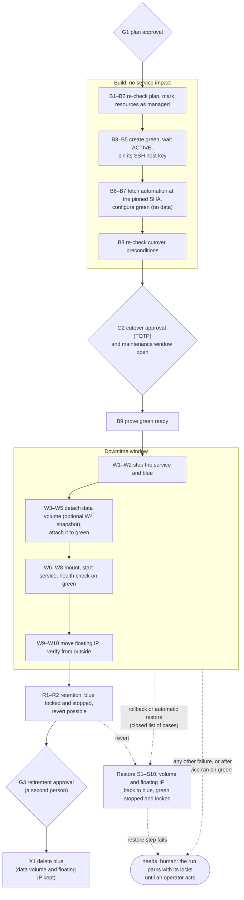
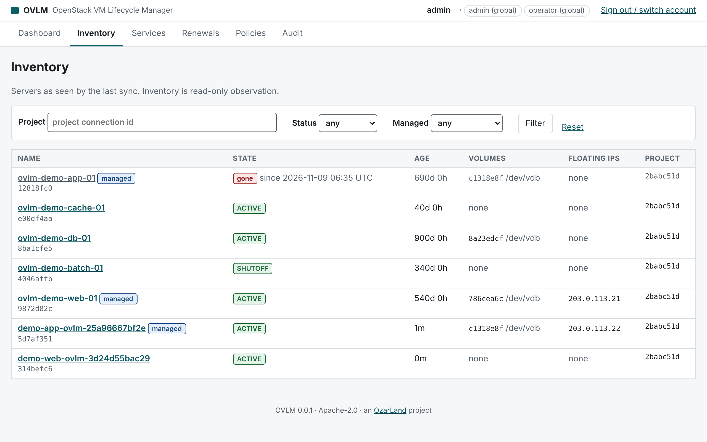
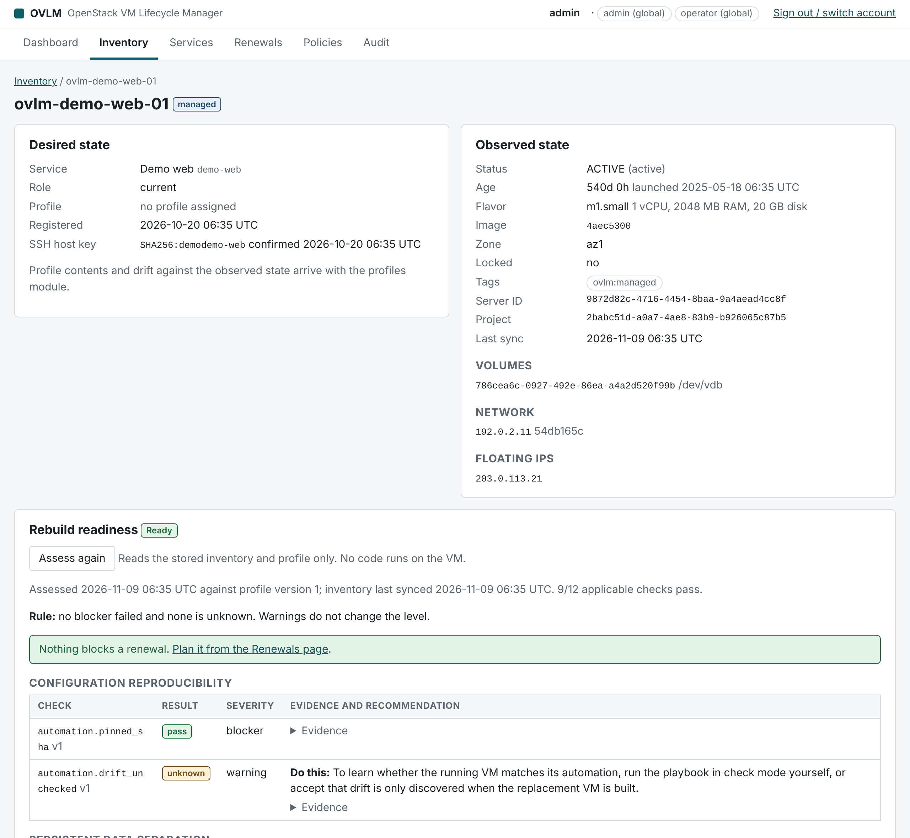
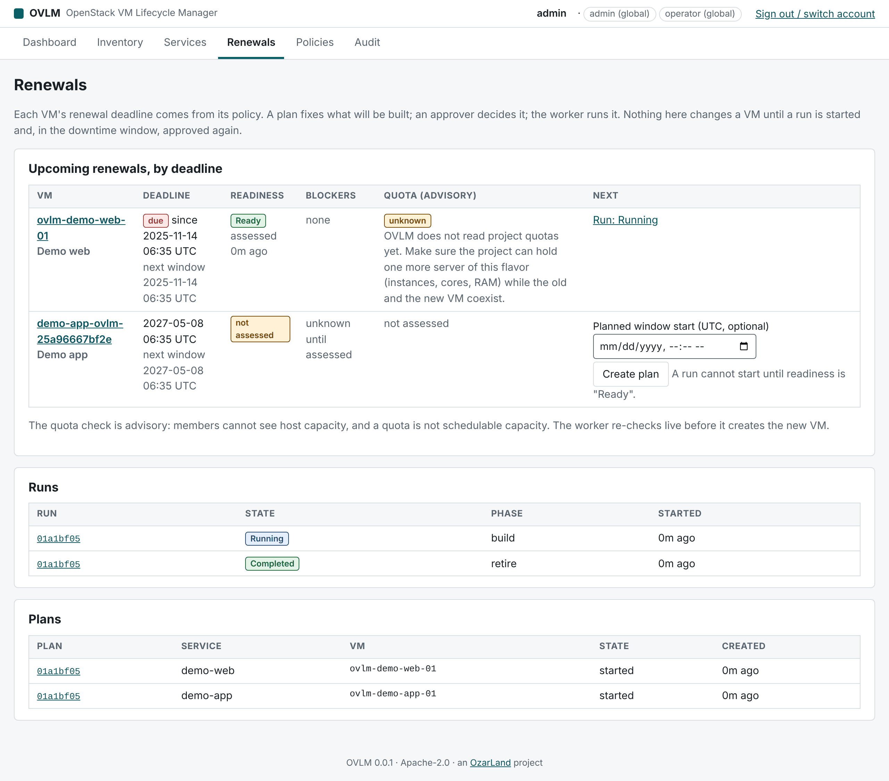
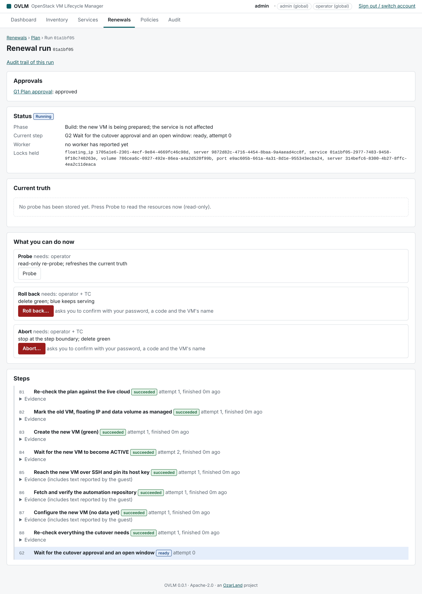
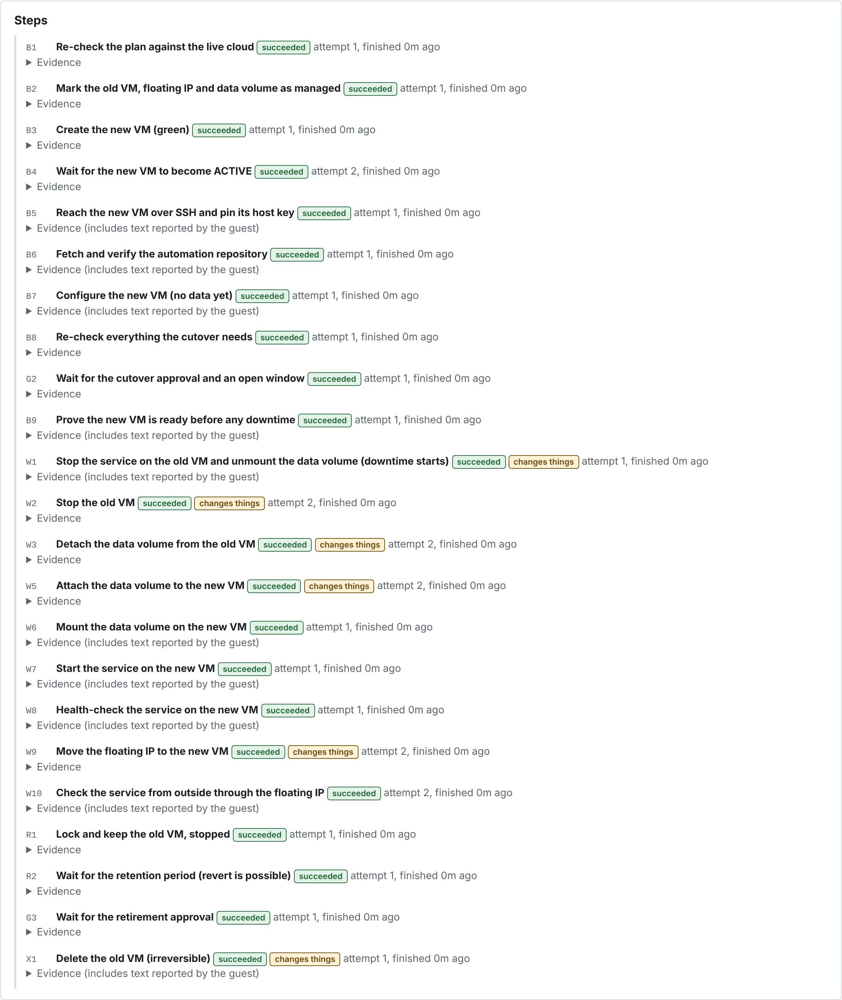
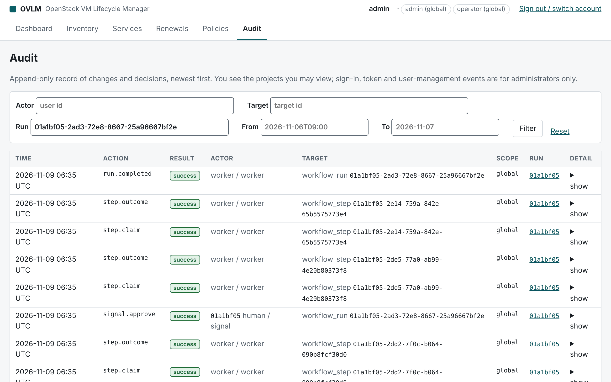

[← OzarLand home](https://github.com/OzarLand/ozarland)

<div align="center">

# 🔁 OpenStack VM Lifecycle Manager (OVLM)

**Stop preserving virtual machines forever. Renew them on a plan, safely.**

<p>
  
  
  
  <a href="LICENSE"></a>
</p>

</div>

---

> **A virtual machine should be replaceable. The service and its persistent data should outlive the virtual machine.**

Organizations that move from VMware to OpenStack often keep their habits: VMs live for years, are configured by hand,
and are never rebuilt. Operators then spend their maintenance windows live-migrating and evacuating instances to
preserve them. OVLM helps operators move those workloads from "preserved forever" to "renewed on a plan".

Part of [OzarLand](https://github.com/OzarLand/ozarland): *a shared land for better OpenStack operations.*

> [!WARNING]
> **Pre-alpha. Do not use against a production cloud.** The design is reviewed and large parts are implemented and
> tested in CI, and the MVP renewal (one data volume, floating IP) is **lab validated on Felcloud**, with its three kept
> failure scenarios. It is **not** production validated. See [Status](#-status) and the [MVP report](docs/mvp-report.md).

## 🧭 What OVLM does

| | Capability | Question it answers |
|---|---|---|
| 🔍 | **Inventory** (read only) | Which VMs do we have, how old are they, and which volumes and IP addresses do they use? |
| 🧭 | **Rebuild readiness** | Could this VM be rebuilt safely today? If not, what exactly is missing? Rule-based, with evidence, not an opaque score. |
| 📅 | **Lifecycle policies** | When should each VM be renewed, under which rules, and who must approve? |
| 🔁 | **Controlled renewal** | Replace the VM step by step, with health checks, human approval, cutover and a way back. |

**MVP renewal strategy: blue/green with data-volume handoff and floating-IP cutover.**



On one real OpenStack cloud, the best-case downtime of this window was measured at **about 40 seconds**
([EXP-01](docs/experiments/EXP-01-design-assumptions-on-felcloud.md)), with the floating-IP move taking 1.1–1.3 s.

**Safety rules built into the design:**
- OVLM never deletes a data volume or a floating IP.
- A volume is never formatted during a renewal.
- Every OpenStack write is checked against an allowlist and an ownership guard.
- Destructive steps need a human approval with TOTP. API tokens and automated agents cannot approve.
- A late failure, once the service may have written new data, stops the run for a human instead of rolling back
  blindly.

**Not in scope:** VMware connectors, Kubernetes, patch management, migrating any arbitrary application. OVLM targets
Linux workloads whose configuration can be reproduced with Ansible.

## 🏗️ Architecture

One codebase, two long-running processes and PostgreSQL, run with Docker Compose. No broker, no Kubernetes.



The api never calls OpenStack, never touches a VM and cannot decrypt credentials: all outbound work runs in the
worker, which talks to the api only through the database. Details in [architecture.md](docs/architecture.md) and the
[security model](docs/security-model.md).

## 🔁 How a renewal works

Strategy `bluegreen_fip_v1`, step by step as in [renewal-workflow.md](docs/renewal-workflow.md). Every step probes,
acts, then verifies, so a worker crash resumes safely.



A failure late in the window, once the service may have written new data on green, parks the run for a human instead
of rolling back blindly ([§4.1](docs/renewal-workflow.md#41-automatic-restore-in-the-window--closed-table-sec-r-30-sre-q5)).

## 🖼️ Screenshots

Taken from a local run of the real api and UI. The data is fictional: a simulated cloud from the integration tests,
documentation IP ranges, made-up names. Timings in these screenshots mean nothing.

**Inventory**: servers as seen by the last sync, with age, volumes and floating IPs.



**Rebuild readiness**: rule-based checks with evidence and a recommendation for each one.



**Renewals**: deadlines from the policy, readiness, runs and plans.



**A run waiting at G2**: green is built and configured; nothing has touched the service yet.



**A completed run**: every step from B1 to X1, with the steps that change things marked.



**Audit**: the append-only trail of one run.



## 📊 Status

Statuses follow [docs/agent-team.md](docs/agent-team.md#status-vocabulary-used-in-every-document): designed →
implemented → unit tested → integration tested → lab validated → production validated.

| Area | Status |
|---|---|
| Product and architecture design, independent SRE and security reviews | ✅ Designed and reviewed |
| Foundation: api, worker, PostgreSQL, Compose, CI | ✅ Integration tested, in `main` |
| Workflow engine (durable, crash-safe, fenced) | ✅ Integration tested, reviewed, in `main` |
| Authentication, TOTP, audit; inventory; profiles, policies, deadlines; operator UI (first pages) | ✅ Integration tested, in `main` |
| OpenStack write client, RBAC, Ansible runner, readiness | ✅ Integration tested, reviewed, in `main` |
| Renewal strategy (blue/green steps, gates, restore) and operator UI pages | ✅ Integration tested, reviewed, in `main` |
| Encrypted credential store and project connections | ✅ Integration tested, reviewed, fixes verified (one Low item open) |
| End-to-end renewal on Felcloud (a real OpenStack cloud) | ✅ Lab validated: primary scenario ACC-01d (build, cutover, retirement) |
| Failure scenarios on Felcloud: configure failure (LAB-04), worker kill in the window (LAB-01), operator rollback after the cutover | ✅ Lab validated (LAB-01 after fixes Z, AA, AB); other failure scenarios integration tested only |
| Production hardening after the MVP (milestone M7) | 🟡 In progress: all P0 items done; paging, backup/restore/upgrade, security follow-ups, independent review fixes, real-cloud install guide, production Compose file and timeout defaults merged; setup UI/CLI (P1-10), P1-11, P1-12 and two lab items to do |
| Production validated | ⬜ No (milestone M8: a pilot on a real service) |

The detailed backlog is in [docs/roadmap.md](docs/roadmap.md), the day-by-day record of the team's work is in
[docs/team-log.md](docs/team-log.md), and where to resume is in [docs/HANDOFF.md](docs/HANDOFF.md).

## 🚀 Try it locally (developers)

You need Docker with Compose, GNU Make and [uv](https://docs.astral.sh/uv/).

```bash
make install   # hash-locked Python environment
make up        # PostgreSQL, migrations, api and worker; waits until healthy
make smoke     # basic checks against the running stack
make test      # unit, then integration tests (integration needs Docker or OVLM_TEST_DATABASE_URL)
make down      # stop and delete the local stack
```

Create the first admin with `ovlm admin create --enrol-link` inside the api container, then open the enrolment link.
An [install guide for evaluation](docs/install-guide.md) exists. It says plainly what is missing. For a real cloud,
the [real-cloud install guide](docs/install-guide-real-cloud.md) covers the cloud administrator's part, production-mode
settings, a first renewal, paging, backup and a security checklist. It is docs only and not validated on a second cloud.

## 🧪 Where OVLM is tested

OVLM is validated on **[Felcloud](https://felcloud.io)**, a real public OpenStack cloud and OzarLand's sponsor, not on
an all-in-one lab ([ADR-0007](docs/decisions/ADR-0007-lab-on-felcloud.md)). Real Nova, Cinder and Neutron on real KVM
hosts give realistic timings and real API behaviour. OVLM uses the same non-admin credentials an operator would give
it.

- **Shared project:** test runs create only `ovlm-*` resources and delete them afterwards. Each run proves, with a
  before/after snapshot, that nothing else in the project changed.
- **What "lab validated" means here:** validated on Felcloud at the recorded API microversions (compute 2.100,
  block storage 3.71 at the first experiments). It does not mean validated on every OpenStack cloud. Reports from
  other clouds are very welcome.

Felcloud provides cloud credit for OzarLand's labs and has no say over the content.

## 📚 Documentation

| Read this | For |
|---|---|
| [Product vision](docs/product-vision.md) · [Requirements](docs/functional-requirements.md) | What and why |
| [Architecture](docs/architecture.md) · [Data model](docs/data-model.md) · [API](docs/api-design.md) | How it is built |
| [Renewal workflow](docs/renewal-workflow.md) · [ADR-0004](docs/decisions/ADR-0004-mvp-renewal-strategy.md) | The state machine, rollback and failure handling |
| [Security model](docs/security-model.md) · [OpenStack integration](docs/openstack-integration.md) | Credentials, least privilege, verified API behaviour |
| [Automation contract](docs/automation-contract.md) · [ansible/](ansible/README.md) | What your Ansible content must provide |
| [Install: evaluation](docs/install-guide.md) · [Install: real cloud](docs/install-guide-real-cloud.md) | Running OVLM on a throw-away host, then next to a real OpenStack project |
| [Operations: alerts and paging](docs/operations.md) | Prometheus rules, Alertmanager routing, a runbook per alert |
| [Backup, restore and upgrade](docs/backup-restore-upgrade.md) | What to back up (database, KEK, TOTP key), restore, upgrade preflight |
| [Testing strategy](docs/testing-strategy.md) · [ADR-0007](docs/decisions/ADR-0007-lab-on-felcloud.md) | How claims become "lab validated" on Felcloud |
| [Decisions](docs/decisions/) · [Reviews](docs/reviews/) | Why things are the way they are |

## 🤖 How OVLM is built

Like the rest of OzarLand, OVLM is written by a team of AI agents with distinct roles (architect, OpenStack
specialist, backend, frontend, automation, SRE, security, QA, documentation), coordinated by an engineering-manager
agent. Critical components get an **independent review** on a different model. **The maintainer decides scope,
approves risk and merges.** See [agent-team.md](docs/agent-team.md),
[model-selection-strategy.md](docs/model-selection-strategy.md) and the [engineering report](docs/engineering-report.md).

## 🤝 Contributing

The project is early and its interfaces still move. The most useful contributions today:

- **Challenge the design.** Open an issue on [renewal-workflow.md](docs/renewal-workflow.md) or the
  [security model](docs/security-model.md), especially if your cloud behaves differently from
  [openstack-integration.md](docs/openstack-integration.md).
- **Report how your cloud behaves:** policy defaults, Cinder backends, floating IPs, console output.

Rules that are not optional, as everywhere in OzarLand:
- no secrets, real hostnames or IP addresses in issues, code or logs;
- sign off your commits (`git commit -s`);
- never present a procedure as validated if it was not.

See [CONTRIBUTING.md](CONTRIBUTING.md) for the dev setup and review rules, [good first issues](docs/good-first-issues.md)
for small tasks, and the
[OzarLand contribution guide](https://github.com/OzarLand/ozarland/blob/main/CONTRIBUTING.md).

## ⚖️ License

[Apache-2.0](LICENSE). OzarLand is an independent community initiative, not affiliated with or endorsed by the
OpenInfra Foundation.
