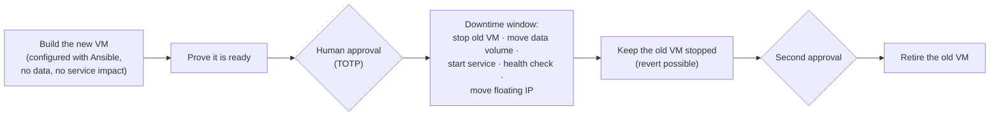

[← OzarLand home](https://github.com/OzarLand/ozarland)

<div align="center">

# 🔁 OpenStack VM Lifecycle Manager (OVLM)

**Stop preserving virtual machines forever. Renew them on a plan, safely.**

<p>
  
  
  
  <a href="LICENSE"></a>
</p>

</div>

---

> **A virtual machine should be replaceable. The service and its persistent data should outlive the virtual machine.**

Organizations that move from VMware to OpenStack often keep their habits: VMs live for years, are configured by hand,
and are never rebuilt. Operators then spend their maintenance windows live-migrating and evacuating instances to
preserve them. OVLM helps operators move those workloads from "preserved forever" to "renewed on a plan".

Part of [OzarLand](https://github.com/OzarLand/ozarland): *a shared land for better OpenStack operations.*

> [!WARNING]
> **Pre-alpha. Do not use against a production cloud.** The design is reviewed and large parts are implemented and
> tested in CI, but the renewal workflow has **not** run end to end on a lab yet. See [Status](#-status).

## 🧭 What OVLM does

| | Capability | Question it answers |
|---|---|---|
| 🔍 | **Inventory** (read only) | Which VMs do we have, how old are they, and which volumes and IP addresses do they use? |
| 🧭 | **Rebuild readiness** | Could this VM be rebuilt safely today? If not, what exactly is missing? Rule-based, with evidence, not an opaque score. |
| 📅 | **Lifecycle policies** | When should each VM be renewed, under which rules, and who must approve? |
| 🔁 | **Controlled renewal** | Replace the VM step by step, with health checks, human approval, cutover and a way back. |

**MVP renewal strategy: blue/green with data-volume handoff and floating-IP cutover.**



On one real OpenStack cloud, the best-case downtime of this window was measured at **about 40 seconds**
([EXP-01](docs/experiments/EXP-01-design-assumptions-on-felcloud.md)), with the floating-IP move taking 1.1–1.3 s.

**Safety rules built into the design:**
- OVLM never deletes a data volume or a floating IP.
- A volume is never formatted during a renewal.
- Every OpenStack write is checked against an allowlist and an ownership guard.
- Destructive steps need a human approval with TOTP. API tokens and automated agents cannot approve.
- A late failure, once the service may have written new data, stops the run for a human instead of rolling back
  blindly.

**Not in scope:** VMware connectors, Kubernetes, patch management, migrating any arbitrary application. OVLM targets
Linux workloads whose configuration can be reproduced with Ansible.

## 📊 Status

Statuses follow [docs/agent-team.md](docs/agent-team.md#status-vocabulary-used-in-every-document): designed →
implemented → unit tested → integration tested → lab validated → production validated.

| Area | Status |
|---|---|
| Product and architecture design, independent SRE and security reviews | ✅ Designed and reviewed |
| Foundation: api, worker, PostgreSQL, Compose, CI | ✅ Integration tested, in `main` |
| Workflow engine (durable, crash-safe, fenced) | ✅ Integration tested, in `main`; review fixes in progress |
| Authentication, TOTP, audit; inventory; profiles, policies, deadlines; operator UI (first pages) | ✅ Integration tested, in `main` |
| OpenStack write client, RBAC, Ansible runner, readiness | 🟡 Integration tested on the working branch; security fixes in progress |
| Renewal strategy (blue/green steps, gates, restore) | 🟡 In progress |
| End-to-end renewal on a lab (openstack-quick-lab with Cinder) | ⬜ Not started |
| Production validated | ⬜ No |

The detailed backlog is in [docs/roadmap.md](docs/roadmap.md), and the day-by-day record of the team's work is in
[docs/team-log.md](docs/team-log.md).

## 🚀 Try it locally (developers)

You need Docker with Compose, GNU Make and [uv](https://docs.astral.sh/uv/).

```bash
make install   # hash-locked Python environment
make up        # PostgreSQL, migrations, api and worker; waits until healthy
make smoke     # basic checks against the running stack
make test      # unit, then integration tests (integration needs Docker or OVLM_TEST_DATABASE_URL)
make down      # stop and delete the local stack
```

Create the first admin with `ovlm admin create --enrol-link` inside the api container, then open the enrolment link.
There is no install guide for real clouds yet, on purpose: it comes after lab validation.

## 📚 Documentation

| Read this | For |
|---|---|
| [Product vision](docs/product-vision.md) · [Requirements](docs/functional-requirements.md) | What and why |
| [Architecture](docs/architecture.md) · [Data model](docs/data-model.md) · [API](docs/api-design.md) | How it is built |
| [Renewal workflow](docs/renewal-workflow.md) · [ADR-0004](docs/decisions/ADR-0004-mvp-renewal-strategy.md) | The state machine, rollback and failure handling |
| [Security model](docs/security-model.md) · [OpenStack integration](docs/openstack-integration.md) | Credentials, least privilege, verified API behaviour |
| [Automation contract](docs/automation-contract.md) · [ansible/](ansible/README.md) | What your Ansible content must provide |
| [Testing strategy](docs/testing-strategy.md) · [Test environment](docs/test-environment.md) | How claims become "lab validated" |
| [Decisions](docs/decisions/) · [Reviews](docs/reviews/) | Why things are the way they are |

## 🤖 How OVLM is built

Like the rest of OzarLand, OVLM is written by a team of AI agents with distinct roles (architect, OpenStack
specialist, backend, frontend, automation, SRE, security, QA, documentation), coordinated by an engineering-manager
agent. Critical components get an **independent review** on a different model. **The maintainer decides scope,
approves risk and merges.** See [agent-team.md](docs/agent-team.md),
[model-selection-strategy.md](docs/model-selection-strategy.md) and the [engineering report](docs/engineering-report.md).

## 🤝 Contributing

The project is early and its interfaces still move. The most useful contributions today:

- **Challenge the design.** Open an issue on [renewal-workflow.md](docs/renewal-workflow.md) or the
  [security model](docs/security-model.md), especially if your cloud behaves differently from
  [openstack-integration.md](docs/openstack-integration.md).
- **Report how your cloud behaves:** policy defaults, Cinder backends, floating IPs, console output.

Rules that are not optional, as everywhere in OzarLand:
- no secrets, real hostnames or IP addresses in issues, code or logs;
- sign off your commits (`git commit -s`);
- never present a procedure as validated if it was not.

See the [OzarLand contribution guide](https://github.com/OzarLand/ozarland/blob/main/CONTRIBUTING.md).

## ⚖️ License

[Apache-2.0](LICENSE). OzarLand is an independent community initiative, not affiliated with or endorsed by the
OpenInfra Foundation.
