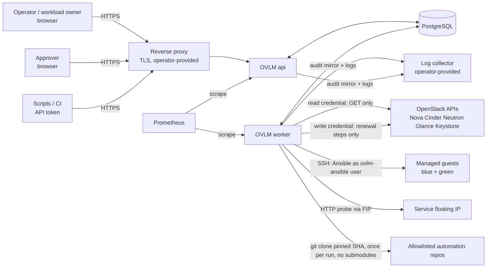
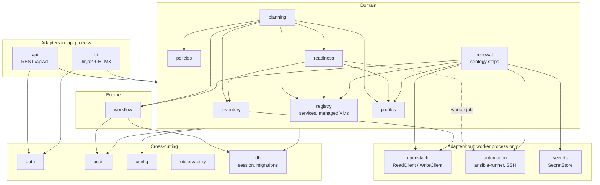

# Architecture

| Field | Value |
|---|---|
| Owner | Agent 2 — Chief Architect |
| Status | **Designed** (Phase 1 proposal; nothing implemented) |
| Last updated | 2026-11-04 |

Status: Designed.

> **Revision 2026-11-04**: DB role split and run admission by the worker (SEC-R-1); write-session allowlist and fence
> gate in `WriteClient` (SEC-R-7, SRE-R-2, SEC-R-26); read-session auth exemption (SEC-R-5); restricted automation
> artefacts and blocking lint (SEC-R-3); one verified clone per run, no run-time Galaxy (SRE-R-8, SEC-R-12); DB HA
> posture (SRE-R-4); subprocess containment (SRE-R-5); operator view and alert rules (SRE-R-9); metrics port
> (SEC-R-17); migrate secret isolation (SEC-R-18); core dumps and SSH agent hardening (SEC-R-14); session key purpose
> and credential test (SEC-R-32); `auto_restore_in_window` moved from config to policy (SEC-R-30); mandatory paging
> for post-start failures (D-1 = B).
>
> **Revision 2026-11-04 (round 2)**: TOTP for approver/admin and action-bound step-up (M9, SEC-R-10, -11); readiness
> never runs repo code on the live VM by default (M9, SEC-R-28); lint and diff are static analysis only, every Ansible
> invocation on repo content happens inside a run after G1 (SEC-R-35); host-key default `injected` (ADR-0006); new
> alerts and keys (SRE-R-23, -24, -25); EXP-01b timings are documentation only.

Related: [data-model.md](data-model.md), [api-design.md](api-design.md), [renewal-workflow.md](renewal-workflow.md),
[security-model.md](security-model.md) (Agent 8, authoritative for authN/Z, secrets, audit integrity),
[openstack-integration.md](openstack-integration.md) (Agent 3, OpenStack facts and their tags),
[automation-contract.md](automation-contract.md) (Agent 6). Decisions: ADR-0002 (UI), ADR-0003 (workflow engine),
ADR-0004 (renewal strategy), ADR-0005 (ownership/idempotency), ADR-0006 (host-key trust).

## 1. Fixed constraints

Python + FastAPI, PostgreSQL, openstacksdk, Ansible via ansible-runner subprocess, Docker Compose, pytest. Modular
monolith: one codebase, one image, process roles `api`, `worker` (+ one-shot `migrate`). No Kubernetes, microservices,
Redis, Celery or broker (NFR-1).

## 2. Context

The `api` never calls OpenStack, never touches guests and cannot decrypt secrets (security-model.md §5.1). All outbound
work runs in the `worker`, including on-demand inventory sync and "test credential".

## 3. Modules and dependency directions

Python package `ovlm`, one sub-package per module. Each module exposes a `service.py` (public functions) and owns its
tables; other modules never import its ORM models or query its tables directly.

| Module | Responsibility | May depend on | Must not |
|---|---|---|---|
| `config` | Typed settings (pydantic-settings), files + env, validated at start | — | import any other module |
| `db` | SQLAlchemy engine/session, Alembic, `fencing_seq` | `config` | contain domain logic |
| `observability` | JSON logging, context vars (run/step/request id), Prometheus registry | `config` | — |
| `audit` | `record(event)` in caller's transaction; after commit emits the row as an `event=audit` log line (log-stream mirror, SEC-R-1); read/query | `db`, `observability` | update/delete rows (DB grants enforce) |
| `auth` | Users, sessions, tokens, RBAC, SoD checks and `self_approved` flag, TOTP (mandatory for `approver`/`admin`, pyotp-class library), single-use step-up bound to (session, action, target), enrolment links (admin never sets passwords) (per security-model.md) | `db`, `audit` | call OpenStack |
| `inventory` | Sync jobs (worker), observed-state tables, `gone` marking, orphan report | `openstack.read`, `db`, `audit` | use the WriteClient |
| `registry` | Services, managed VMs, registration (links observed server → managed VM) | `inventory` (read service), `db`, `audit` | — |
| `profiles` | Profile + immutable versions, schema validation (incl. automation block), ETag | `db`, `audit` | — |
| `policies` | Policies, bindings, effective-policy resolution, deadline + window computation, exceptions (V1) | `registry`, `db`, `audit` | — |
| `readiness` | Versioned checks, assessments, level rules (FR-RDY-3) | `profiles`, `inventory`, `registry`; by default only OVLM-owned read-only probes and static repo analysis; a check-mode run of repo code on the live VM only as an explicit operator action with TC, as a worker job in run containment, audited with the SHA (M9, SEC-R-28) | mutate OpenStack |
| `planning` | Due list, capacity pre-check (quota, advisory), conflict check, plan + approval requests, plan hash | `readiness`, `policies`, `profiles`, `registry`, `inventory`, `workflow` (start run) | — |
| `workflow` | Generic durable step executor, run admission, resource locks, `run_signal` consumption, approval waits, scheduler, `api_unreachable` re-probe (ADR-0003) | `db`, `audit`, `observability` | know any strategy |
| `renewal` | Strategy `bluegreen_fip_v1`: step handlers, restore sequence, closed auto-restore table, approval-evidence re-validation, current-truth panel, ownership guard calls | `workflow`, `openstack`, `automation`, `secrets`, `registry`, `profiles`, `auth` (read-only SoD/role queries) | be imported by `api`/`ui` except its read-only views |
| `openstack` | `ReadClient`: GET/HEAD-only hook at the **service-request layer** (SDK adapter / `Session.request` for service endpoints) with one explicit, tested exemption for the auth plugin's token request (SEC-R-5). `WriteClient` (worker + step context only): request hook that (1) checks the **fence deadline** (ADR-0003), (2) checks a **(method, path-pattern) allowlist** limited to the strategy's operations; anything else raises before sending, explicitly `DELETE …/volumes/*`, `POST`/`DELETE …/floatingips*`, any `security-groups*` write, `POST …/volumes` (SEC-R-7). Error mapping (e.g. FIP 404 text), microversion pinning, ownership guard | `secrets`, `config` | be imported in the api process (import guard) |
| `automation` | Run-level verified checkout (once per run), per-attempt local copy, blocking lint as **pure static analysis** (YAML/git parsing and rule matching; no Ansible process, no plugin loading, no Jinja evaluation, SEC-R-35): `no_log` on secret-handling tasks, templated task names flagged, no `mkfs`/`wipefs`, no playbook-level `ansible_ssh_*`/`-A`, `check_mode: false`, `always_run`, `delegate_to`/`local_action` in `configure.yml`; audited waiver rows. Every `ansible-playbook`/`ansible-inventory` invocation on repo content (incl. `--syntax-check`, `--list-hosts`) runs only inside a run (B6 or later, after G1) in phase containment, ansible-runner subprocess as `ovlm-ansible` in its own process group with parent-death signal, OVLM-owned SSH config (`ForwardAgent no`, `IdentitiesOnly yes`, per-run control path), result JSON validation, redaction, restricted artefact storage (`store_diffs` opt-in), known_hosts | `secrets`, `config` | receive OpenStack credentials |
| `secrets` | Envelope encryption: seal (api, public key) / unseal (worker, KEK) | `config` | — |
| `api`, `ui` | HTTP adapters: parse, call service, render | domain `service.py`, `auth` | contain business rules, query tables |

Enforcement: `import-linter` contracts in CI (layers above; `openstack`, `automation`, `secrets.unseal` forbidden from
`ovlm.api`/`ovlm.ui`), plus a runtime guard: `WriteClient` construction requires `process_role == "worker"` and an active
step context holding a valid fencing token; every request it sends passes the fence gate and the allowlist. DB grants
enforce the same split at the data layer (data-model.md §12).

## 4. Process model

| Process | Command | Does | Never |
|---|---|---|---|
| `api` | `ovlm api` (uvicorn, N workers), DB role `ovlm_api` | REST + UI, auth, writes plans/approvals, inserts runs in `requested` and `run_signal` rows, seals secrets | OpenStack, SSH, decrypt, change run/step state |
| `worker` | `ovlm worker` under a minimal init (signal forwarding, reaping), DB role `ovlm_worker` | Admits runs, consumes signals, claims steps (ADR-0003), inventory sync, readiness, lint and diff jobs, renewals, scheduler (advisory-lock leader), sweepers (kill orphan process groups **before** claiming, expired leases, run dirs), metrics on its own port | listen on a public port; create approvals, users or sessions |
| `migrate` | `ovlm migrate` (one-shot) | Alembic `upgrade head` as `ovlm_owner` DB role | run continuously |
| `postgres` | official image | all state | be published outside the Compose network |

Two OS users in the image: `ovlm` (api/worker) and `ovlm-ansible` (ansible-runner children, scrubbed env, no KEK access;
security-model.md §6.5). Worker and `ovlm-ansible` processes run with `RLIMIT_CORE=0` and non-dumpable; the worker
host has no swap or encrypted swap; the per-run ssh-agent is killed in `finally` and by the sweeper (SEC-R-14).
api ↔ worker communication is only through the DB (`run_signal`, run/step rows).

Background jobs that are not renewals (inventory sync, readiness run, credential test, KEK re-wrap) are single-step
`workflow_run`s of their own `kind`, so they get the same leases, retries, audit and UI visibility.

## 5. Configuration

| Source | Content |
|---|---|
| `/etc/ovlm/ovlm.toml` (mounted) | All non-secret settings below, validated by pydantic at start; unknown keys are errors |
| Env vars `OVLM_<SECTION>__<KEY>` | Override file values (12-factor); never secrets |
| Docker secrets files | DB password per role (api: `ovlm_api`, worker: `ovlm_worker`, migrate: `ovlm_owner` only — never mounted into api or worker, SEC-R-18), KEK private key (worker only), CSRF token derivation key (api only; sessions stay server-side with opaque ids, SEC-R-32). Passwords are read from files, never placed in a URL or env |
| DB | Clouds/projects, credentials (sealed), profiles, policies — managed through the API |

Key groups (all timeouts and limits are named keys; **defaults TBD in lab** unless a doc states otherwise):
`worker.{slots, lease_duration, heartbeat_interval, fence_margin, shutdown_grace}`,
`poll.{initial_interval, max_interval}`, `retry.max_attempts.<step_key>`, `timeouts.<step_key>`,
`worker.takeover_delay`, `green_ready.max_age`, `timeouts.green_ready`, `admission.alert_after`, `signal.alert_after`, `automation.{run_root, timeout.<phase>, idle_timeout.<phase>, result_max_bytes,
log_max_bytes, artifact_retention}`, `inventory.{sync_interval, gone_after_missed_syncs}`,
`renewal.max_concurrent_runs` (checked at admission), `retire.health_max_age`, `approval.validity.{plan, cutover, retirement}`,
`ui.poll_interval`, `external_url` (required for the api unless `development_mode`), `http.trusted_proxies` (TLS
proxy addresses whose `X-Forwarded-For` is believed; default loopback), `auth.login_ip_delay_seconds` (fixed,
non-escalating per-source delay), `log.openstack_http_debug` (refused unless `development_mode`), `development_mode`
(development/test installations only).
`auto_restore_in_window` and `max_window_duration` are **policy** fields, not config keys (bound into the plan hash,
SEC-R-30, SRE-R-6). `auth.allow_operator_approver` is an installation setting in the DB (admin, TC, audited, M9), not
a file key. EXP-01/EXP-01b lab times (renewal-workflow.md §10) are documentation, never defaults.

## 6. Observability

| Signal | Design |
|---|---|
| Logs | JSON lines to stdout. Context fields: `ts, level, process, request_id, actor, run_id, step_id, step_key, attempt, fencing_token, project_id, openstack_request_id` (from `x-openstack-request-id`). Secrets never logged (security-model.md §5.2). |
| Metrics (Prometheus, `/metrics` on a separate internal port of api and worker, reachable only on the Compose network or behind proxy auth, SEC-R-17) | `ovlm_workflow_runs{kind,state}` gauge; `ovlm_step_attempts_total{step_key,outcome,error_class}`; `ovlm_step_duration_seconds{step_key}`; `ovlm_lease_takeovers_total`; `ovlm_fenced_commit_rejected_total`; `ovlm_openstack_requests_total{service,method,status}` + latency histogram; `ovlm_ansible_phase_duration_seconds{phase,outcome}`; `ovlm_inventory_sync_age_seconds{project}`; `ovlm_renewal_downtime_seconds{kind}` histogram (one observation per downtime interval, `window` or `restore`); `ovlm_runs_needing_attention{phase,reason}`; `ovlm_window_budget_exceeded_total`; `ovlm_worker_heartbeat_age_seconds`; `ovlm_auto_restore_total{trigger}`; `ovlm_approval_evidence_invalid_total{gate}`; `ovlm_post_start_failures_total`; `ovlm_step_accepted_total{step}`; `ovlm_renewal_downtime_open_seconds{kind}` (age of the oldest open downtime interval); `ovlm_runs_requested_overdue`; `ovlm_run_signals_pending_overdue`. No IDs or names as labels. |
| Alert rules | A sample Prometheus rule file ships with each release (SRE-R-9 e): [`deploy/prometheus/ovlm-alerts.yml`](../deploy/prometheus/ovlm-alerts.yml), with `severity=page|ticket` and a runbook per alert in [operations.md](operations.md) (loading, Alertmanager routing, runbooks); `tests/unit/test_alert_rules.py` checks every metric and label against the code. Alerts: needs_human while `phase=window`; window budget exceeded; worker heartbeat age; increase of `ovlm_fenced_commit_rejected_total`, `ovlm_lease_takeovers_total`, `ovlm_approval_evidence_invalid_total`; any run in needs_human > 15 min; needs_human with `reason=approval_evidence_invalid` while `phase=window` (pages, SRE-R-23); run in `requested` longer than `admission.alert_after` (SRE-R-25); `run_signal` pending longer than `signal.alert_after` (SRE-R-24); **`OvlmPostStartFailure`**: needs_human with `reason=post_start_failure` (W7–W10 failure without snapshot, D-1 = B). In MVP these alerts are the paging path (the notification channel is V1, SRE-R-20). **Paging is mandatory**: a deployment must route at least `OvlmPostStartFailure` and "needs_human while `phase=window`" to an on-call pager; the install guide and readiness of the installation state this, because after D-1 the service stays down in that state until a human acts. Also shipped: accept-step used (`ovlm_step_accepted_total`, ticket), restore downtime interval open > 30 min (page), automatic restore (ticket), worker down (page), credential expiring or failing validation (ticket). |
| Health | api `/healthz` (process alive), `/readyz` (DB reachable, schema at head, worker heartbeat younger than `worker.heartbeat_interval × k`). Worker writes `worker_heartbeat` rows; its `/healthz` on the internal port. |
| Audit vs logs | Audit (`audit_event`) is the accountable record; logs are diagnostics. Every audit row carries the correlation ids so both can be joined. |
| Evidence | Each step stores structured `evidence` (OpenStack states before/after, request ids, Ansible result summary) displayed in the run timeline. Ansible logs, events and diffs are restricted artefacts (operator/admin, own retention, SEC-R-3). |
| Operator view | Run-level current-truth panel, read-only probe action, `available_actions[]` with effects, lease/heartbeat of running steps (renewal-workflow.md §6.1). |

## 7. Deployment (Docker Compose)

| Service | Image | Notes |
|---|---|---|
| `postgres` | `postgres:<major>` pinned by digest | volume `pgdata`; not published |
| `migrate` | `ovlm:<version>` | `depends_on: postgres healthy`; exits 0 |
| `api` | `ovlm:<version>` | `depends_on: migrate completed`; port bound to `127.0.0.1` or the proxy network; read-only rootfs |
| `worker` | `ovlm:<version>` | KEK as Docker secret; `tmpfs` for `automation.run_root` (each run's verified checkout lives there until the run is terminal, then the worker removes it: automation-contract.md section 2); egress allowlist: OpenStack endpoints, guests or jump host, allowlisted git hosts (no Galaxy: collections vendored in the repo at the SHA or shipped in the image, SEC-R-12); tini as PID 1, started by the entrypoint after it dropped to uid `ovlm` (no `init: true`, no root process after start-up; review CS-6) |

TLS termination by an operator-provided reverse proxy (security-model.md §9). Backups: `pg_dump` (or base backup) plus
the KEK backed up separately; documented restore test (NFR-7). Lab (ADR-0001): Compose runs on the quick-lab VM so the
worker reaches lab floating IPs; guest SSH uses the profile's guest-access path (direct route or jump host).

## 8. Scale assumptions (NFR-9)

| Dimension | Target | Design consequence |
|---|---|---|
| Inventoried servers | 5,000 / installation | Current-state tables + revision rows only on change (data-model.md §3); full sync per project paged; Nova `changes-since` optional optimisation (SOURCE-VERIFIED §1) |
| Managed VMs | 500 | Policy/deadline evaluation is a periodic full scan; no index tricks needed |
| Concurrent renewals | 5 | `renewal.max_concurrent_runs`; one worker with `worker.slots` ≥ 5 + background jobs |
| Audit rows | grows unbounded | Monthly partitioning of `audit_event` deferred until measured; retention purge per security-model.md §8 |
| Run evidence / Ansible logs | capped per phase (`automation.log_max_bytes`) | stored in DB (`bytea`/text); no object store in MVP |

Larger scales are not designed for. A single PostgreSQL instance is sufficient.

## 9. Upgrades and migrations

- Alembic, linear history, one migration per PR that changes schema; `ovlm migrate` runs before api/worker start; both
  refuse to start if the schema is not at head.
- Expand/contract for columns used by in-flight runs; migrations that rewrite workflow tables require drained workers.
- Upgrade procedure: stop worker gracefully (no step `running`; steps `waiting` for approval/retention are fine) →
  `migrate` → start api + worker. Runs record `strategy_version`; a release resumes runs of the previous minor version
  or refuses to start with a clear message listing them.
- Supported upgrade path: N-1 → N only. Downgrade = restore backup.
- Procedure, backup and restore: [backup-restore-upgrade.md](backup-restore-upgrade.md). `ovlm upgrade preflight`
  (read-only, run with the new release) refuses while a run is in phase `window` or `restore` or a downtime interval
  is open, and when the database is ahead of the release.

## 10. Testing architecture (summary; Agent QA owns the plan)

Unit (pure step logic with a fake OpenStack adapter), engine crash tests against real PostgreSQL in CI (kill worker at
each step boundary, DB restart, lease expiry with a paused worker, SIGSTOP beyond the lease then SIGCONT → mutating call
refused locally, worker-process kill → subprocess group gone before takeover, fenced commit rejection incl.
`lease_owner`), WriteClient allowlist tests (volume delete, FIP create/delete, SG writes refused), DB grant tests
(`ovlm_api` cannot update step state or read ciphertext; `ovlm_worker` cannot insert approvals), approval-evidence
tests (profile author approving is rejected), contract tests for the Ansible result schema, import-linter, and lab
end-to-end per test-environment.md.

## 11. Deliberately not built

| Not built | Why |
|---|---|
| Broker, Redis, Celery, Temporal, Kubernetes, microservices | NFR-1; ADR-0003 |
| SPA frontend / Node toolchain | ADR-0002 |
| Generic workflow DSL or plugin marketplace | One strategy in MVP; strategies are Python classes |
| Own secret vault, HSM integration | Envelope encryption now; `SecretStore` interface for Vault/Barbican later (security-model.md) |
| Admin-credential operations (force-detach, reset-state, evacuate, unlock override) | OVLM stops and reports; humans with admin rights act |
| Orphan deletion, volume deletion, FIP allocation/deletion | Report-only orphans (SEC-R-25); the write allowlist refuses these calls (SEC-R-7); EXP-01 showed a FIP pool can be empty under unlimited quota |
| Multiattach, Octavia/Designate cutover, fixed-IP preservation, boot-from-volume green, >1 data volume | ADR-0004 scope |
| HA for api/worker | Stateless api can be replicated; multiple workers are safe but not required. DB HA posture (SRE-R-4): single PostgreSQL instance with backups (MVP default) or synchronous replication (`synchronous_commit = on`, sync standby); failover to an asynchronous replica is **unsupported** for workflow tables |
| Object storage for logs/artifacts | Size-capped in DB |
| Live migration, patch management, VMware integration | Product vision "not" list |
