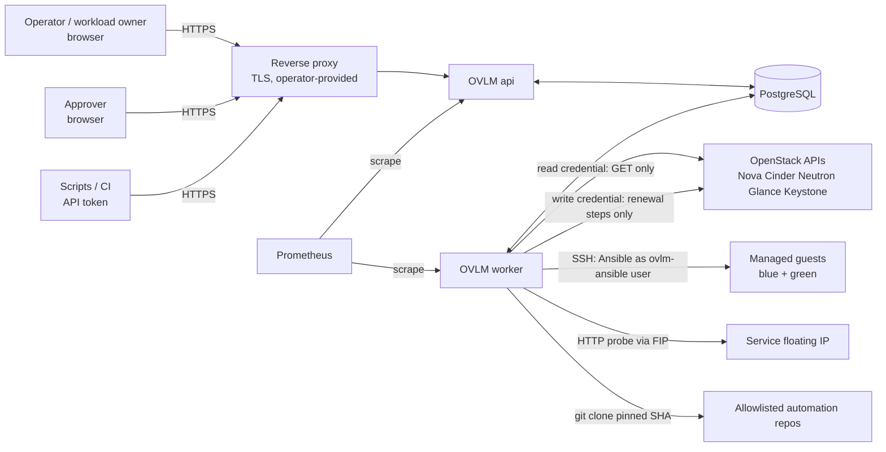
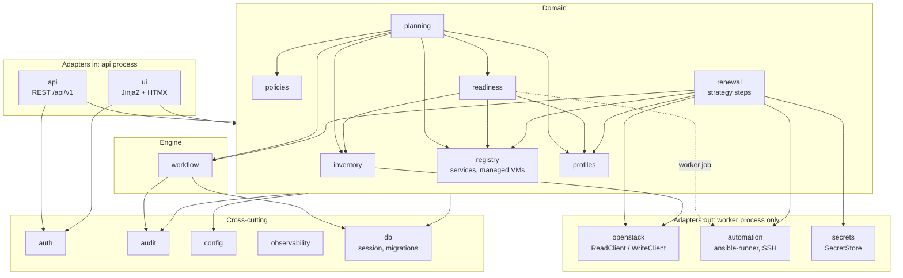

# Architecture

| Field | Value |
|---|---|
| Owner | Agent 2 — Chief Architect |
| Status | **Designed** (Phase 1 proposal; nothing implemented) |
| Last updated | 2026-11-04 |

Status: Designed.

Related: [data-model.md](data-model.md), [api-design.md](api-design.md), [renewal-workflow.md](renewal-workflow.md),
[security-model.md](security-model.md) (Agent 8, authoritative for authN/Z, secrets, audit integrity),
[openstack-integration.md](openstack-integration.md) (Agent 3, OpenStack facts and their tags),
[automation-contract.md](automation-contract.md) (Agent 6). Decisions: ADR-0002 (UI), ADR-0003 (workflow engine),
ADR-0004 (renewal strategy), ADR-0005 (ownership/idempotency), ADR-0006 (host-key trust).

## 1. Fixed constraints

Python + FastAPI, PostgreSQL, openstacksdk, Ansible via ansible-runner subprocess, Docker Compose, pytest. Modular
monolith: one codebase, one image, process roles `api`, `worker` (+ one-shot `migrate`). No Kubernetes, microservices,
Redis, Celery or broker (NFR-1).

## 2. Context

The `api` never calls OpenStack, never touches guests and cannot decrypt secrets (security-model.md §5.1). All outbound
work runs in the `worker`, including on-demand inventory sync and "test credential".

## 3. Modules and dependency directions

Python package `ovlm`, one sub-package per module. Each module exposes a `service.py` (public functions) and owns its
tables; other modules never import its ORM models or query its tables directly.

| Module | Responsibility | May depend on | Must not |
|---|---|---|---|
| `config` | Typed settings (pydantic-settings), files + env, validated at start | — | import any other module |
| `db` | SQLAlchemy engine/session, Alembic, `fencing_seq` | `config` | contain domain logic |
| `observability` | JSON logging, context vars (run/step/request id), Prometheus registry | `config` | — |
| `audit` | `record(event)` in caller's transaction; read/query | `db` | update/delete rows (DB grants enforce) |
| `auth` | Users, sessions, tokens, RBAC, step-up, SoD checks (per security-model.md) | `db`, `audit` | call OpenStack |
| `inventory` | Sync jobs (worker), observed-state tables, `gone` marking, orphan report | `openstack.read`, `db`, `audit` | use the WriteClient |
| `registry` | Services, managed VMs, registration (links observed server → managed VM) | `inventory` (read service), `db`, `audit` | — |
| `profiles` | Profile + immutable versions, schema validation (incl. automation block), ETag | `db`, `audit` | — |
| `policies` | Policies, bindings, effective-policy resolution, deadline + window computation, exceptions (V1) | `registry`, `db`, `audit` | — |
| `readiness` | Versioned checks, assessments, level rules (FR-RDY-3) | `profiles`, `inventory`, `registry`; check-mode Ansible runs only as worker jobs | mutate OpenStack |
| `planning` | Due list, capacity pre-check (quota, advisory), conflict check, plan + approval requests, plan hash | `readiness`, `policies`, `profiles`, `registry`, `inventory`, `workflow` (start run) | — |
| `workflow` | Generic durable step executor, resource locks, approvals waits, scheduler (ADR-0003) | `db`, `audit`, `observability` | know any strategy |
| `renewal` | Strategy `bluegreen_fip_v1`: step handlers, restore sequence, ownership guard calls | `workflow`, `openstack`, `automation`, `secrets`, `registry`, `profiles` | be imported by `api`/`ui` except its read-only views |
| `openstack` | `ReadClient` (GET/HEAD-only session hook), `WriteClient` (worker + step context only), error mapping (e.g. FIP 404 text), microversion pinning, ownership guard | `secrets`, `config` | be imported in the api process (import guard) |
| `automation` | Run-dir build, ansible-runner subprocess as `ovlm-ansible`, result JSON validation, redaction, known_hosts | `secrets`, `config` | receive OpenStack credentials |
| `secrets` | Envelope encryption: seal (api, public key) / unseal (worker, KEK) | `config` | — |
| `api`, `ui` | HTTP adapters: parse, call service, render | domain `service.py`, `auth` | contain business rules, query tables |

Enforcement: `import-linter` contracts in CI (layers above; `openstack`, `automation`, `secrets.unseal` forbidden from
`ovlm.api`/`ovlm.ui`), plus a runtime guard: `WriteClient` construction requires `process_role == "worker"` and an active
step context holding a valid fencing token.

## 4. Process model

| Process | Command | Does | Never |
|---|---|---|---|
| `api` | `ovlm api` (uvicorn, N workers) | REST + UI, auth, writes plans/approvals/requests, seals secrets, enqueues worker jobs as runs | OpenStack, SSH, decrypt |
| `worker` | `ovlm worker` | Claims steps (ADR-0003), inventory sync, readiness jobs, renewals, scheduler (advisory-lock leader), sweepers (expired leases, orphan run dirs), metrics on its own port | listen on a public port |
| `migrate` | `ovlm migrate` (one-shot) | Alembic `upgrade head` as `ovlm_owner` DB role | run continuously |
| `postgres` | official image | all state | be published outside the Compose network |

Two OS users in the image: `ovlm` (api/worker) and `ovlm-ansible` (ansible-runner children, scrubbed env, no KEK access;
security-model.md §6.5). Worker → api communication is only through the DB.

Background jobs that are not renewals (inventory sync, readiness run, credential test, KEK re-wrap) are single-step
`workflow_run`s of their own `kind`, so they get the same leases, retries, audit and UI visibility.

## 5. Configuration

| Source | Content |
|---|---|
| `/etc/ovlm/ovlm.toml` (mounted) | All non-secret settings below, validated by pydantic at start; unknown keys are errors |
| Env vars `OVLM_<SECTION>__<KEY>` | Override file values (12-factor); never secrets |
| Docker secrets files | DB passwords, KEK private key (worker only), session signing key |
| DB | Clouds/projects, credentials (sealed), profiles, policies — managed through the API |

Key groups (all timeouts and limits are named keys; **defaults TBD in lab** unless a doc states otherwise):
`worker.{slots, lease_duration, heartbeat_interval, fence_margin, shutdown_grace}`,
`poll.{initial_interval, max_interval}`, `retry.max_attempts.<step_key>`, `timeouts.<step_key>`,
`automation.{run_root, timeout.<phase>, idle_timeout.<phase>, result_max_bytes, log_max_bytes}`,
`inventory.{sync_interval, gone_after_missed_syncs}`, `renewal.{max_concurrent_runs, auto_rollback_in_window}`,
`approval.validity.{plan, cutover, retirement}`, `ui.poll_interval`, `external_url`.

## 6. Observability

| Signal | Design |
|---|---|
| Logs | JSON lines to stdout. Context fields: `ts, level, process, request_id, actor, run_id, step_id, step_key, attempt, fencing_token, project_id, openstack_request_id` (from `x-openstack-request-id`). Secrets never logged (security-model.md §5.2). |
| Metrics (Prometheus, `/metrics` on api and on worker's internal port) | `ovlm_workflow_runs{kind,state}` gauge; `ovlm_step_attempts_total{step_key,outcome,error_class}`; `ovlm_step_duration_seconds{step_key}`; `ovlm_lease_takeovers_total`; `ovlm_fenced_commit_rejected_total`; `ovlm_openstack_requests_total{service,method,status}` + latency histogram; `ovlm_ansible_phase_duration_seconds{phase,outcome}`; `ovlm_inventory_sync_age_seconds{project}`; `ovlm_renewal_downtime_seconds` histogram; `ovlm_runs_needing_attention`. No IDs or names as labels. |
| Health | api `/healthz` (process alive), `/readyz` (DB reachable, schema at head, worker heartbeat younger than `worker.heartbeat_interval × k`). Worker writes `worker_heartbeat` rows; its `/healthz` on the internal port. |
| Audit vs logs | Audit (`audit_event`) is the accountable record; logs are diagnostics. Every audit row carries the correlation ids so both can be joined. |
| Evidence | Each step stores structured `evidence` (OpenStack states before/after, request ids, Ansible result summary) displayed in the run timeline. |

## 7. Deployment (Docker Compose)

| Service | Image | Notes |
|---|---|---|
| `postgres` | `postgres:<major>` pinned by digest | volume `pgdata`; not published |
| `migrate` | `ovlm:<version>` | `depends_on: postgres healthy`; exits 0 |
| `api` | `ovlm:<version>` | `depends_on: migrate completed`; port bound to `127.0.0.1` or the proxy network; read-only rootfs |
| `worker` | `ovlm:<version>` | KEK as Docker secret; `tmpfs` for `automation.run_root`; egress to OpenStack, guests, git |

TLS termination by an operator-provided reverse proxy (security-model.md §9). Backups: `pg_dump` (or base backup) plus
the KEK backed up separately; documented restore test (NFR-7). Lab (ADR-0001): Compose runs on the quick-lab VM so the
worker reaches lab floating IPs; guest SSH uses the profile's guest-access path (direct route or jump host).

## 8. Scale assumptions (NFR-9)

| Dimension | Target | Design consequence |
|---|---|---|
| Inventoried servers | 5,000 / installation | Current-state tables + revision rows only on change (data-model.md §3); full sync per project paged; Nova `changes-since` optional optimisation (SOURCE-VERIFIED §1) |
| Managed VMs | 500 | Policy/deadline evaluation is a periodic full scan; no index tricks needed |
| Concurrent renewals | 5 | `renewal.max_concurrent_runs`; one worker with `worker.slots` ≥ 5 + background jobs |
| Audit rows | grows unbounded | Monthly partitioning of `audit_event` deferred until measured; retention purge per security-model.md §8 |
| Run evidence / Ansible logs | capped per phase (`automation.log_max_bytes`) | stored in DB (`bytea`/text); no object store in MVP |

Larger scales are not designed for. A single PostgreSQL instance is sufficient.

## 9. Upgrades and migrations

- Alembic, linear history, one migration per PR that changes schema; `ovlm migrate` runs before api/worker start; both
  refuse to start if the schema is not at head.
- Expand/contract for columns used by in-flight runs; migrations that rewrite workflow tables require drained workers.
- Upgrade procedure: stop worker gracefully (no step `running`; steps `waiting` for approval/retention are fine) →
  `migrate` → start api + worker. Runs record `strategy_version`; a release resumes runs of the previous minor version
  or refuses to start with a clear message listing them.
- Supported upgrade path: N-1 → N only. Downgrade = restore backup.

## 10. Testing architecture (summary; Agent QA owns the plan)

Unit (pure step logic with a fake OpenStack adapter), engine crash tests against real PostgreSQL in CI (kill worker at
each step boundary, DB restart, lease expiry with a paused worker, fenced commit rejection), contract tests for the
Ansible result schema, import-linter, and lab end-to-end per test-environment.md.

## 11. Deliberately not built

| Not built | Why |
|---|---|
| Broker, Redis, Celery, Temporal, Kubernetes, microservices | NFR-1; ADR-0003 |
| SPA frontend / Node toolchain | ADR-0002 |
| Generic workflow DSL or plugin marketplace | One strategy in MVP; strategies are Python classes |
| Own secret vault, HSM integration | Envelope encryption now; `SecretStore` interface for Vault/Barbican later (security-model.md) |
| Admin-credential operations (force-detach, reset-state, evacuate, unlock override) | OVLM stops and reports; humans with admin rights act |
| Multiattach, Octavia/Designate cutover, fixed-IP preservation, boot-from-volume green, >1 data volume | ADR-0004 scope |
| HA for api/worker | Stateless api can be replicated; multiple workers are safe but not required; DB HA is the operator's choice |
| Object storage for logs/artifacts | Size-capped in DB |
| Live migration, patch management, VMware integration | Product vision "not" list |
