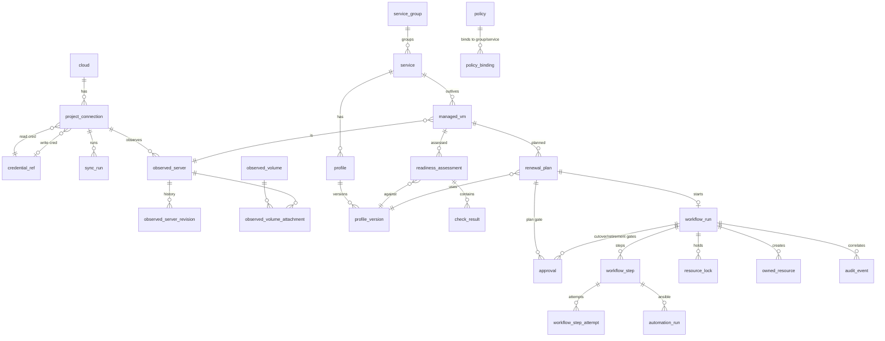

# Data model

| Field | Value |
|---|---|
| Owner | Agent 2 — Chief Architect |
| Status | **Designed** (Phase 1 proposal; nothing implemented) |
| Last updated | 2026-11-05 |

> **Revision 2026-11-04**: DB role split `ovlm_api` / `ovlm_worker` with grants, `run_signal`, run `requested` state
> (SEC-R-1); requester set and hash inputs on approvals, automation diff on plans (SEC-R-2); automation artefact
> classes and retention (SEC-R-3, SEC-R-31); secret refs bound to a service (SEC-R-27); security-group IDs and image
> facts in `resolved`, policy fields `auto_restore_in_window` and `max_window_duration` (SEC-R-29, SEC-R-30, SRE-R-6);
> `lease_owner` as per-process id (SRE-R-4); current-truth panel (SRE-R-9); ledger partial uniqueness (SRE-R-11);
> port lock timing (SRE-R-16).
>
> **Revision 2026-11-04 (round 2)**: installation setting for operator+approver and `self_approved` approvals, account
> provenance (M9, SEC-R-2, SEC-R-11); TOTP step-up reference (SEC-R-10); lint waivers as their own rows (SEC-R-36);
> credential rotation fields (SEC-R-13); live-VM assessment flag (SEC-R-28); host-key policy `injected` (ADR-0006);
> `profile_version` insert-only for the api (SEC-R-36); snapshot retention after restore (SRE-R-31); signal semantics
> (SRE-R-24).
>
> **Revision 2026-11-05 (inventory sync / host-key review fixes)**: `managed_vm` insert guard, tombstone, confirmation
> cleared on fingerprint change and CHECK (`registry_0002`, review IS-1); `sync_run.error` holds a reason code only
> (IS-4).

PostgreSQL, SQLAlchemy 2 + Alembic. Conventions: `id uuid` PK (UUIDv7, time-ordered); `created_at`, `updated_at`
`timestamptz`; `version int` for optimistic concurrency where an API exposes ETags; enumerations as `text` + `CHECK`;
JSON documents as `jsonb` validated by pydantic schemas in the owning module. Every table belongs to exactly one module
(architecture.md §3). User, session, token, role-binding and secret tables are specified in
[security-model.md](security-model.md) and are only referenced here.

## 1. Desired vs observed state (rule)

| Kind | Tables | Written by | Rule |
|---|---|---|---|
| **Observed** | `observed_*`, `sync_run` | `inventory` (worker, read credential) only | What OpenStack said, when. Never edited by users. History kept. |
| **Desired** | `profile_version`, `policy`, `policy_binding` | users through the API | What should be. Immutable versions (profiles); edits create versions. |
| **Decisions / execution** | `readiness_assessment`, `renewal_plan`, `approval`, `workflow_*`, `owned_resource` | domain services, worker | Reference the observed revision and desired version they used; never overwritten. |

Drift (FR-INV-4) = comparison function over a `profile_version` and the latest `observed_server_revision`; it is computed,
not stored as a separate truth. The UI shows both columns side by side (FR-REG-4).

## 2. Clouds, projects, credentials

| Table | Key columns | Constraints / notes |
|---|---|---|
| `cloud` | `name`, `auth_url`, `region`, `ca_bundle_ref`, `interface` | `UNIQUE(name)`; TLS verify always on |
| `project_connection` | `cloud_id`, `openstack_project_id`, `name`, `read_credential_id`, `write_credential_id` (nullable), `guest_access` jsonb (`mode: direct|jump_host`, jump host address + pinned key), `enabled` | `UNIQUE(cloud_id, openstack_project_id)`. Write credential nullable: inventory/assessment work without it (FR-INV-2). |
| `credential_ref` | `kind` (`os_read`, `os_write`, `ssh_key`, `vault_password`, `secret`), `service_id` (nullable), `secret_id` → sealed secret (security-model.md §5), `app_credential_id`, `expires_at` (entered by the admin at upload for `os_*`; Keystone read only if Agent 3 confirms it), `last_validated_at`, `validation_result` jsonb, `rotated_at`, `state` (`active`, `superseded`), `superseded_by`, `cloud_deletion_pending bool` (the old application credential must be deleted out of band by the cloud admin; OVLM cannot, SEC-R-13) | Secret value never in this table; `UNIQUE` per (project_connection, kind) for `os_*`; `CHECK(service_id IS NOT NULL OR kind IN ('os_read','os_write','ssh_key'))`: vault passwords and secrets belong to one service (SEC-R-27); the per-project SSH key is deliberately shared across services |

## 3. Inventory (observed state)

Pattern for each resource type `X ∈ {server, volume, volume_attachment, port, floating_ip, network, subnet,
security_group, image, flavor}`:

| Table | Key columns | Constraints / notes |
|---|---|---|
| `sync_run` | `project_connection_id`, `kind` (`full`, `servers_delta`), `started_at`, `finished_at`, `status`, `counts` jsonb, `error` jsonb, `workflow_run_id` | One row per sync; a failed sync never marks anything `gone`. `error` is `{"code": ...}`, a fixed reason code (`src/ovlm/inventory/reasons.py`; security-model.md §4.1): viewers read it, so no exception text is stored (review IS-4). Rows written before hold `{"type", "message"}` and are shown as a code |
| `observed_X` (current) | `project_connection_id`, `openstack_id`, `name`, typed key fields, `payload` jsonb (normalized), `payload_hash`, `first_seen_sync_id`, `last_seen_sync_id`, `missed_syncs int`, `status` (`present`, `gone`, `unknown`), `gone_at` | `UNIQUE(project_connection_id, openstack_id)`. Row is updated in place; history lives in revisions |
| `observed_X_revision` | `observed_X_id`, `sync_run_id`, `payload`, `payload_hash`, `observed_at` | Inserted only when `payload_hash` changes (append-only). This is the FR-INV-3 snapshot. |

Server typed fields: `status`, `vm_state`, `task_state`, `power_state`, `created`, `launched_at` (nullable; deadline falls
back to `created`, SOURCE-VERIFIED §1), `flavor_original_name`, `flavor_vcpus/ram/disk`, `image_id` (null for
boot-from-volume), `availability_zone`, `locked`, `locked_reason`, `tags text[]`, `metadata` jsonb, `host_id`
(hash, SOURCE-VERIFIED §1), `is_minimal_construct bool` (mv 2.69 down cell, DOCUMENTED-UNVERIFIED).
Volume: `status`, `size`, `bootable`, `multiattach`, `availability_zone`, `volume_type`, `metadata`.
Volume attachment: `server_openstack_id`, `volume_openstack_id`, `device`, `delete_on_termination` (mv ≥ 2.79).
Port: `network_id`, `device_id`, `device_owner`, `fixed_ips` jsonb, `mac`, `security_group_ids`. Floating IP:
`floating_ip_address`, `port_id`, `fixed_ip_address`, `router_id`, `floating_network_id`, `status`, `tags`.

`gone` handling: a resource absent from a **successful full** sync increments `missed_syncs`; at
`inventory.gone_after_missed_syncs` it becomes `gone` (Agent 3 rec. 9). Never deleted. Minimal-construct servers
(status `UNKNOWN`) set `status=unknown`, never `gone`, never drift. Nova delta syncs may mark `gone` immediately on a
tombstone (deleted servers are returned with `changes-since`, SOURCE-VERIFIED §1).

## 4. Services and managed VMs

| Table | Key columns | Constraints / notes |
|---|---|---|
| `service_group` | `name`, `description` | optional grouping for policy binding |
| `service` | `name`, `slug`, `service_group_id`, `project_connection_id`, `owner_contact`, `current_profile_id` | `UNIQUE(slug)`; the long-lived identity (FR-REG-1) |
| `managed_vm` | `service_id`, `observed_server_id`, `openstack_server_id`, `role` (`current`, `retained`, `candidate`, `retired`), `registered_by`, `registered_at`, `ssh_host_key_fingerprint`, `host_key_confirmed_by/at`, `launched_at_effective` | Partial unique: one `current` per service (`UNIQUE(service_id) WHERE role='current'`); `UNIQUE(openstack_server_id)`. Host-key trust (security-model.md §6.2.1, review IS-1): trigger `managed_vm_api_insert_guard` (no fingerprint or confirmation in an `ovlm_api` insert; no tomb-stoned id for any role); `managed_vm_host_key_follow` clears `host_key_confirmed_*` when the fingerprint changes; CHECK `managed_vm_host_key_confirmation` (confirmed_at and confirmed_by both set or both NULL, and a confirmation needs a fingerprint) |
| `managed_vm_tombstone` | `id` (a deleted `managed_vm.id`), `openstack_server_id`, `deleted_by_role`, `deleted_at` | Written only by the `SECURITY DEFINER` AFTER DELETE trigger on `managed_vm`; SELECT for `ovlm_api` and `ovlm_worker`, no other grant. A deleted id is never inserted again; re-registering the same server draws a new id |

Renewal moves `current` → `retained` → `retired` for blue and creates green as `candidate` → `current` (one
transaction at `verify_external` success).

## 5. Profiles (desired state)

| Table | Key columns | Constraints / notes |
|---|---|---|
| `profile` | `service_id`, `name`, `latest_version`, `version` (ETag) | one active profile per service in MVP |
| `profile_version` | `profile_id`, `number`, `spec` jsonb, `spec_hash`, `created_by`, `created_at`, `automation_sha`, `lint_result` jsonb (worker job, **static analysis only**: YAML/git parsing and rule matching, no Ansible process, no plugin loading, no Jinja evaluation, SEC-R-35) | `UNIQUE(profile_id, number)`; immutable except `lint_result` (worker-only column grant); `created_by` is in the requester set of every gate of a plan built on it (SEC-R-2) |

`spec` (pydantic-validated): `flavor` (name), `image` (`{name}` or `{properties}`; resolved at plan time and recorded in
the plan: the match must be **unique** among `active` images visible to the project, ambiguity is a plan error, never
"newest wins", SEC-R-29), `network` (`network_id`, `subnet_id`), `security_groups` (resolved to IDs at plan time),
`availability_zone` (`from_volume`), `data_volume` (`volume_id`, `fs_type`, `fs_uuid` or `label`, `mount_point`,
`snapshot_before_handoff`) or `stateless_service: true`, `automation` (automation-contract.md §1: repo, full SHA,
playbook_dir, requirements, inventory_vars, `secret_refs` → `credential_ref` **of the same service only**, SEC-R-27;
`store_diffs` bool default false, SEC-R-3; lint waivers are separate rows, see `lint_waiver`), `guest_access` (`ssh_user`, `host_key_policy: injected|console|tofu`, default `injected`, ADR-0006),
`health_check` (`external: {scheme, port, path, expected_status}`, `accept_degraded`), `cutover` (`floating_ip_id`;
method fixed to `floating_ip` in MVP), `strategy` (`bluegreen_fip_v1`).

## 6. Policies

| Table | Key columns | Constraints / notes |
|---|---|---|
| `policy` | `name`, `max_age`, `renewal_interval`, `windows` jsonb (weekday + time ranges + IANA tz), `approvals` jsonb (`plan`, `cutover` bool; retirement always required), `require_distinct_approvers`, `snapshot_retain_after_restore` (default: until the next successful renewal, SRE-R-31), `auto_restore_in_window` (default true, SEC-R-30; after W7 it applies only when a W4 snapshot exists, D-1 = B), `max_window_duration` (**required**, SRE-R-6), `retention_period`, `version`, `last_edited_by` | ETag; no global default (FR-POL-4); `version` and its fields are bound into the plan hash; `last_edited_by` is in the requester set |
| `policy_binding` | `policy_id`, `scope_type` (`service_group`, `service`), `scope_id` | `UNIQUE(scope_type, scope_id)`; most specific wins (FR-POL-2) |
| `policy_exception` (V1) | `service_id`, `reason`, `owner`, `starts_at`, `expires_at`, `approved_by` | `CHECK(expires_at > starts_at)`; ignored after expiry |

Effective policy and deadline (FR-POL-5) are computed on read and cached in `managed_vm_due` (materialized by the
scheduler: `managed_vm_id`, `policy_id`, `deadline`, `next_window_start`, `computed_at`).

## 7. Readiness, plans, approvals

| Table | Key columns | Constraints / notes |
|---|---|---|
| `readiness_assessment` | `managed_vm_id`, `profile_version_id`, `observed_server_revision_id`, `input_snapshot` jsonb (revision ids used), `level` (`not-ready`, `partially-ready`, `ready`), `summary` jsonb, `requested_by`, `workflow_run_id`, `live_code_run bool` (default false), `live_code_sha`, `live_code_confirmation` (TC as typed, step-up id) | Append-only (FR-RDY-4). By default no repo code runs on the live VM; checks needing it report `unknown` (warning). `live_code_run = true` only by an explicit operator action with TC, audited with the SHA executed (M9, SEC-R-28) |
| `lint_waiver` | `profile_version_id`, `rule` (one waivable rule, CHECK), `path_glob`, `reason`, `granted_by`, `granted_at`, `stepup_id` (unique), `revoked_by`, `revoked_at`, `revoke_stepup_id`, `revoke_reason` | Append-only (trigger: only the revocation columns change, once; no DELETE grant); `granted_by` must hold `approver`, must not be the version author nor in the requester set of any plan on that version (checked by the api at grant, by the worker before B6 and at every approval re-validation; review SFR-1, SFR-3); `path_glob` keeps one literal path segment (CHECK, SFR-2); for members of `ovlm_api` a guard trigger requires the granter's (revoker's) own consumed password+TOTP step-up bound to the version (the waiver) and a granter other than the author (SFR-1); the active waivers are bound into the plan hash and listed in `approval.hash_inputs` (SEC-R-36). Migration `profiles_0002` (SF-13) |
| `check_result` | `assessment_id`, `check_key`, `check_version`, `category`, `result` (`pass`, `fail`, `unknown`, `not-applicable`), `severity` (`blocker`, `warning`, `info`), `evidence` jsonb, `recommendation` | `UNIQUE(assessment_id, check_key)` |
| `attestation` (V1) | `managed_vm_id`, `check_key`, `statement`, `attested_by`, `attested_at`, `expires_at`, `profile_version_id` | expires with profile change |
| `renewal_plan` | `managed_vm_id`, `profile_version_id`, `assessment_id`, `policy_id`, `policy_version`, `resolved` jsonb (image id + `owner`, `visibility` and hash fields (names AS), flavor id, network/subnet, **security-group ids**, AZ, FIP id, volume id, blue server id, `auto_restore_in_window`, `max_window_duration`, worst-case window), `automation_diff` jsonb (worker job: previous approved SHA for the service or "first approval of this repo", changed files, capped diff; SEC-R-2), `plan_hash`, `planned_window_start`, `capacity_check` jsonb (advisory), `state` (`draft`, `awaiting_approval`, `approved`, `started`, `cancelled`, `expired`), `created_by` | `plan_hash` = SHA-256 over canonical JSON of (resolved, profile_version spec_hash, automation SHA, target IDs, policy version) — security-model.md §7.1 |
| `approval` | `subject_type` (`plan`, `cutover`, `retirement`, `manual_recovery`), `subject_id`, `bound_hash`, `hash_inputs` jsonb (every input shown to the approver, incl. lint waivers), `requester_set` uuid[] (snapshot for display), `requested_by`, `decided_by`, `decision` (`approved`, `rejected`), `typed_confirmation` (name + last 6 ID chars, as typed), `auth_method` (`password+totp`), `reauth_at`, `stepup_id` (single-use TOTP step-up bound to session, action, target; SEC-R-10), `self_approved bool`, `account_provenance` jsonb (decider account created by/at, last credential reset by/at; SEC-R-11), `decided_at`, `expires_at`, `void_reason` | `CHECK(self_approved OR NOT decided_by = ANY(requester_set))`; `CHECK(NOT (subject_type = 'retirement' AND self_approved))`; `self_approved` only if `installation_setting.allow_operator_approver` was true at `decided_at`; `UNIQUE(stepup_id)`; partial unique: one open request per subject; valid only while `bound_hash` matches and `now() < expires_at`. The worker recomputes the requester set and re-validates the evidence; it never trusts these columns alone (renewal-workflow.md §3.1) |

## 8. Workflow engine (ADR-0003)

| Table | Key columns | Constraints / notes |
|---|---|---|
| `workflow_run` | `kind` (`renewal`, `inventory_sync`, `readiness`, `credential_test`, `rewrap`, `automation_lint`, `automation_diff`, `probe`), `strategy`, `strategy_version`, `state` (`requested`, `rejected`, `running`, `needs_human`, `failed`, `completed`, `rolled_back`, …), `renewal_plan_id`, `service_id`, `subject` jsonb, `abort_requested`, `abort_requested_by`, `phase` (`build`, `window`, `retained`, `restore`, `retire`), `auto_restore_used bool`, `needs_human_reason` (`api_unreachable`, `post_start_failure`, `approval_evidence_invalid`, `ambiguous_state`, …; drives re-probe and paging), `downtime_started_at` (written in the W1 claim transaction), `downtime_ended_at`, `current_truth` jsonb + `current_truth_at` (SRE-R-9), `started_by`, `started_at`, `finished_at`, `version` | Partial unique: one non-terminal `renewal` run per service (`UNIQUE(service_id) WHERE kind='renewal' AND state NOT IN terminal`); api may INSERT only with `state='requested'` (trigger) |
| `run_signal` | `run_id`, `kind` (`admit`, `abort`, `rollback`, `revert`, `retry_step`, `mark_resolved`, `probe`, `discard`, `approve`, `reprepare_automation`), `actor_id`, `approval_id`, `payload` jsonb (TC as typed, step-up id, attestation), `created_at`, `consumed_at`, `outcome` | Written by api (INSERT), consumed by worker; `consumed_at`/`outcome` are set in the **same fenced transaction** as the state change the signal causes, so an uncommitted effect leaves the signal pending and it is re-applied (SRE-R-24); the worker re-validates actor role, step-up and TC before acting |
| `automation_reprepare` | `run_id`, `signal_id` (unique), `step_id`, `step_key`, `sha` (the plan's pin), `approver_id`, `authorized_at`, `consumed_at`, `outcome` | One-shot approver authorization of one re-clone inside the window (`reprepare-automation`, renewal-workflow.md §2). Inserted by the worker when it accepts the signal; `consumed_at` set by the guest port **before** it clones, then `outcome`; at most one pending per run (partial unique index); no DELETE grant; api reads. Migration `renewal_0002` |
| `installation_setting` | `key`, `value` jsonb, `changed_by`, `changed_at` (history kept) | Admin only, TC, audited. `allow_operator_approver` (default false, M9): when true, operator+approver in one scope is allowed and such approvals are flagged `self_approved` |
| `workflow_step` | `run_id`, `seq`, `step_key`, `state` (`ready`, `running`, `waiting`, `succeeded`, `failed`, `needs_human`, `skipped`, `cancelled`), `attempt int`, `fencing_token bigint`, `lease_owner` (worker instance UUID, new per process start), `lease_expires_at`, `heartbeat_at`, `not_before`, `deadline_at`, `intent` jsonb, `evidence` jsonb, `error_class` (`retryable`, `needs_human`, `fatal`), `error` jsonb, `destructive bool` | `UNIQUE(run_id, seq)`; partial unique `UNIQUE(run_id) WHERE state='running'`; index `(state, not_before)`; index `(state, lease_expires_at)` |
| `workflow_step_attempt` | `step_id`, `attempt`, `fencing_token`, `worker_id`, `started_at`, `ended_at`, `outcome`, `evidence` jsonb | Append-only history of attempts (FR-AUD-2 "every step attempt") |
| `automation_run` | `step_id`, `attempt`, `phase`, `target_role` (`old`, `new`), `repo`, `sha`, `requirements_hash`, `ansible_core_version`, `extravars_sha256`, `extravars_keys`, `exit_code`, `classification`, `result` jsonb (validated `ovlm.result/1`), `task_summary` jsonb (per task: name, changed/ok/failed), **restricted**: `log` (redacted, capped), `events` jsonb, `diff` (only if the profile set `store_diffs`), `artifact_expires_at` | automation-contract.md §1, §3.7, §7. **Restricted columns may contain workload secrets** (SEC-R-3): readable through the API only by `operator`/`admin` in scope; purged after `automation.artifact_retention` (separate from audit retention); excluded from every export |
| `worker_heartbeat` | `worker_id`, `hostname`, `started_at`, `last_seen_at`, `version`, `draining` | readiness probe |
| sequence `fencing_seq` | global monotonic | — |

## 9. Ownership ledger and locks (ADR-0005, ADR-0003)

| Table | Key columns | Constraints / notes |
|---|---|---|
| `owned_resource` | `run_id`, `resource_type` (`server`, `snapshot`), `role` (`green`, `snapshot`), `intended_name`, `openstack_id` (nullable until known), `state` (`intended`, `present`, `deleted`, `orphan`), `intent_committed_at` | `UNIQUE(resource_type, openstack_id)`; partial unique `UNIQUE(run_id, role) WHERE state IN ('intended','present')`; `deleted` rows kept as history (SRE-R-11) |
| `resource_lock` | `resource_type` (`service`, `server`, `volume`, `floating_ip`, `port`), `resource_key`, `holder_run_id`, `acquired_at`, `reason` | **PK (resource_type, resource_key)**; FK to run; acquired by the worker at run admission; green's server and port in the B4 success transaction (SRE-R-16); released when the run becomes terminal |

## 10. Audit

| Table | Key columns | Constraints / notes |
|---|---|---|
| `audit_event` | `id bigserial`, `ts` (DB transaction clock), `actor_id`, `principal_type`, `auth_method`, `source_ip`, `project_scope`, `action`, `target_type`, `target_id`, `before` jsonb, `after` jsonb (allowlisted fields, secrets excluded), `result`, `run_id`, `step_id`, `request_id`, `authority_ref` (e.g. G2 approval id for `restore.auto`) | Append-only: `ovlm_api` and `ovlm_worker` have INSERT/SELECT only + trigger rejecting UPDATE/DELETE (security-model.md §8). Written in the same transaction as the change it records. **Mirrored**: after commit, `audit.record()` emits the full row (with its id) as a JSON log line `event=audit` to the log stream, so a DB-side rewrite is detectable against the log collector before the V1 hash chain (SEC-R-1, SEC-R-21) |

## 12. Database roles and grants (SEC-R-1)

The runtime role `ovlm_app` is replaced by two roles. `ovlm_owner` (one-shot `migrate` only; its secret is never
mounted into api or worker containers, SEC-R-18) owns all tables; `ovlm_audit_admin` purges audit (offline).

| Table group | `ovlm_api` | `ovlm_worker` |
|---|---|---|
| users, sessions, api tokens, step-up records, role bindings + history (security-model.md) | read/write | SELECT on users, step-up records, role bindings + history (to re-validate approvals); nothing on sessions/tokens |
| sealed secret values | INSERT (seal) only; **no SELECT** on ciphertext columns | SELECT; UPDATE (re-wrap) |
| `credential_ref` metadata, `cloud`, `project_connection` | read/write | SELECT; UPDATE on validation columns |
| `service`, `managed_vm`, `profile`, `policy*` | read/write (`managed_vm`: SELECT, INSERT, DELETE, UPDATE of `host_key_confirmed_by/at` only; inserts guarded, deletes tomb-stoned) | SELECT; UPDATE `managed_vm.role`, `ssh_host_key_fingerprint` (clears the confirmation when it changes) |
| `managed_vm_tombstone` | SELECT | SELECT |
| `profile_version` | INSERT, SELECT only (no UPDATE, no DELETE, SEC-R-36) | SELECT; UPDATE `lint_result` only |
| `lint_waiver`, `installation_setting` | INSERT, SELECT (`lint_waiver`: UPDATE of the revocation columns only) | SELECT |
| `renewal_plan`, `approval` | read/write (no UPDATE of `renewal_plan.automation_diff`) | SELECT; UPDATE `renewal_plan.automation_diff`, `renewal_plan.state` (`started`) |
| `workflow_run` | INSERT (`state='requested'` only), SELECT | read/write |
| `run_signal` | INSERT, SELECT | SELECT, UPDATE (`consumed_at`, `outcome`) |
| `workflow_step*`, `automation_run`, `owned_resource`, `resource_lock`, `worker_heartbeat` | SELECT | read/write |
| `observed_*`, `sync_run`, `readiness_assessment`, `check_result` | SELECT (readiness rows: INSERT of the request) | read/write |
| `audit_event` | INSERT, SELECT | INSERT, SELECT |

Effect: a compromised api cannot change run or step state, cannot read secret ciphertext, and its forged approvals
must pass the worker's evidence re-validation (renewal-workflow.md §3.1); a compromised worker cannot create
approvals, users or sessions. Residual: renewal-workflow.md §3.1.

## 11. ER diagram (main entities)

