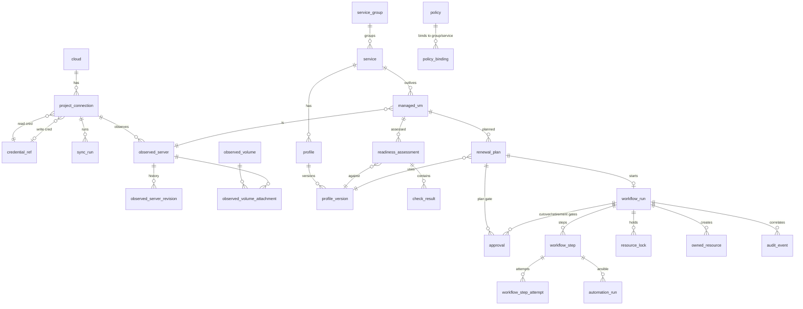

# Data model

| Field | Value |
|---|---|
| Owner | Agent 2 — Chief Architect |
| Status | **Designed** (Phase 1 proposal; nothing implemented) |
| Last updated | 2026-11-04 |

PostgreSQL, SQLAlchemy 2 + Alembic. Conventions: `id uuid` PK (UUIDv7, time-ordered); `created_at`, `updated_at`
`timestamptz`; `version int` for optimistic concurrency where an API exposes ETags; enumerations as `text` + `CHECK`;
JSON documents as `jsonb` validated by pydantic schemas in the owning module. Every table belongs to exactly one module
(architecture.md §3). User, session, token, role-binding and secret tables are specified in
[security-model.md](security-model.md) and are only referenced here.

## 1. Desired vs observed state (rule)

| Kind | Tables | Written by | Rule |
|---|---|---|---|
| **Observed** | `observed_*`, `sync_run` | `inventory` (worker, read credential) only | What OpenStack said, when. Never edited by users. History kept. |
| **Desired** | `profile_version`, `policy`, `policy_binding` | users through the API | What should be. Immutable versions (profiles); edits create versions. |
| **Decisions / execution** | `readiness_assessment`, `renewal_plan`, `approval`, `workflow_*`, `owned_resource` | domain services, worker | Reference the observed revision and desired version they used; never overwritten. |

Drift (FR-INV-4) = comparison function over a `profile_version` and the latest `observed_server_revision`; it is computed,
not stored as a separate truth. The UI shows both columns side by side (FR-REG-4).

## 2. Clouds, projects, credentials

| Table | Key columns | Constraints / notes |
|---|---|---|
| `cloud` | `name`, `auth_url`, `region`, `ca_bundle_ref`, `interface` | `UNIQUE(name)`; TLS verify always on |
| `project_connection` | `cloud_id`, `openstack_project_id`, `name`, `read_credential_id`, `write_credential_id` (nullable), `guest_access` jsonb (`mode: direct|jump_host`, jump host address + pinned key), `enabled` | `UNIQUE(cloud_id, openstack_project_id)`. Write credential nullable: inventory/assessment work without it (FR-INV-2). |
| `credential_ref` | `kind` (`os_read`, `os_write`, `ssh_key`, `vault_password`, `secret`), `secret_id` → sealed secret (security-model.md §5), `app_credential_id`, `expires_at`, `last_validated_at`, `validation_result` jsonb, `rotated_at` | Secret value never in this table; `UNIQUE` per (project_connection, kind) for `os_*` |

## 3. Inventory (observed state)

Pattern for each resource type `X ∈ {server, volume, volume_attachment, port, floating_ip, network, subnet,
security_group, image, flavor}`:

| Table | Key columns | Constraints / notes |
|---|---|---|
| `sync_run` | `project_connection_id`, `kind` (`full`, `servers_delta`), `started_at`, `finished_at`, `status`, `counts` jsonb, `error` jsonb, `workflow_run_id` | One row per sync; a failed sync never marks anything `gone` |
| `observed_X` (current) | `project_connection_id`, `openstack_id`, `name`, typed key fields, `payload` jsonb (normalized), `payload_hash`, `first_seen_sync_id`, `last_seen_sync_id`, `missed_syncs int`, `status` (`present`, `gone`, `unknown`), `gone_at` | `UNIQUE(project_connection_id, openstack_id)`. Row is updated in place; history lives in revisions |
| `observed_X_revision` | `observed_X_id`, `sync_run_id`, `payload`, `payload_hash`, `observed_at` | Inserted only when `payload_hash` changes (append-only). This is the FR-INV-3 snapshot. |

Server typed fields: `status`, `vm_state`, `task_state`, `power_state`, `created`, `launched_at` (nullable; deadline falls
back to `created`, SOURCE-VERIFIED §1), `flavor_original_name`, `flavor_vcpus/ram/disk`, `image_id` (null for
boot-from-volume), `availability_zone`, `locked`, `locked_reason`, `tags text[]`, `metadata` jsonb, `host_id`
(hash, SOURCE-VERIFIED §1), `is_minimal_construct bool` (mv 2.69 down cell, DOCUMENTED-UNVERIFIED).
Volume: `status`, `size`, `bootable`, `multiattach`, `availability_zone`, `volume_type`, `metadata`.
Volume attachment: `server_openstack_id`, `volume_openstack_id`, `device`, `delete_on_termination` (mv ≥ 2.79).
Port: `network_id`, `device_id`, `device_owner`, `fixed_ips` jsonb, `mac`, `security_group_ids`. Floating IP:
`floating_ip_address`, `port_id`, `fixed_ip_address`, `router_id`, `floating_network_id`, `status`, `tags`.

`gone` handling: a resource absent from a **successful full** sync increments `missed_syncs`; at
`inventory.gone_after_missed_syncs` it becomes `gone` (Agent 3 rec. 9). Never deleted. Minimal-construct servers
(status `UNKNOWN`) set `status=unknown`, never `gone`, never drift. Nova delta syncs may mark `gone` immediately on a
tombstone (deleted servers are returned with `changes-since`, SOURCE-VERIFIED §1).

## 4. Services and managed VMs

| Table | Key columns | Constraints / notes |
|---|---|---|
| `service_group` | `name`, `description` | optional grouping for policy binding |
| `service` | `name`, `slug`, `service_group_id`, `project_connection_id`, `owner_contact`, `current_profile_id` | `UNIQUE(slug)`; the long-lived identity (FR-REG-1) |
| `managed_vm` | `service_id`, `observed_server_id`, `openstack_server_id`, `role` (`current`, `retained`, `candidate`, `retired`), `registered_by`, `registered_at`, `ssh_host_key_fingerprint`, `host_key_confirmed_by/at`, `launched_at_effective` | Partial unique: one `current` per service (`UNIQUE(service_id) WHERE role='current'`); `UNIQUE(openstack_server_id)` |

Renewal moves `current` → `retained` → `retired` for blue and creates green as `candidate` → `current` (one
transaction at `verify_external` success).

## 5. Profiles (desired state)

| Table | Key columns | Constraints / notes |
|---|---|---|
| `profile` | `service_id`, `name`, `latest_version`, `version` (ETag) | one active profile per service in MVP |
| `profile_version` | `profile_id`, `number`, `spec` jsonb, `spec_hash`, `created_by`, `created_at`, `automation_sha` | `UNIQUE(profile_id, number)`; immutable (no UPDATE grant) |

`spec` (pydantic-validated): `flavor` (name), `image` (`{name}` or `{properties}`; resolved at plan time and recorded in
the plan), `network` (`network_id`, `subnet_id`), `security_groups`, `availability_zone` (`from_volume`),
`data_volume` (`volume_id`, `fs_type`, `fs_uuid` or `label`, `mount_point`, `snapshot_before_handoff`) or
`stateless_service: true`, `automation` (automation-contract.md §1: repo, full SHA, playbook_dir, requirements,
inventory_vars, `secret_refs` → `credential_ref`), `guest_access` (`ssh_user`, `host_key_policy: console|tofu`),
`health_check` (`external: {scheme, port, path, expected_status}`, `accept_degraded`), `cutover` (`floating_ip_id`;
method fixed to `floating_ip` in MVP), `strategy` (`bluegreen_fip_v1`).

## 6. Policies

| Table | Key columns | Constraints / notes |
|---|---|---|
| `policy` | `name`, `max_age`, `renewal_interval`, `windows` jsonb (weekday + time ranges + IANA tz), `approvals` jsonb (`plan`, `cutover` bool; retirement always required), `require_distinct_approvers`, `retention_period`, `version` | ETag; no global default (FR-POL-4) |
| `policy_binding` | `policy_id`, `scope_type` (`service_group`, `service`), `scope_id` | `UNIQUE(scope_type, scope_id)`; most specific wins (FR-POL-2) |
| `policy_exception` (V1) | `service_id`, `reason`, `owner`, `starts_at`, `expires_at`, `approved_by` | `CHECK(expires_at > starts_at)`; ignored after expiry |

Effective policy and deadline (FR-POL-5) are computed on read and cached in `managed_vm_due` (materialized by the
scheduler: `managed_vm_id`, `policy_id`, `deadline`, `next_window_start`, `computed_at`).

## 7. Readiness, plans, approvals

| Table | Key columns | Constraints / notes |
|---|---|---|
| `readiness_assessment` | `managed_vm_id`, `profile_version_id`, `observed_server_revision_id`, `input_snapshot` jsonb (revision ids used), `level` (`not-ready`, `partially-ready`, `ready`), `summary` jsonb, `requested_by`, `workflow_run_id` | Append-only (FR-RDY-4) |
| `check_result` | `assessment_id`, `check_key`, `check_version`, `category`, `result` (`pass`, `fail`, `unknown`, `not-applicable`), `severity` (`blocker`, `warning`, `info`), `evidence` jsonb, `recommendation` | `UNIQUE(assessment_id, check_key)` |
| `attestation` (V1) | `managed_vm_id`, `check_key`, `statement`, `attested_by`, `attested_at`, `expires_at`, `profile_version_id` | expires with profile change |
| `renewal_plan` | `managed_vm_id`, `profile_version_id`, `assessment_id`, `policy_id`, `policy_version`, `resolved` jsonb (image id, flavor id, network/subnet, AZ, FIP id, volume id, blue server id), `plan_hash`, `planned_window_start`, `capacity_check` jsonb (advisory), `state` (`draft`, `awaiting_approval`, `approved`, `started`, `cancelled`, `expired`), `created_by` | `plan_hash` = SHA-256 over canonical JSON of (resolved, profile_version spec_hash, automation SHA, target IDs, policy version) — security-model.md §7.1 |
| `approval` | `subject_type` (`plan`, `cutover`, `retirement`, `manual_recovery`), `subject_id`, `bound_hash`, `requested_by`, `decided_by`, `decision` (`approved`, `rejected`), `typed_confirmation` (name + last 6 ID chars, as typed), `auth_method`, `reauth_at`, `decided_at`, `expires_at`, `void_reason` | `CHECK(decided_by <> requested_by)`; partial unique: one open request per subject; valid only while `bound_hash` matches and `now() < expires_at` |

## 8. Workflow engine (ADR-0003)

| Table | Key columns | Constraints / notes |
|---|---|---|
| `workflow_run` | `kind` (`renewal`, `inventory_sync`, `readiness`, `credential_test`, `rewrap`), `strategy`, `strategy_version`, `state`, `renewal_plan_id`, `service_id`, `subject` jsonb, `abort_requested`, `abort_requested_by`, `phase` (`build`, `window`, `retained`, `restore`, `retire`), `downtime_started_at`, `downtime_ended_at`, `started_by`, `started_at`, `finished_at`, `version` | Partial unique: one non-terminal `renewal` run per service (`UNIQUE(service_id) WHERE kind='renewal' AND state NOT IN terminal`) |
| `workflow_step` | `run_id`, `seq`, `step_key`, `state` (`ready`, `running`, `waiting`, `succeeded`, `failed`, `needs_human`, `skipped`, `cancelled`), `attempt int`, `fencing_token bigint`, `lease_owner`, `lease_expires_at`, `heartbeat_at`, `not_before`, `deadline_at`, `intent` jsonb, `evidence` jsonb, `error_class` (`retryable`, `needs_human`, `fatal`), `error` jsonb, `destructive bool` | `UNIQUE(run_id, seq)`; partial unique `UNIQUE(run_id) WHERE state='running'`; index `(state, not_before)`; index `(state, lease_expires_at)` |
| `workflow_step_attempt` | `step_id`, `attempt`, `fencing_token`, `worker_id`, `started_at`, `ended_at`, `outcome`, `evidence` jsonb | Append-only history of attempts (FR-AUD-2 "every step attempt") |
| `automation_run` | `step_id`, `attempt`, `phase`, `target_role` (`old`, `new`), `repo`, `sha`, `requirements_hash`, `ansible_core_version`, `extravars_sha256`, `extravars_keys`, `exit_code`, `classification`, `result` jsonb (validated `ovlm.result/1`), `log` (redacted, capped) | automation-contract.md §1, §3.7, §7 |
| `worker_heartbeat` | `worker_id`, `hostname`, `started_at`, `last_seen_at`, `version`, `draining` | readiness probe |
| sequence `fencing_seq` | global monotonic | — |

## 9. Ownership ledger and locks (ADR-0005, ADR-0003)

| Table | Key columns | Constraints / notes |
|---|---|---|
| `owned_resource` | `run_id`, `resource_type` (`server`, `snapshot`), `role` (`green`, `snapshot`), `intended_name`, `openstack_id` (nullable until known), `state` (`intended`, `present`, `deleted`, `orphan`) | `UNIQUE(resource_type, openstack_id)`; `UNIQUE(run_id, role)` in MVP |
| `resource_lock` | `resource_type` (`service`, `server`, `volume`, `floating_ip`, `port`), `resource_key`, `holder_run_id`, `acquired_at`, `reason` | **PK (resource_type, resource_key)**; FK to run; released when the run becomes terminal |

## 10. Audit

| Table | Key columns | Constraints / notes |
|---|---|---|
| `audit_event` | `id bigserial`, `ts`, `actor_id`, `principal_type`, `auth_method`, `source_ip`, `project_scope`, `action`, `target_type`, `target_id`, `before` jsonb, `after` jsonb (allowlisted fields, secrets excluded), `result`, `run_id`, `step_id`, `request_id` | Append-only: `ovlm_app` has INSERT/SELECT only + trigger rejecting UPDATE/DELETE (security-model.md §8). Written in the same transaction as the change it records. |

## 11. ER diagram (main entities)

