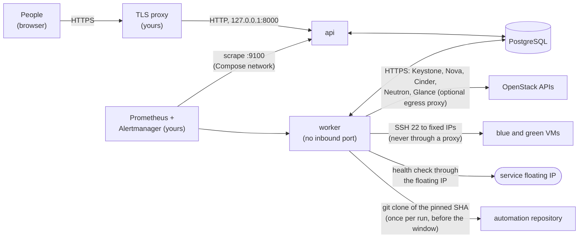

[← OVLM home](../README.md)

# Install guide: a real OpenStack cloud (Docker Compose, one host)

| Field | Value |
|---|---|
| Status | **Docs only, not validated on a second cloud.** Every command, setting, Make target and endpoint here was checked against the code at the time of writing. The renewal itself is lab validated on one cloud (Felcloud, [MVP report](mvp-report.md)). The production Compose file of this guide (`compose.prod.yaml`: TLS proxy in front, `development_mode` off, configuration file, restart policies) is checked by `docker compose config` and unit tests in CI, but has not started a stack or run a renewal anywhere. |
| Audience | The operator who installs OVLM next to a real OpenStack project, and the cloud administrator who prepares that project |
| Companion | [install-guide.md](install-guide.md) (evaluation on a throw-away host). Read it first if you have never started the stack |
| Last updated | 2026-11-09 |

> [!WARNING]
> **OVLM is lab validated on one cloud and not production validated.** One renewal strategy (`bluegreen_fip_v1`) ran
> end to end on Felcloud, with three failure scenarios. The others are integration tested only (§10). Start with a
> **dedicated project** holding only the VMs OVLM manages, and a VM whose service you can afford to lose for the
> length of a window. Nothing in this guide makes OVLM highly available.

Legend: ⚠️ changes state, 🛑 destroys data, ◻︎ read-only. Placeholders: `ovlm.example.org` for OVLM's name,
`keystone.example.org` for the cloud, addresses from the documentation ranges (`192.0.2.0/24`, `198.51.100.0/24`,
`203.0.113.0/24`). Never put a real name, address or secret into an issue.

## Contents

1. [What you are building](#1-what-you-are-building)
2. [Prerequisites](#2-prerequisites)
3. [OpenStack side (cloud administrator)](#3-openstack-side-cloud-administrator)
4. [Network reachability](#4-network-reachability)
5. [OVLM side: install](#5-ovlm-side-install)
6. [OVLM side: connect the project and register a VM](#6-ovlm-side-connect-the-project-and-register-a-vm)
7. [A first renewal, step by step](#7-a-first-renewal-step-by-step)
8. [Operations: paging, backup, upgrade](#8-operations-paging-backup-upgrade)
9. [Security checklist](#9-security-checklist)
10. [Known limits](#10-known-limits)

## 1. What you are building



One host runs the repository's production Compose file, `compose.prod.yaml`: `postgres`, `migrate` (runs once), `api` and `worker`. The api serves
the UI and the API and never calls OpenStack. The worker holds the credentials, calls OpenStack, reaches the guests
over SSH and runs Ansible as a separate OS user. Only the worker unseals secrets ([credential-store.md](credential-store.md)).

What a renewal does (strategy `bluegreen_fip_v1`, [renewal-workflow.md](renewal-workflow.md)): build a new VM
(green) from your pinned Ansible automation while the old VM (blue) keeps serving; after a cutover approval, in a
policy window, stop blue, move its one data volume and its floating IP to green, check health; keep blue stopped and
locked for a way back; delete blue after a second, separate approval.

## 2. Prerequisites

### 2.1 Host

| Need | Notes |
|---|---|
| One Linux host, dedicated to OVLM | The Felcloud lab host was Ubuntu 24.04 with **at least 2 vCPU and 4 GB RAM** (Docker builds, PostgreSQL, api, worker). That is the only measured size: it ran one renewal at a time. Disk and memory under several concurrent runs (`renewal.max_concurrent_runs`, default 5; `worker.slots`, default 4) are **not measured**. The worker's run directories are a tmpfs (RAM) |
| Docker Engine with BuildKit, the Compose v2 plugin, GNU Make, git, openssl | The stack uses `docker compose up --wait`, build secrets and `service_completed_successfully`. The lab used Ubuntu's `docker.io` and `docker-compose-v2` packages. No minimum version is tested |
| `uv` (optional) | Only for `ovlm kek public` and `ovlm inventory sync --dry-run` from a source checkout (`make install`) |
| Network position | See §4: the worker must reach the OpenStack endpoints, the **fixed IPs** of the VMs on port 22, the service floating IP, and the automation git host |
| No inbound port but HTTPS on the proxy | The api is published on `127.0.0.1:8000` only; PostgreSQL and the metrics ports are never published |
| Who has a shell on it | **Treat a shell on this host like OVLM admin access.** A shell in the api container can bootstrap an admin who never enrolled; the KEK file is on this host ([install-guide.md §4](install-guide.md#4-create-the-first-admin-enrolment-link)) |

### 2.2 PostgreSQL: bundled or external

| Choice | What it means today |
|---|---|
| **Bundled** (the `postgres` service of `compose.prod.yaml`, PostgreSQL 16 pinned by digest) | The supported path. `make backup`, `make restore` and `make upgrade-preflight` assume it. One instance, on the same host, no replication: the host is a single point of failure. Back it up (§8.2) |
| **External** (a managed or separate PostgreSQL) | Possible but **not described or tested end to end** by the project. Create the three roles as `docker/postgres/10-ovlm-roles.sh` does (`ovlm_owner` with `CREATEROLE`, `ovlm_api`, `ovlm_worker`; none a superuser), the database `ovlm` owned by `ovlm_owner`, set `OVLM_DB__HOST`, `OVLM_DB__PORT` and `OVLM_DB__SSLMODE` (`verify-full` for a remote server) on every service, and remove the `postgres` service from your stack. The Make targets for backup and restore do not work there: follow [backup-restore-upgrade.md §3](backup-restore-upgrade.md#3-restore) "PostgreSQL outside Compose" and run the client tools of the server's major version |

### 2.3 TLS termination in front of the api

OVLM does not terminate TLS. Its cookies are `Secure` (`__Host-ovlm_session`), so the UI only works over HTTPS.
Bring a reverse proxy on the same host. A sample nginx configuration that does everything in the table below is
[`deploy/proxy/nginx-ovlm.conf`](../deploy/proxy/nginx-ovlm.conf) (not tested by the project: run `nginx -t` and
check the headers yourself).

| The proxy must | Why |
|---|---|
| Terminate TLS for the external URL with a certificate browsers accept: **RSA or ECDSA** | Lab bug R: an Ed25519 certificate was refused by browsers |
| Forward to `http://127.0.0.1:8000` | The api listens on loopback only |
| Set `X-Forwarded-For` to the real client address and drop any value the client sent | OVLM trusts that header only from `http.trusted_proxies` and records it in the audit trail |
| Pass `Origin` and `Referer` through unchanged, and **not** add `Referrer-Policy: no-referrer` | The CSRF check compares `Origin` with the external URL. Lab bug N: `no-referrer` made browsers send `Origin: null`, which refused every form. OVLM sends `Referrer-Policy: same-origin` itself |
| Add HSTS | security-model.md §9: HSTS is the proxy's job |
| Not expose `/metrics`, not cache or rewrite responses | The api answers 404 for `/metrics` on its public port; the UI uses HTMX fragments |

Then tell the api where it is (§5.4): `OVLM_EXTERNAL_URL`, and the address it sees the proxy as. A proxy on the host
reaches the published port through the Compose network's gateway, not `127.0.0.1`: `compose.prod.yaml` fixes that
network (`172.30.240.0/24`, gateway `172.30.240.1`) and trusts the gateway by default
(`OVLM_HTTP__TRUSTED_PROXIES=172.30.240.1/32`). Every process on the host that connects to `127.0.0.1:8000` arrives
from the same address, which is acceptable only because a shell on this host is already admin-equivalent (§2.1). If
every client in the audit log still has the same address, your Docker setup differs: list the address the api
actually sees (never a wider range than the proxy). Not verified on a real host.

### 2.4 Time

Keep the OVLM host's clock synchronised (NTP or chrony), and the people's phones too. TOTP codes are accepted
for the current 30-second step and one step either side, nothing more. Keystone token and application-credential
expiry, approval validity (plan 24 h, cutover 4 h by default) and the audit trail are all time-based. The workflow
engine's leases use the database clock and a local monotonic clock, not the wall clock (ADR-0003).

### 2.5 People

| Role | Who | Why |
|---|---|---|
| Cloud administrator | Creates the project, the service user, roles, quotas, and the two application credentials (§3); is on call for what a `member` cannot do (§3.5) | OVLM never creates or deletes Keystone credentials |
| OVLM admin | Configures OVLM, uploads credentials. **Not** an approver or operator (admin does not inherit them) | security-model.md §3.1 |
| Operator(s) | Register VMs, confirm host keys, write profiles, run readiness, create plans, start runs, act on parked runs | |
| **Two approvers**, distinct humans | G1 (plan) and G2 (cutover) need an approver who is not in the requester set; **G3 (retirement) needs a second human** who is neither in the requester set nor the G1 approver, whatever the settings | renewal-workflow.md §3. Without a second approver, blue stays stopped and locked forever (no data risk, quota cost) |
| Two KEK custodians | Hold the offline copies of the KEK and the TOTP key (§5.2) | security-model.md §5.1 |
| On-call | Receives the pages of §8.1 during every window | operations.md |

Every person has their **own** account with TOTP. No shared admin, no shared approver (§9).

## 3. OpenStack side (cloud administrator)

### 3.1 A dedicated project and a service user

1. A **dedicated project** for the VMs OVLM manages, and nothing else. A `member` can stop or delete any server in
   its project: the blast radius of OVLM's write credential is the whole project (security-model.md §4.2).
2. A **dedicated Keystone service user** (not a person's account) with the roles `reader` and `member` in that
   project only. No `admin`, no `manager`, no other project.
3. Ask which policy defaults the cloud enforces (`enforce_new_defaults`) and whether `member` implies `reader` and
   nothing else (see 3.2). Write the answer down.

### 3.2 Two application credentials

Created by the service user, in that project, **restricted** (no `--unrestricted`), with an expiry of at most 180
days ([install-guide.md §6](install-guide.md#6-create-the-two-keystone-application-credentials) has the commands):

| Credential (OVLM kind) | Role | OVLM uses it for |
|---|---|---|
| `ovlm-inventory` (`os_read`) | `reader` | Inventory sync, readiness, the read-only probe. Every request is GET or HEAD (a session hook refuses anything else before it is sent, `src/ovlm/openstack/guard.py`) |
| `ovlm-renewal` (`os_write`) | `member` | Renewal steps only, after a human approval, inside a fenced step attempt |

**What OVLM checks when you upload them** (worker, read-only, [credential-store.md §3](credential-store.md#3-registering-a-project) step 5):
one token request and one GET of the credential's own Keystone record (`/v3/users/{user}/application_credentials/{id}`).
The token must be scoped to the connection's project and carry exactly `reader` (`os_read`) or `member` plus at most
the implied `reader` (`os_write`); the credential must be restricted, and Keystone must report an expiry no more than
180 days ahead and not later than the date you uploaded. Consequences:

- **Any other role in the token is a rejection.** A cloud whose `member` implies more roles than `reader`, or that
  names its roles differently (for example a legacy `_member_`), is not supported: the role names are fixed in
  `src/ovlm/connections/validation.py`.
- **The credential must be able to read its own Keystone record.** Keystone's default policy allows it, and Felcloud
  did (HTTP 200). If your cloud forbids it, every validation fails with "Keystone did not show the application
  credential's record".
- A never-expiring credential is refused.

**What the write credential is allowed to send** (the write allowlist, `src/ovlm/openstack/allowlist.py`; anything
else is refused before it leaves the worker):

| Service | Requests | Step |
|---|---|---|
| Compute | `POST /servers` (with OVLM's tags, no block-device mapping) | B3 create green |
| Compute | `DELETE /servers/{id}` | discard/rollback of green; retirement of blue |
| Compute | `POST /servers/{id}/action`: `os-stop`, `os-start`, `lock`, `unlock`, `os-getConsoleOutput` only | window, restore, retention |
| Compute | `PUT /servers/{id}/tags/ovlm:...` (add one tag) | B2 claim |
| Compute | `POST`/`DELETE /servers/{id}/os-volume_attachments[/{id}]` (no `delete_on_termination: true`) | volume handoff |
| Network | `PUT /floatingips/{id}` (re-association only, never a disassociation) and `PUT /floatingips/{id}/tags/ovlm:...` | cutover, claim |
| Block storage | `POST /volumes/{id}/metadata` (merge of `ovlm.*` keys) | B2 claim |
| Block storage | `POST /snapshots` (`ovlm-prehandoff-<run>`, `force: false`) | W4, only when the profile sets `snapshot_before_handoff` |

OVLM never creates or deletes a volume or a floating IP, never deletes a snapshot, and never writes security
groups. All of the above is allowed to `member` by default policy (security-model.md §4.2, openstack-integration.md
§7, §8).

**What the read credential reads:** servers (details, volume attachments), volumes, volume types (including
`GET /types/default`), snapshots, ports, floating IPs, networks, images (Glance), flavors, block storage limits, and
the compute and block storage version documents (microversion negotiation).

**Access rules** (Keystone application credential access rules) are recommended for the read credential in the design
(security-model.md §4.4) and **not** for the write credential. OVLM has **not** been run with access rules on any
cloud. If you add them to the read credential, they must also allow the identity GET above, or validation fails.

### 3.3 What the cloud must offer

| Requirement | Why | Source |
|---|---|---|
| Compute API microversion **2.79 or later** | Tags at create (2.52), lock reason (2.73), `delete_on_termination` on attachments (2.79). Below it the write client refuses before any write | `src/ovlm/openstack/sdk_write.py` |
| Server tags and Neutron floating-IP tags | Ownership markers (§3.4) | ADR-0005 |
| Cinder with an **explicit** volume type on the data volume | Readiness warns otherwise; Felcloud had no working default type | readiness `data.volume_type_explicit` |
| A router with an external gateway on green's subnet, on the floating IP's external network | The floating IP moves to green's port | renewal-workflow.md §1 |
| Glance image readable by the project, matched by your profile | Green boots from it | |
| A flavor with `disk > 0` | Green boots from image; OVLM creates no volume | renewal-workflow.md §1 |
| cloud-init in the image, with the `users` and `ssh_keys` modules | Green gets the guest user and the injected bootstrap host key from user-data (ADR-0006). Lab validated with **Ubuntu 24.04** only | `src/ovlm/renewal/production.py` |

### 3.4 Tags and metadata OVLM writes

OVLM marks what it manages and **never** removes these markers itself. Do not remove or copy them by hand.

| Resource | Marker |
|---|---|
| Blue (claimed at B2) and green (at create) | server tag `ovlm:managed`; green also `ovlm:run:<run id>` |
| The service floating IP | tag `ovlm:managed` |
| The data volume | metadata `ovlm.managed=true` and other `ovlm.*` keys (merged, existing keys kept) |
| Pre-handoff snapshot (optional) | name `ovlm-prehandoff-<run id>`, metadata `ovlm.managed=true` |

Markers are hints any `member` can edit: OVLM acts only on resources its own database lists for the run
(security-model.md §4.3). OVLM never deletes a marked resource that no run of its own created. The design's
report-only orphan list (`GET /orphans`, api-design.md §3.2) is not served by this release: look for `ovlm:*` markers
by hand after a failed or restored run.

### 3.5 Quotas, and what needs the cloud administrator during a run

**Quota per concurrent renewal:** one more instance, and the cores and RAM of green's flavor; one more port on green's
network. With `snapshot_before_handoff`: one more Cinder snapshot and the volume's size in `gigabytes`. No volume, no
floating IP. Blue and green coexist from B3 until retirement (after the retention period), so the headroom is held for
days, not minutes. OVLM's own quota check reports `unknown` today (roadmap P2-4; a `reader` cannot see Neutron quotas
at all): check headroom by hand before each plan.

**Stuck states a `member` cannot fix** (OVLM stops in `needs_human` and keeps its locks; renewal-workflow.md §6): a
volume stuck `detaching`/`reserved`/`attaching` (force-detach, reset-status), an admin lock on blue (unlock), a
detach refused because blue's compute host is down (fix the host or evacuate), a server in `ERROR` that will not
delete, a floating IP that stays `DOWN`. **Name a cloud administrator who can be reached during every window.**

## 4. Network reachability

| From | To | Port | Used by | Notes |
|---|---|---|---|---|
| browsers | TLS proxy | 443 | people | |
| worker | Keystone and every catalog endpoint of the connection's `interface` (`public` or `internal`): compute, block storage, network, image | 443 (whatever the catalog says) | inventory, validation, renewal | TLS verification is always on. A private CA goes in the cloud's `ca_bundle_pem`. `insecure` is refused |
| worker | blue and green **fixed IPs** | 22 | host-key scan, Ansible, the read-only probe | Address = `fixed_ips[0]` of the port the service floating IP is on; green has no floating IP before the cutover. **No jump host:** `guest_access` is stored but no worker code uses it (security-model.md §6.3), so the worker needs a direct route to the project network (the lab host sat on it) |
| worker | the service **floating IP** | the profile's `health_check.external.port` | B8, W10, S9 external check | Never through a proxy (§4.2). See the hairpin caveat (§4.1) |
| worker | automation git host | 443 (`https://`) or 22 (`ssh://`) | B6, and `reprepare-automation` | Once per run, before the window. An `https://` repository can go through the egress proxy; an `ssh://` one needs direct access and a deploy key (`automation.git_ssh_key_file` and `automation.git_ssh_known_hosts_file`, not wired in either Compose file and not tested) |
| guests | package mirrors | | your playbooks | OVLM never needs guests to reach it |
| Prometheus | api and worker `:9100` | 9100 | metrics | Compose network only (§8.1) |

**Security groups** of blue and green (the profile lists green's by name): SSH 22 from the worker's address only (a
readiness warning flags `0.0.0.0/0` on 22), and the health-check port from wherever the external check arrives from.

### 4.1 Floating-IP hairpin (lab bug L)

The external check goes from the worker to the service floating IP. When the worker sits **in the same project, behind
the same router**, that path is a hairpin through the router: in the Felcloud lab it did not work until the lab host
itself got a floating IP (lab configuration, not code), and the check then arrived at the guest **with the worker host's
floating IP as its source address**, not its fixed IP. So:

- test, before the first plan, that the worker host can open the health URL through the floating IP
  (for example `curl -fsS http://203.0.113.10:8080/health` from the host, with your address and path);
- allow the health-check port in blue's and green's security groups from the source address the guest actually sees.

A worker outside the cloud, reaching the floating IP over a routed or public path, avoids the hairpin but must then
reach the fixed IPs on port 22 some other way (VPN or a routed management network), because there is no jump host.

### 4.2 Egress proxy (optional, not lab tested)

If the project network has no direct Internet, the worker can reach the OpenStack APIs through an HTTPS-only proxy
(`CONNECT` to 443) while reaching guests directly. Put `HTTPS_PROXY` and `NO_PROXY` in the `.env` of §5.4;
`NO_PROXY` must list loopback, the Compose service names, the project subnet(s) and any guest address. SSH never
uses the proxy and OVLM's own health probe ignores proxy variables. Building the worker image behind the proxy
needs the same values as build arguments: `make build` passes none, so set them in Docker's client proxy
configuration or build with `docker build --build-arg HTTPS_PROXY=... --build-arg NO_PROXY=...`. Details and the hosts a build needs: [install-guide.md §5a](install-guide.md#5a-reaching-openstack-through-an-egress-proxy-optional).
**Status:** unit tested only (roadmap E5-8, P1-5). The Felcloud lab had direct egress for the renewal runs; no
renewal has run through a proxy.

## 5. OVLM side: install

### 5.1 Get the code at a fixed commit and build ⚠️

```bash
git clone https://github.com/OzarLand/openstack-vm-lifecycle-manager.git
cd openstack-vm-lifecycle-manager
git checkout <commit SHA or release tag>     # never a moving branch on a real installation
make build IMAGE_TAG=$(git rev-parse --short=12 HEAD)   # images ovlm:<tag> (api, migrate), ovlm-worker:<tag> (worker)
```

There are no published images: you build from the source you checked out, tagged with its commit, never `:dev`
(that is the development stack's tag, rebuilt by `make up`). Record the commit; backups and upgrades refer to it.
§5.4 names the two images in `.env`. If you push them to your own registry, name them there by digest
(`registry.example.org/ovlm@sha256:...`) instead.

### 5.2 Secrets: KEK, TOTP key, database passwords ⚠️

```bash
make secrets
```

It creates `./secrets` (mode 0700) with four database passwords, the TOTP key (`totp_key`, api only), and the
worker key pair (`worker_kek`, mode 0400, worker only; `worker_kek.pub`, api). It creates only missing files: it
never overwrites a file or changes an existing file's mode (it warns if `worker_kek` is readable by group or others).

| File | Holder | If it is lost |
|---|---|---|
| `secrets/worker_kek` (the KEK) | the worker container only; offline copy with **two custodians** | every stored credential and guest SSH key is unreadable: upload them all again |
| `secrets/totp_key` | the api container only; offline copy **with** the KEK | every admin and approver loses TOTP: no step-up, no approval, no credential upload |
| `secrets/db_*_password` | PostgreSQL and the one service that uses each; the deployment's secret store | new passwords work on a new, empty database volume |

1. **Label the KEK with its id** (needed to match it with a backup's manifest). From a source checkout
   (`make install`):

   ```bash
   uv run --frozen ovlm kek public --private-in secrets/worker_kek    # prints the public key and "# kek_id <id>"
   ```

2. **Make offline copies** of `worker_kek` and `totp_key` now, together, to a place as protected as the database
   (an encrypted medium or a secret manager), held by the two custodians. The live copy stays on the host: the worker
   reads it at start.
3. **Tighten the TOTP key** so that only the api's uid can read it
   ([install-guide.md §3a](install-guide.md#3a-back-up-the-totp-key-together-with-the-kek)):

   ```bash
   # ⚠️ State-changing. Undo: chown back to your user and chmod 0444.
   sudo chown 10001:10001 secrets/totp_key && sudo chmod 0400 secrets/totp_key
   ```

   `make secrets` leaves the tightened mode as it is. Do not run `make up` on this host: it builds and starts the
   development stack (`compose.yaml`).

The database password files stay `0444` inside the `0700` directory: Compose mounts file secrets with their host
owner and mode (`compose.prod.yaml` does not change them), and PostgreSQL and the service that uses each file run as
different uids.

### 5.3 The configuration file

The settings are a TOML file read by the api and the worker (`OVLM_CONFIG_FILE`, default `/etc/ovlm/ovlm.toml`;
[architecture.md](architecture.md)). It holds no secret. Create `config/ovlm.toml`, mode 0644, and mount the **same**
file into the api and the worker (section 5.4).

The renewal timeouts have **built-in defaults** (`ovlm-renewal-defaults/1`), derived from the Felcloud lab with margins:
every key, its value, where it comes from and how it was chosen are in [timeouts.md](timeouts.md). A fresh install can
create a plan without setting any of them. The defaults stay explicit: the api and the worker log at start which keys
use them and the worst-case windows they give, and each plan records the effective value of every key
(`resolved.renewal_settings`, bound into the plan hash and approved at G1 and G2). With the defaults the worst-case
window is 36 min (stateless), 44 min (data volume) or 49 min (with a pre-handoff snapshot). Your Keystone tokens must
outlive it (W1 is refused otherwise; Keystone's default lifetime is 1 h), and the G2 approver weighs it against the
policy's windows and `max_window_duration` (section 6.6).

The one key you must set is the automation allowlist. Every renewal key below is an **optional override**: uncomment
only the ones you measured on your cloud and your workload; the others keep their defaults.

```toml
[automation]
allowed_repos = ["https://git.example.org/team/"]   # URL prefixes of the automation repositories; empty refuses all

# Optional overrides (seconds unless noted). Defaults and their sources: docs/timeouts.md.
# [renewal.timeouts]               # one deadline per step (renewal-workflow.md section 2)
# preflight = 120
# claim_resources = 120
# green_create_call = 120
# green_build = 900                # green ACTIVE
# green_ssh = 600                  # green reachable over SSH
# green_host_key = 300             # added to green_ssh
# green_ready = 300
# server_stop = 90
# server_start = 90
# server_lock = 30
# server_delete = 600
# volume_detach = 60
# volume_attach = 90
# snapshot = 300                   # used only when a profile sets snapshot_before_handoff
# fip_status = 30
# external_verify = 60
#
# [renewal.automation_timeouts]    # per Ansible phase as the renewal counts it (step deadline = this + 60 s);
# preflight = 120                  # default: the runner's timeout of the phase (automation.timeout or the contract)
# configure = 1800
# quiesce = 120
# data_attach = 120
# start_service = 120
# healthcheck = 60
# rollback_hooks = 120
#
# [renewal.green_ready]
# max_age = 1800
#
# [renewal.healthcheck]
# max_attempts = 2                 # count
# interval = 10
#
# [renewal.external_verify]
# required_successes = 2           # count
# interval = 5
#
# [renewal.retire]
# health_max_age = 3600
#
# [renewal.approval_validity]
# retirement = 14400               # plan (24 h) and cutover (4 h) have their own defaults
```

Notes:

- `renewal.automation_timeouts.<phase>` bounds the **step**; the Ansible process itself is stopped at the runner's
  timeout for that phase (the contract defaults of [automation-contract.md §6](automation-contract.md#6-timeouts-and-exit-code-classification),
  or `[automation.timeout]` overrides, capped by `[automation.max_timeout]`). Left unset, the step bound follows the
  runner's timeout. Set below it, the api and the worker refuse to start; a profile whose `automation.timeouts` asks
  for more than the step bound is refused at plan creation (`renewal-timeouts-inconsistent`). The other checks
  between keys are listed in [timeouts.md §4](timeouts.md#4-checks).
- The G2 approval shows the worst-case window computed from these values (sum of the W1–W10 and S1–S10 deadlines).
  The policy's `max_window_duration` must fit in its shortest window (§6.6).
- Changing a renewal key applies to plans created afterwards; restart the api and the worker together. The worker
  logs a warning when its values differ from the ones a plan recorded.
- `automation.allowed_repos` is read by the **worker** at B6 (after G1). A profile with a repository outside it is
  accepted when it is saved and refused only at B6: check it yourself before G1. There is no admin API for this list;
  changing it means editing the file and restarting the worker.
- Unknown keys are errors: the api and worker refuse to start on a typo.

### 5.4 The production Compose file and `.env`

`compose.yaml` is the development and CI file (development mode on the api, no configuration file, no restart
policy, images built as `:dev`). A real installation uses **`compose.prod.yaml`** instead, never both together. It
builds nothing, runs no service in development mode, mounts `config/ovlm.toml` read-only into `migrate`, `api` and
`worker` and loads it, restarts `postgres`, `api` and `worker` (`unless-stopped`), rotates the container logs, and
keeps the secret split, read-only root file systems, dropped capabilities, the worker's tmpfs run root and the
`checkouts` volume of the development file (a unit test compares the two). Its project name is `ovlm-prod`, so `make
down` (the development stack, which deletes its volumes) never touches it. Resource limits are in it as commented
suggestions: none is measured.

Create `.env` next to it (Compose reads it; git-ignored; keep a copy in your deployment's configuration management):

```bash
# ⚠️ Every Compose command and the Make targets backup, restore, upgrade-preflight and smoke use this file
COMPOSE_FILE=compose.prod.yaml
# The images of §5.1 (required): the tag you built, or <registry>/ovlm@sha256:... and <registry>/ovlm-worker@sha256:...
OVLM_IMAGE=ovlm:<tag>
OVLM_WORKER_IMAGE=ovlm-worker:<tag>
# The public origin behind the TLS proxy (required): CSRF Origin check, enrolment links
OVLM_EXTERNAL_URL=https://ovlm.example.org
# Optional, with their defaults: the Compose network (change both if the range is in use on your network) and the
# proxy address the api trusts for X-Forwarded-For (section 2.3)
# OVLM_NETWORK_SUBNET=172.30.240.0/24
# OVLM_NETWORK_GATEWAY=172.30.240.1
# OVLM_TRUSTED_PROXIES=172.30.240.1/32
# Optional egress proxy for the worker (section 4.2)
# HTTPS_PROXY=http://proxy.example:3128
# NO_PROXY=localhost,127.0.0.1,::1,postgres,api,worker,192.0.2.0/24
```

Check it before the first start (read-only; it needs no running daemon):

```bash
docker compose config        # the resolved file; it refuses to print without OVLM_IMAGE, OVLM_WORKER_IMAGE, OVLM_EXTERNAL_URL
```

- `config/ovlm.toml` must exist (§5.3): a missing file fails the start instead of becoming an empty directory.
- With `development_mode` off the api **refuses to start** without `OVLM_EXTERNAL_URL`, settings refuse
  `renewal.credentials_dir` (plain-file credentials) and `log.openstack_http_debug`, and the worker refuses to start
  without its separate Ansible user (the file sets it). Treat a refused start as the check working.
- Restart policies: a host reboot or a crashed worker would otherwise leave every run, and any window in progress,
  stopped until a human starts it. The worker is built to be restarted (a killed worker was taken over in the window
  in LAB-01). The policies themselves have not been exercised on a real host.
- Site-specific additions (a Prometheus service, a deploy key for `ssh://` repositories) go in a file of your own,
  listed after it: `COMPOSE_FILE=compose.prod.yaml:compose.site.yaml`. `compose.override.yaml` is not read once
  `COMPOSE_FILE` is set.
- Do not add `OVLM_RENEWAL__CREDENTIALS_DIR`, `OVLM_LOG__OPENSTACK_HTTP_DEBUG` or `OVLM_KEK__PRIVATE_KEY_FILE` to
  the api.

### 5.5 Start and check ⚠️

```bash
docker compose up -d --wait        # compose.prod.yaml (from .env): postgres, migrate (once), api, worker; waits until healthy
make smoke                         # assertions against the running stack; prints "smoke OK"
curl -fsS https://ovlm.example.org/readyz
```

`make smoke` runs in CI against the development stack; it has not been run against `compose.prod.yaml`. `/readyz`
answers 503 when the database or the schema is not ready, or when the api's KEK public key is not one the worker
announced (`checks.kek`, review SF-6). Enter the worker only as its own user: `docker compose exec -u ovlm worker ...`
(a plain `exec` is a root shell that can read the KEK).

### 5.6 First admin and the other accounts ⚠️

```bash
docker compose exec api ovlm admin create --username <admin name> --display-name "<Name>" --enrol-link
```

The single-use link (72 h by default, `auth.enrolment_link_hours`) now carries your external URL. Open it, choose a
password, sign in, enrol TOTP at `/account/totp`. A lost or expired link: the same command with `--reissue` (only for
an admin who never finished enrolment; audited with the OS user and the host).

Then, as that admin, create every other person (`POST /api/v1/users` with `username`, `display_name` and `roles`,
each `{role, scope}`; or `POST /api/v1/role-bindings` later). Each call returns an enrolment link for that person
only; the admin never sets or sees a password. Approvers and admins must enrol TOTP before they can act; operators
should too (an enrolled operator confirms host keys with a step-up, §6.4). Give scopes `project:<project connection
id>` once the connection exists, or `global`.

**How a human calls the API.** Most setup steps below are API-only (there are no UI pages for clouds, project
connections, credentials, users, services or profiles). Use a session, not an API token: **no API token can manage
users or credentials, approve, or confirm a destructive action** (security-model.md §2.2, §7.2). `POST
/api/v1/session` with `username`, `password` and `totp_code` sets the session cookie and returns a `csrf_token`; every
unsafe request then needs the cookie, the header `X-CSRF-Token: <token>` and `Origin: https://ovlm.example.org`. A
step-up is `POST /api/v1/session/reauth` with `password`, `totp_code`, `action` and `target_id`; it returns a
single-use `stepup_id` valid 5 minutes for exactly that action and target. Keep the cookie jar in a mode-0600 file,
type passwords at a prompt (not on the command line), and delete the jar afterwards (`DELETE /api/v1/session`). The
request bodies are in [api-design.md](api-design.md) and [credential-store.md §3](credential-store.md#3-registering-a-project);
OVLM does not serve an OpenAPI document yet.

## 6. OVLM side: connect the project and register a VM

### 6.1 Cloud and project connection (admin) ⚠️

1. `POST /api/v1/clouds` with `name`, `auth_url` (https only), `region`, `interface` (`public` or `internal`) and,
   for a private CA, `ca_bundle_pem`. Changing any of these later sends every credential of the cloud back to
   validation (they are bound to the endpoint): plan to upload them again.
2. `POST /api/v1/project-connections` with `cloud_id`, `openstack_project_id`, `openstack_project_name`, `name`, and
   `guest_access` `{"mode": "direct"}` (a jump host is stored but not used, §4).

### 6.2 Upload and validate the credentials (admin, TOTP step-up) ⚠️

Three uploads per connection, each with its own step-up (`action` `credential.upload`, `target_id` = the connection
id) and the connection name as `typed_confirmation`:
`POST /api/v1/project-connections/<id>/credentials` with `kind`:

| `kind` | `secret` | Also |
|---|---|---|
| `os_read` | the `ovlm-inventory` application credential secret | `app_credential_id`, `expires_at` (Keystone's date or earlier) |
| `os_write` | the `ovlm-renewal` secret | `app_credential_id`, `expires_at` |
| `ssh_key` | an **unencrypted OpenSSH private key** for the guest user (`ssh-keygen -t ed25519 -N ''`; RSA at least 3072 bits; ECDSA accepted) | only its public key and fingerprint are ever shown |

The api seals each secret to the worker's public key and cannot read it back. Within a minute
(`kek.validation_interval`) the worker validates `os_read` and `os_write` against Keystone. Check
`GET /api/v1/credentials/<id>`: `state: active`, or `rejected` with a readable reason. `POST
/api/v1/credentials/<id>/validate` asks again (for example after the cloud administrator fixed a role). Active
credentials are re-validated daily. Then **destroy every local copy** of the secrets you pasted (`shred -u`).

The guest key: put its **public** half into `~<ssh_user>/.ssh/authorized_keys` on every blue VM (the workload
owner does this; OVLM never logs into blue with anything else). Green gets it from cloud-init, together with
`sudo NOPASSWD:ALL` for that user (security-model.md §6.1, accepted pending review). The playbooks run with `become`
on blue too, so blue's user needs the privileges your playbooks use.

Rotation of an application credential: create the new one in Keystone, upload it; the worker switches atomically
when it validates and marks the old one for deletion in Keystone by the cloud administrator
([credential-store.md §4](credential-store.md#4-rotating-an-application-credential-security-modelmd-44)). Alerts
`OvlmCredentialExpiring` and `OvlmCredentialValidationFailing` remind you (§8.1).

### 6.3 Inventory sync (operator or admin)

`POST /api/v1/projects/<project connection id>/syncs` (202, or 409 while one is queued or running), then `GET
/api/v1/projects/<id>/syncs`. The worker also syncs every `inventory.sync_interval` (900 s by default). A failure
shows a fixed reason code: `credential_unavailable`, `client_setup_failed`, `auth_failed`, `project_mismatch`,
`cloud_error`, `interrupted`, `sync_already_running`, `worker_error`. The redacted detail is in the worker log.

Optional, before any upload: a read-only check from a `clouds.yaml` of the **reader** credential (mode 0600, outside
the repository), from a source checkout. It sends only GET and HEAD, writes nothing and needs no database:

```bash
uv run --frozen ovlm inventory sync --cloud ovlm-reader --clouds-yaml /path/to/clouds.yaml --dry-run
```

### 6.4 Register the VM and confirm its host key (operator) ⚠️

1. `POST /api/v1/services` (a service; green is named after it), then `POST /api/v1/services/<id>/managed-vms` with
   `observed_server_id`. The worker scans blue's SSH host key (`ssh-keyscan` of `fixed_ips[0]` of the service
   floating IP's port). The UI's inventory page offers the same (Register).
2. **Read the fingerprint on the VM itself**, out of band: its console, or `ssh-keygen -lf
   /etc/ssh/ssh_host_ed25519_key.pub` run on the VM. Paste it into the confirm form (the UI never pre-fills it) or
   `POST /api/v1/managed-vms/<id>/host-key/confirm` with `fingerprint`, `source` and, for an operator with TOTP, a
   `stepup_id` (`host_key.confirm`, the managed VM id). A mismatch is refused. **Never confirm a fingerprint you did
   not read on the VM:** it is the trust root of every later SSH to blue.

A plan is refused (409 `host-key-unconfirmed`) until this is done. A rebuilt blue has a new key: scan and confirm again.

### 6.5 Profile: automation pinned to a commit (operator)

`POST /api/v1/services/<id>/profiles`, then `POST /api/v1/profiles/<id>/versions` (immutable versions;
`src/ovlm/profiles/spec.py` is the schema). What it must say:

| Field | Rule |
|---|---|
| `automation.repo` | `https://` or `ssh://`, inside `automation.allowed_repos` (§5.3) |
| `automation.sha` | a **full commit SHA**; branches and tags are refused. The SHA is bound into the approved plan hash |
| `automation.playbook_dir` | holds the phase playbooks of [automation-contract.md §3](automation-contract.md#3-phases-entry-points); `hosts: ovlm_target` |
| `automation.requirements` | every collection and role pinned; nothing is downloaded at run time: collections come from the worker image (`ansible.posix`) or are vendored in the repository |
| `data_volume` | the **one** data volume: id, `fs_type` (`ext4`/`xfs`), `fs_uuid` or `label`, `mount_point`, `snapshot_before_handoff`. Or `stateless_service: true` |
| `guest_access` | `ssh_user` (the user that holds the guest key), `host_key_policy` `injected` (default), `console` or `tofu` |
| `health_check.external` | `scheme` (`http`/`https`/`tcp`), `port`, `path`, `expected_status`: checked by the worker through the floating IP |
| `cutover.floating_ip_id` | the service floating IP, already associated with blue |
| `flavor`, `image`, `network`, `security_groups`, `availability_zone` | green's build (`availability_zone` defaults to the volume's) |

**Lint and waivers.** Profile save starts no lint (`lint_status: pending`): the static lint runs at **B6**, after
G1, on the checked-out SHA. A blocking finding stops B6 for a human. Run the reference lint on your repository before
you ask for G1 (the reference roles in [`ansible/`](../ansible/README.md) pass with no waiver). If a finding is a
deliberate, reviewed exception, an **approver** who is neither the version's author nor a requester grants a waiver
for one rule, on a path glob, for that one profile version, with a TOTP step-up and a reason:
`POST /api/v1/profiles/<id>/versions/<n>/lint-waivers`. The data-safety rules are never waivable. Waivers are bound
into the plan hash: granting or revoking one voids approvals bound to the old hash.

### 6.6 Policy and windows (admin)

`POST /api/v1/policies` (or the UI's Policies pages to edit), then `POST /api/v1/policy-bindings` to bind it to the
service. Fields (`src/ovlm/policies/models.py`): `max_age`, `renewal_interval` (ISO 8601 durations), `windows`
(weekdays, `start`, `end`, `timezone`; a night window is two windows), `approvals` (`plan`, `cutover`; retirement is
always required), `require_distinct_approvers` (default true), `auto_restore_in_window` (default true),
`max_window_duration` (required, must fit in the shortest window), `retention_period`, `snapshot_retain_after_restore`.
A new policy version changes the plan hash and voids open approvals.

### 6.7 Readiness (operator)

`POST /api/v1/managed-vms/<id>/assessments` (202), then `GET /api/v1/assessments/<id>`. The level must be `ready`
before a plan can start. Blockers: automation pinned, one separate data volume, VM `ACTIVE` and not locked, service
reached through a floating IP, flavor and image resolve to exactly one, health check defined. Warnings include an
implicit volume type, quota headroom (always `unknown` today) and missing human attestations. By default readiness runs
no repository code on the live VM.

## 7. A first renewal, step by step

### 7.1 Before G1 (plan approval): check by hand

Readiness does not check everything the strategy needs. Before you ask for G1, confirm:

- [ ] The data volume is mounted on blue **by UUID or label with `nofail`** in `/etc/fstab`, and every unit in the
      profile's `automation.inventory_vars.service_units` is **enabled** (a restore boots blue and relies on both; renewal-workflow.md §1).
- [ ] Blue's data attachment has `delete_on_termination == false`.
- [ ] Quota headroom for green (§3.5) for the whole retention period.
- [ ] The worker reaches blue on port 22 and the health URL through the floating IP (§4.1).
- [ ] The repository is in `automation.allowed_repos`, the SHA exists there, and the lint passes or has its waivers.
- [ ] Green's security groups exist and allow 22 from the worker and the health port from the probe's source.
- [ ] You know who approves G1, G2 and G3 (three decisions, at least two different humans, none of them the requester).

### 7.2 Plan, G1, build phase (no service impact)

Create the plan (UI: Renewals; API: `POST /api/v1/plans` with `managed_vm_id`, `planned_window_start`), request the
plan approval, and have an approver decide G1 with a TOTP step-up (UI: Approvals). Read the approval page: the hash
inputs (profile version, SHA, repository, targets, image, policy version), the automation diff, any `self_approved`
flag. Then the operator starts the run. B1–B9 build and prove green while blue keeps serving: create, wait for SSH,
pin green's host key, clone and lint the pinned SHA, `configure`, external check, readiness of green before any
outage. A failure here stops before any downtime; blue is untouched. Green is never deleted automatically: **Roll back**
(typed confirmation) deletes it.

### 7.3 Before G2 (cutover approval): the go/no-go

- [ ] Paging works: a test page reached the on-call phone (§8.1), and the on-call person and the cloud administrator
      are reachable for the whole window.
- [ ] A fresh backup exists (`make backup`), and the offline KEK and TOTP key match its manifest's `kek_id`.
- [ ] The G2 page's blast radius is read: outage start, **worst-case window** against the `max_window_duration`
      budget, snapshot or not ("no: revert carries green's writes forward"), and the automatic-restore statement:
      before the service starts on green, a listed failure restores blue automatically; **after it, OVLM stops and
      pages** unless a pre-handoff snapshot was taken.
- [ ] Nobody will upgrade, restore or stop the worker during the window (§8.2).

G2 needs an approver outside the requester set, a step-up and the typed confirmation of blue (`<server name> <last 6
characters of its id>`). W1 starts only inside a policy window; a G2 given outside one waits (and expires after 4 h by
default).

### 7.4 In the window: what you can do, and when

The run page shows `available_actions[]`, each with its concrete effect from the current state. Read the effect
before you press anything.

| Action | Who | When |
|---|---|---|
| **Probe** | operator or approver | any time; read-only (cloud reads, fixed SSH command list); refresh before deciding |
| **Retry step** | operator | a parked step whose cause is gone (transient API error, slow start); a new attempt probes first |
| **Roll back** | operator, typed confirmation | build phase: delete green. In the window: the restore sequence S1–S10 (volume and floating IP back to blue, blue started). Before W7 there is no data risk |
| **Abort** | operator, typed confirmation | stop the run; the effect depends on the phase (renewal-workflow.md §5) |
| **Revert** | operator, typed confirmation | after the cutover, until retirement: the restore sequence back to blue. Voids any retirement approval |
| **Mark resolved** | operator, typed confirmation; approver if the next step is destructive | after a cloud administrator fixed a stuck resource by hand; state what was done |
| **Re-prepare automation** | approver (not the requester), step-up | only when the worker lost or cannot verify the run's checkout; one audited re-clone of the pinned SHA |
| **Accept step** | approver (not the requester), step-up, attestation | only restore step S2, only when its playbook ran and refused while OVLM's fresh probe shows green already quiesced ([ADR-0008](decisions/ADR-0008-accept-step-restore-exit.md)) |
| **Discard** | operator | a build that failed and waits for its green to be discarded |

Do not change servers, volumes or the floating IP by hand while OVLM holds the run's locks. The per-alert runbooks are
in [operations.md §4](operations.md#4-runbooks).

### 7.5 Retention and retirement

After W10 blue stays stopped and locked for the policy's `retention_period`. Then an operator requests retirement and
a **second approver** decides G3 (never self-approved, never the G1 approver when `require_distinct_approvers` is on).
X1 deletes blue after re-checking the approval, green's recent health and `delete_on_termination`. The data volume
stays on green; the pre-handoff snapshot, if any, is kept (OVLM never deletes snapshots).

## 8. Operations: paging, backup, upgrade

### 8.1 Paging is mandatory

Load [`deploy/prometheus/ovlm-alerts.yml`](../deploy/prometheus/ovlm-alerts.yml), scrape the api and the worker on
their internal port 9100 from the Compose network (job names `ovlm-api` and `ovlm-worker`), and route
`severity="page"` to a pager. At least **`OvlmPostStartFailure`** and **`OvlmNeedsHumanInWindow`** must page: after a
failure past the service start on green, the service stays down until a human acts, and OVLM has no notification
channel of its own. The other pages: `OvlmApprovalEvidenceInvalidInWindow`, `OvlmWindowBudgetExceeded`,
`OvlmRestoreDowntimeOpenTooLong`, `OvlmWorkerDown`, `OvlmWorkerHeartbeatStale`. Test the path before the first G2
(`amtool alert add OvlmPostStartFailure severity=page`). Configuration, routing and a runbook per alert:
[operations.md](operations.md). Prometheus and Alertmanager are not part of the stack.

Ship the containers' logs to a collector: the api and the worker mirror every audit row as an `event=audit` log line,
which is the only copy of audit rows written after your last backup if you ever restore (backup-restore-upgrade.md
§2, rule 6). Keep its retention longer than your backup interval.

### 8.2 Backup, restore, upgrade

[backup-restore-upgrade.md](backup-restore-upgrade.md) is the procedure. In short:

| Task | Command | Rule |
|---|---|---|
| Backup ⚠️ | `make backup` (refuses when the keys on hand cannot restore the dump; `ovlm backup check`) | outside a window; store dumps encrypted; keep the KEK and TOTP key of each manifest's `kek_id` offline |
| Restore 🛑 | `make restore DUMP=backups/<time> CONFIRM=replace-ovlm-database` | keys back in `./secrets` **before** the restore; then `ovlm backup check` in the api and `ovlm kek status` in the worker; probe every non-terminal run |
| Restore test | into a throw-away stack, at least quarterly and after every KEK rotation | a backup never restored is not a backup |
| Upgrade ⚠️ | check out the new commit, `make build IMAGE_TAG=<new commit>`, set `OVLM_IMAGE` and `OVLM_WORKER_IMAGE` in `.env` to the new tag, `make upgrade-preflight`, stop the worker, `make upgrade-preflight PREFLIGHT_ARGS=--worker-stopped`, `make backup`, stop the api, `docker compose up -d --wait`, `make smoke` | never mid-window (`ovlm upgrade preflight` refuses); no downgrades: the way back is a restore |
| KEK rotation | [credential-store.md §5](credential-store.md#5-rotating-the-kek-security-modelmd-51): worker first, then the api; `ovlm kek status` exit 0 before the old key goes | keep an old KEK while a retained backup needs it |

`make down` stops the **development** stack (`compose.yaml`, project `ovlm`) and deletes its volumes; it never reaches
the `ovlm-prod` project. To stop the production stack use `docker compose down`, never with `-v` (🛑 deletes the
database volume).

## 9. Security checklist

**Who holds which secret**

| Secret | Held by | Never |
|---|---|---|
| KEK private key (`worker_kek`) | the worker container (tmpfs copy, uid `ovlm`), the host file (0400), two offline custodians | the api, an environment variable, a ticket, a chat |
| TOTP key (`totp_key`) | the api container (0400, uid 10001), offline with the KEK | the worker |
| KEK public key | the api | — (not secret) |
| Database owner password | the `migrate` service and PostgreSQL only | the api, the worker |
| `ovlm_api` / `ovlm_worker` passwords | their one service and PostgreSQL | each other |
| Application credential secrets, guest SSH private key | sealed in the database; decrypted in worker memory per step | the api, logs, Ansible variables, user-data |
| Each person's password and TOTP seed | that person | anyone else, an admin, an agent |
| Enrolment links | the person they were issued for, once | a shared channel |

**Checklist**

- [ ] One account per human. No shared admin, no shared approver, no account used by a script or an AI agent for a
      decision (approvals and typed confirmations are refused to API tokens by design, security-model.md §7.2).
- [ ] TOTP enrolled by every admin and approver (mandatory) and every operator (recommended: it adds the step-up to
      host-key confirmation).
- [ ] `operator` and `approver` are different people in the same scope; `auth.allow_operator_approver` stays off. If
      you turn it on (a solo installation), every self-approval is flagged `self_approved` and G3 still needs a second human.
- [ ] Two approvers for G3; `require_distinct_approvers` left on.
- [ ] The OVLM admin is not an approver, and no cloud admin credential is ever given to OVLM.
- [ ] Shell access to the OVLM host and `docker compose exec` access are limited to people trusted as OVLM admins;
      the worker is entered only with `-u ovlm`.
- [ ] The two application credentials are restricted, expiring (≤ 180 days), in one dedicated project; the cloud
      administrator deletes superseded ones in Keystone.
- [ ] Host-key fingerprints are confirmed from a source read on the VM, never from OVLM's own scan.
- [ ] Automation repositories are allowlisted, profiles pin full SHAs, and approvers read the automation diff at G1.
- [ ] TLS at the proxy, HSTS on, `OVLM_HTTP__TRUSTED_PROXIES` no wider than the proxy.
- [ ] Offline copies of the KEK and TOTP key exist, are labelled with the `kek_id`, and a restore test passed.
- [ ] Audit log lines are shipped off the host.

## 10. Known limits

> [!CAUTION]
> Read this section before you decide to run OVLM on a cloud that matters to you.

**Validation status**

- **Not production validated.** Lab validated on one cloud (Felcloud, compute microversion 2.100, block storage 3.71,
  real KVM, an `NVMe` volume type, Ubuntu 24.04 guests): the primary scenario ACC-01d, LAB-04 (configure failure),
  LAB-01 (worker killed in the window) and an operator rollback after the cutover ([MVP report](mvp-report.md)).
- **Integration tested only**, never on a real cloud: LAB-02, LAB-03 and LAB-05 to LAB-09 (capacity, provisioning,
  health-check and cutover failures, database restart, detach refused, data-safety negatives; roadmap P1-1).
- **This guide** has not been followed end to end on any cloud. The Felcloud lab ran the development Compose stack
  behind an SSH tunnel and later a TLS relay (lab README step 3, MVP report D-4), not `compose.prod.yaml` (§5.4).
- **Egress proxy** (§4.2): unit tested; no renewal has run through one (roadmap E5-8, P1-5).
- **Paging, backup/restore, upgrade**: rules and procedures exist and are tested in CI where possible; no deployment
  has paged, the Make targets have not run on a real installation, and no upgrade between two releases has been tested.

**Scope of `bluegreen_fip_v1`**

- **Exactly one data volume** per VM (or `stateless_service`). Multiple data volumes are V1 scope.
- **Boot from image only**: green's flavor needs `disk > 0`; boot from volume is V1 scope. OVLM creates no volume.
- **A floating IP is required**: the service must be reached through one floating IP that already exists. OVLM never
  allocates or releases one. Fixed-IP or MAC preservation, load balancers and DNS cutover are not supported.
- One project per connection; the write credential's blast radius is that whole project.

**Gaps that affect a real installation** (found while writing this guide, or open in the roadmap)

| Gap | Effect | Workaround today |
|---|---|---|
| No published images, no release tags process described | You build from a commit you choose | pin the commit (§5.1) |
| `compose.prod.yaml` has not started a stack on a real host (only `docker compose config` and unit tests in CI); `make smoke` is not run against it in CI | Restart policies, the fixed network and the proxy's address are unverified | §5.4, §5.5; check the audit log's client addresses (§2.3) |
| The sample TLS proxy configuration is untested | | `nginx -t` and check the headers (§2.3) |
| Renewal timeout defaults come from one lab cloud (1 vCPU guests, few runs) | A slower cloud or workload can hit a step deadline | compare step durations with the plan's deadlines after a first run and override (§5.3, [timeouts.md](timeouts.md) §5) |
| No UI for clouds, connections, credentials, users, services, profiles; no OpenAPI document | Setup is API-only, by hand, with a session and CSRF | §5.6, api-design.md |
| Automation repository allowlist is a worker setting, checked at B6 only (the admin API in the design is not built) | A wrong repository is found after G1 | check it before G1 (§7.1) |
| No lint at profile save (`lint_status: pending`) | Lint findings appear at B6 | lint your repository before G1 |
| Quota check reports `unknown` (P2-4) | No early warning of missing capacity | check by hand (§3.5) |
| Jump host not wired (`guest_access` stored, unused) | The worker needs a direct route to the fixed IPs | place the worker on a routed network (§4) |
| Role names fixed to `reader` / `member`; extra implied roles are rejected | Clouds with other role models cannot connect | none |
| Application credential access rules untested | | leave them off, or test validation yourself |
| `ssh://` automation repositories need a deploy key mount not in either Compose file | | use `https://` |
| External PostgreSQL not described end to end; Make backup targets assume the bundled one | | §2.2 |
| Readiness does not check fstab `nofail`, enabled units, `delete_on_termination`, worker-to-guest reachability | Found at preflight or in the window | the checklist of §7.1 |
| The orphan report (`GET /orphans`) of the design is not served | Leftover `ovlm:*` resources are found by hand | list markers after failed runs |
| Login does not return to the requested page (P2-1) | Minor | |
| Green's guest user gets `sudo NOPASSWD:ALL` (security review item pending) | A stolen guest key is root on green | protect the guest key; rotate it |

**Security follow-ups:** the SF items of the [roadmap](roadmap.md#security-follow-ups-before-production-not-blocking-the-mvp-lab)
are fixed or closed (SF-2 is moot until the jump host is wired). The post-MVP review leaves PMR-5 (Low), PMR-7,
PMR-9 and PMR-10 (Info) open ([review-post-mvp.md](reviews/review-post-mvp.md)). The design's V1 items are not
there: signed approvals, OIDC, an audit hash chain, Barbican or Vault.

Please report how your cloud behaves, with the cloud behaviour report template and without real names, addresses
or secrets.
