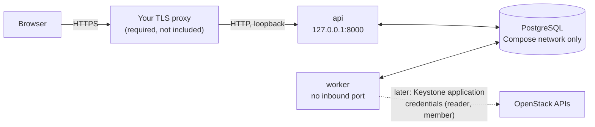

[← OVLM home](../README.md)

# Install guide (evaluation, Docker Compose)

| Field | Value |
|---|---|
| Status | **Implemented, partly integration tested.** The stack in this guide starts and passes `make smoke` in CI. A TLS-fronted, production-mode install is **not** lab validated; the Felcloud lab connected a real cloud with this development stack. For a real cloud, see [install-guide-real-cloud.md](install-guide-real-cloud.md). |
| Audience | An operator who wants to evaluate OVLM on a throw-away host |
| Last updated | 2026-11-04 |

> [!WARNING]
> **OVLM is pre-alpha and not lab validated.** The renewal workflow has not run end to end on a real cloud.
> Do not point it at a production cloud or a project with workloads you cannot lose.
>
> 🟡 **The encrypted credential store is implemented and reviewed, not lab validated.** OpenStack application
> credentials are sealed by the api and can only be unsealed by the worker
> ([credential-store.md](credential-store.md)). Each secret is bound to the cloud endpoint it was uploaded for; changing
> that endpoint needs a step-up and invalidates the credentials. It has not yet been used against a real cloud.
>
> This guide shows what works today and where the gaps are. It does not describe a finished product.

> [!TIP]
> **Installing next to a real OpenStack project?** Use [install-guide-real-cloud.md](install-guide-real-cloud.md):
> the cloud administrator's part (roles, application credentials, quotas, network paths), production-mode settings,
> the configuration file, the first renewal, paging, backup and a security checklist. It builds on this guide.

## 1. What you get



Four Compose services: `postgres`, `migrate` (runs once), `api` and `worker`. PostgreSQL and the metrics ports are
never published. The api listens on **loopback only** (`127.0.0.1:8000`).

## 2. Prerequisites

| Need | Notes |
|---|---|
| A Linux host you can throw away | Not a shared or production host |
| Docker with the Compose plugin, and GNU Make | `make up` runs `docker compose` |
| A TLS-terminating reverse proxy | **Required.** OVLM sets `Secure` cookies and refuses to start without an external URL (§5) |
| A DNS name for OVLM and a certificate for it | Use `ovlm.example.org` in your notes, never a real name in an issue |
| An authenticator app (TOTP) | Mandatory for the `admin` and `approver` roles |
| Access to an OpenStack project for the credentials (§6) | Optional for a first look; a **dedicated** project |

Clone the repository and stay in its directory for every command below:

```bash
git clone https://github.com/OzarLand/openstack-vm-lifecycle-manager.git
cd openstack-vm-lifecycle-manager
```

## 3. Generate the secrets and start the stack

```bash
make secrets   # random database passwords, the TOTP key and the worker key pair in ./secrets (git-ignored)
make up        # builds both images, starts postgres, migrate, api and worker, waits until healthy
```

`make secrets` never overwrites an existing file. `secrets/totp_key` is the Fernet key that encrypts TOTP secrets
at rest (`auth.totp_key_file`); Compose mounts it into the **api only**. Without it TOTP enrolment fails closed (503). `make up` runs `make secrets` itself, so the first command is
only there to show you where the secrets live.

Check it:

```bash
make smoke     # assertions against the running stack; prints "smoke OK" at the end
```

Back up `./secrets` with the same care as the database. Do not commit it or paste its content into an issue.

### 3a. Back up the TOTP key together with the KEK

Two files in `./secrets` cannot be regenerated without losing data:

| File | What it protects | If it is lost |
|---|---|---|
| `worker_kek` | The worker's private key: every OpenStack application credential and guest SSH key in the database is wrapped to it | Every stored credential is unreadable: upload them all again |
| `totp_key` | The Fernet key that encrypts every user's TOTP secret at rest | **Every admin and approver is locked out of TOTP**: no step-up, so no approval, no credential upload, no destructive confirmation. Each user must be reset and enrol again, and with no working admin that means the bootstrap CLI |

Back them up **together**, at the same time as a database backup, to a place with the same protection as the
database itself (an encrypted backup, an offline copy, a secret manager). A database backup restored without the
`totp_key` and the `worker_kek` of the same date is of little use. Never put either file in a ticket, a chat or the
repository.

**File modes.** The key files are `0400` (read by the owner only):

- `worker_kek` is `0400` and stays owned by your host user: the worker's launcher reads it once as root and copies it
  into a tmpfs readable by uid `ovlm` only (security-model.md §5.1).
- On a real installation, make `totp_key` `0400` **owned by the uid the api runs as** (`10001` in the image), so
  that no other host user can read it:

  ```bash
  # ⚠️ State-changing: changes the owner and mode of the TOTP key file. Undo: chown back and chmod 0444.
  sudo chown 10001:10001 secrets/totp_key && sudo chmod 0400 secrets/totp_key
  ```

  `make secrets` leaves the development key at `0444` so that the development stack works without `sudo`: Compose
  mounts a file secret with its host owner and mode, and a `0400` file owned by your host user is unreadable by the
  api's uid. Do not keep that mode outside a development machine.

Restoring: put both files back at their paths with the same modes **before** `make up`, then restore the database.
`ovlm kek status` (in the worker) shows whether every stored secret is wrapped to a key the worker holds. The
full procedure, `make backup` and `make restore`: [backup-restore-upgrade.md](backup-restore-upgrade.md).

> [!NOTE]
> `compose.yaml` is the **development and CI** file. It sets `OVLM_DEVELOPMENT_MODE: "true"` and publishes the api
> on loopback. §5 shows how to switch the api to production-mode checks. Nothing in this guide makes the stack
> highly available or backed up.

## 4. Create the first admin (enrolment link)

There is no default account and no password option. You create the admin without a password and get a
**single-use enrolment link**:

```bash
docker compose exec api ovlm admin create --username alice --display-name "Alice Example" --enrol-link
```

The link is printed on stdout. It works **once** and is valid for 72 hours by default (`auth.enrolment_link_hours`).
Without `OVLM_EXTERNAL_URL` (the unmodified Compose file) the command prints only the path, `/enrol/<token>`. Put
your address in front of it, for example `http://127.0.0.1:8000/enrol/<token>` for a local look, or your external
URL once §5 is done. Open it in your browser, then:

1. Choose a password. The form refuses a password that breaks the policy.
2. Sign in, then open `/account/totp` and enrol your authenticator app. Scan the code, then confirm with a
   six-digit code. TOTP is mandatory for `admin` and `approver`. Approvals and destructive confirmations ask for a
   fresh code each time.
3. Create other users through the API (`POST /api/v1/users`). Each one gets an enrolment link too. The admin never
   sets anyone's password.

If you lose the link before using it, or it expires, ask for a new one with `--reissue`:

```bash
docker compose exec api ovlm admin create --username alice --enrol-link --reissue
```

It works only for an admin who **never finished enrolment** (no password set yet). It revokes every earlier unused
link of that user, prints a new single-use link, and is audited (`user.enrolment_link.reissue`). An admin who already
enrolled and lost their credentials is reset by another admin instead.

Every use of this command is audited with `principal_type=system`, `auth_method=cli`. A `--reissue` also records the
OS user who ran it (`SUDO_USER`, else `USER`) and the host name (in a container, the container id): **a shell in the
api container is enough to bootstrap an admin who never enrolled**, so treat `docker compose exec api` access like
OVLM admin access.

### Shell access to the worker

Enter the worker as its own user, never as root:

```bash
docker compose exec -u ovlm worker sh
```

The worker container starts as root only for its launcher, which copies the KEK and then drops to `ovlm`; no process
runs as root after start-up (`make smoke` checks it). A plain `docker compose exec worker` would start a **root**
shell holding the container's capabilities, including `CAP_DAC_READ_SEARCH`, which reads every file in the
container, the original KEK included. Use `-u ovlm` for every command, for example
`docker compose exec -u ovlm worker ovlm kek status`.

## 5. Put a TLS proxy in front (required)

OVLM does not terminate TLS. Its session and form cookies carry the `Secure` flag, so a login over plain HTTP from
another machine does not work and must not be attempted.

⚠️ **State-changing.** The settings below change how the api checks requests. Do this on the evaluation host only.

Create `compose.override.yaml` next to `compose.yaml` (Compose reads it automatically):

```yaml
services:
  api:
    environment:
      OVLM_DEVELOPMENT_MODE: "false"
      OVLM_EXTERNAL_URL: "https://ovlm.example.org"   # the public origin; CSRF check and enrolment links use it
      OVLM_HTTP__TRUSTED_PROXIES: "127.0.0.1/32"      # the address(es) the api sees your proxy as, see below
```

Then recreate the api: `docker compose up -d --wait api`.

What the proxy must do:

| Requirement | Why |
|---|---|
| Terminate TLS with a valid certificate for the external URL | Cookies are `Secure` |
| Forward to `http://127.0.0.1:8000` on the same host | The api is published on loopback only |
| Set `X-Forwarded-For` to the real client address, and drop any value the client sent | OVLM trusts that header **only** from `trusted_proxies` and uses it for audit |
| Not expose `/metrics` | The api answers 404 for it on the public port; keep it so |
| Not cache or rewrite responses | The UI uses HTMX fragments |

⚠️ **Check the address the api sees.** With Docker's port publishing, the api may see the Docker bridge gateway
instead of `127.0.0.1`. If every client in the audit log has the same address, add that address to
`OVLM_HTTP__TRUSTED_PROXIES` (a comma-separated list). **This guide has not verified this on a real host.** Never
trust a wider range than your proxy.

With `OVLM_DEVELOPMENT_MODE` off, the api **refuses to start without** `OVLM_EXTERNAL_URL`, and the worker refuses
to start without its separate Ansible user (`compose.yaml` sets it). Treat a start-up error as the check working.

## 5a. Reaching OpenStack through an egress proxy (optional)

Some projects have **no direct Internet**: the OpenStack APIs, the package archives and the registries are reached
through an operator-provided proxy. OVLM supports one that allows `CONNECT` to port 443 only (plain HTTP refused).
The rule is: **the worker reaches the OpenStack APIs through the proxy, and reaches guests directly.**

Put the settings in a `.env` file next to `compose.yaml` (Compose reads it; it is git-ignored):

```bash
HTTPS_PROXY=http://proxy.example:3128
# Hosts and networks that must NOT use the proxy: loopback, the Compose service names, and the project subnet(s)
# and any guest addresses. Keep the loopback entries.
NO_PROXY=localhost,127.0.0.1,::1,postgres,api,10.20.0.0/24
```

| What | Behaviour |
|---|---|
| `compose.yaml` | Passes `HTTPS_PROXY`, `https_proxy`, `NO_PROXY`, `no_proxy` to the **worker** only (the api never calls OpenStack), and the same values as **build arguments** of the worker image. Both unset: no proxy |
| OpenStack API calls (openstacksdk, keystoneauth, `requests`) | Use the proxy, except for hosts matched by `NO_PROXY` (host names, domain suffixes, IP addresses and CIDR blocks). Unit tested: `tests/unit/test_egress_proxy.py` |
| SSH to guests (host-key scan, Ansible) | Never uses the proxy: OpenSSH does not read these variables |
| The external health probe (OVLM's own HTTP check of a guest) | **Never** uses a proxy, whatever the variables say (`UrllibGetter` builds its opener with an empty proxy map). It must see the guest, not a proxy's answer. Unit tested |
| Git clone of the automation repository | Runs with a scrubbed environment; only `HTTPS_PROXY`, `NO_PROXY` and their lowercase forms are passed through, so an `https://` repository goes through the proxy. An `ssh://` repository must be reachable directly |

⚠️ `NO_PROXY` must contain the project subnet(s): if an OpenStack endpoint or a guest sits on the project network,
the proxy must not be used for it. CIDR blocks are honoured by `requests` (the SDK) for IP-address URLs only.
**Status:** unit tested; not yet verified against a real proxy (the Felcloud lab run is the first test).

**Building the images behind such a proxy.** `docker compose build` uses the same `HTTPS_PROXY`/`NO_PROXY` from `.env`
as build arguments. The Dockerfile's apt sources use **`https://`** by default (`APT_URI_SCHEME`, set it to `http`
with `--build-arg` to restore the base image's own sources), so no hand-built base image is needed. pip and the git
fetch of the pinned collection honour the proxy variables too. A TLS-intercepting proxy needs its CA as the optional
`pip_ca` build secret (pip, git and apt use it). The Docker **daemon** needs the proxy for image pulls: a systemd
drop-in `Environment="HTTPS_PROXY=..."` for `docker.service` (the lab kit writes it).

Hosts the proxy must allow for a build and a first start: the Debian archive (`deb.debian.org`,
`security.debian.org`), `pypi.org` and `files.pythonhosted.org`, `github.com`, and the registry of the base images
(Docker Hub: `registry-1.docker.io`, `auth.docker.io`, `production.cloudflare.docker.com`).

## 6. Create the two Keystone application credentials

OVLM uses two credentials, one per purpose, in **one dedicated project**:

| Credential | Role | Used for |
|---|---|---|
| `ovlm-inventory` (reader) | `reader` | Inventory and readiness. Read only. |
| `ovlm-renewal` (member) | `member` | Renewal steps only, and only after a human approves |

Why a dedicated project: a `member` can delete **any** server in its project. The blast radius of the write
credential is the whole project, so give OVLM a project that holds only the VMs it manages
([security-model.md §4.2](security-model.md)).

The cloud administrator should:

1. Create a **dedicated project** and a **dedicated Keystone service user** (not a human account).
2. Give that user the `reader` and `member` roles in that project only. No `admin`, no other project.
3. As that user, create the two application credentials. Replace the date with an expiry of at most 180 days:

```bash
# ⚠️ State-changing: creates a credential. The secret is shown ONCE; store it in a password manager or a secret file.
openstack application credential create ovlm-inventory --role reader --expiration 2027-01-31T00:00:00

openstack application credential create ovlm-renewal --role member --expiration 2027-01-31T00:00:00
```

Do **not** pass `--unrestricted`. Without it, the credential cannot create other credentials or trusts. Do not
paste the output anywhere. (These are standard OpenStack client commands, not OVLM commands. Flags differ a little
between client releases; check `openstack application credential create --help`.)

Least-privilege checklist:

- [ ] One project, one purpose. No other workloads in it.
- [ ] Roles are exactly `reader` and `member`. The design has OVLM reject a credential whose token shows other roles.
- [ ] Neither credential is unrestricted.
- [ ] Both have an expiry. The design warns at 30 and 7 days before it. Rotation is done by the cloud administrator, out of band.
- [ ] Access rules for the reader credential are recommended (`GET` only) but optional. For the member credential
      they are **not** recommended in the MVP ([security-model.md §4.4](security-model.md)).
- [ ] TLS verification to the cloud stays on. OVLM refuses `insecure`.
- [ ] You asked the cloud administrator which policy defaults apply (`enforce_new_defaults`). If the cloud differs
      from what the design assumes, please [tell us](../.github/ISSUE_TEMPLATE/cloud-behaviour-report.yml).

🛑 **Where the credentials go.** Upload them to OVLM's encrypted credential store (sealed by the api, unsealed only
by the worker): [credential-store.md §3](credential-store.md#3-registering-a-project), step by step in
[install-guide-real-cloud.md §6](install-guide-real-cloud.md#6-ovlm-side-connect-the-project-and-register-a-vm).
Never put a credential into an environment value or `compose.yaml`. The worker-only file source
`renewal.credentials_dir` is for development only: settings refuse it unless `development_mode` is on.

## 7. Inventory sync

**In OVLM.** Once a project connection's read credential is uploaded and validated (`state: active`), the worker
syncs the project's inventory with it: every `inventory.sync_interval` (default 900 seconds; `0` turns the periodic
sync off) and on request, `POST /api/v1/projects/<project connection id>/syncs` (operator or admin; an API token
needs the `inventory:sync` or `operate` scope). The request answers 202 with the run, or 409 while a sync of that
project is queued or running. `GET /api/v1/projects/<id>/syncs` lists the sync records (status, kind, counts,
error) and the recent runs; a missing, failing, expired or re-bound credential, or a token scoped to another
OpenStack project, shows there as a failed sync with its reason and changes nothing.

**Read-only check from a `clouds.yaml`.** `ovlm inventory sync --dry-run` reads one project and prints counts only.
It writes nothing and needs no database. Create `clouds.yaml` from the **reader** credential, mode 0600, outside the
repository:

```yaml
clouds:
  ovlm-reader:
    auth_type: v3applicationcredential
    auth:
      auth_url: https://keystone.example.org:5000/v3
      application_credential_id: "<id>"
      application_credential_secret: "<secret>"
    region_name: RegionOne
    interface: public
```

Run it from a source checkout (`make install` first, see [CONTRIBUTING.md](../CONTRIBUTING.md)):

```bash
uv run --frozen ovlm inventory sync --cloud ovlm-reader --clouds-yaml /path/to/clouds.yaml --dry-run
```

The command sends only GET and HEAD requests (plus the token request). Environment variables are not read. Its
former database-writing mode is retired: the inventory is filed only by the worker, under the real project
connection, with the credential from the encrypted store.

## 8. What does not work yet

| Gap | Status |
|---|---|
| Encrypted credential store (seal in the api, unseal in the worker) | 🟡 Implemented, reviewed, fixes verified; used on Felcloud (credentials validated against Keystone). Worker container hardening (CS-6) fixed as SF-1 |
| Registering a cloud project through the API | 🟡 Implemented with the credential store; used on Felcloud. No UI page |
| Inventory sync by the worker (on request and periodic, with the stored read credential) | 🟡 Integration tested; ran on Felcloud (read-only) |
| Blue's SSH host key: scan at registration, operator confirmation | 🟡 Integration tested, reviewed; used on Felcloud |
| End-to-end renewal on a real cloud | 🟢 Lab validated on Felcloud only (ACC-01d and three failure scenarios, [mvp-report.md](mvp-report.md)); not production validated |
| A guide for a real cloud | 🟡 [install-guide-real-cloud.md](install-guide-real-cloud.md): docs only, not validated on a second cloud |
| TLS proxy example configuration | ⬜ Not provided. Bring your own |
| Backup and restore of the database and the key | 🟡 Procedure and `make backup` / `make restore`: [backup-restore-upgrade.md](backup-restore-upgrade.md). Integration tested, not lab validated |
| Upgrades between versions | 🟡 Procedure with a read-only preflight that refuses mid-window: [backup-restore-upgrade.md §4](backup-restore-upgrade.md#4-upgrade). No upgrade between two real releases tested yet |
| Alerts and paging | 🟡 Sample Prometheus rules and runbooks: [operations.md](operations.md). Paging is mandatory before any real renewal; not lab validated |

The day-by-day state is in [team-log.md](team-log.md) and the backlog in [roadmap.md](roadmap.md).

## 9. Stop and clean up

```bash
docker compose down        # stops the stack, keeps the database volume
```

🛑 **Destructive.** Deletes the database volume `pgdata`: all users, audit records and inventory. It cannot be
undone without a backup. Run it only on an evaluation host:

```bash
make down
```

To remove the generated secrets as well, delete the `./secrets` directory yourself after `make down`.

## 10. Help

- A step fails or a command does not match this guide: open a *Bug report* issue.
- Your cloud behaves differently from what is described: open a *Cloud behaviour report*.
- Questions: [OzarLand Discussions](https://github.com/OzarLand/ozarland/discussions).

Never paste secrets, `clouds.yaml`, tokens, real hostnames or addresses.
