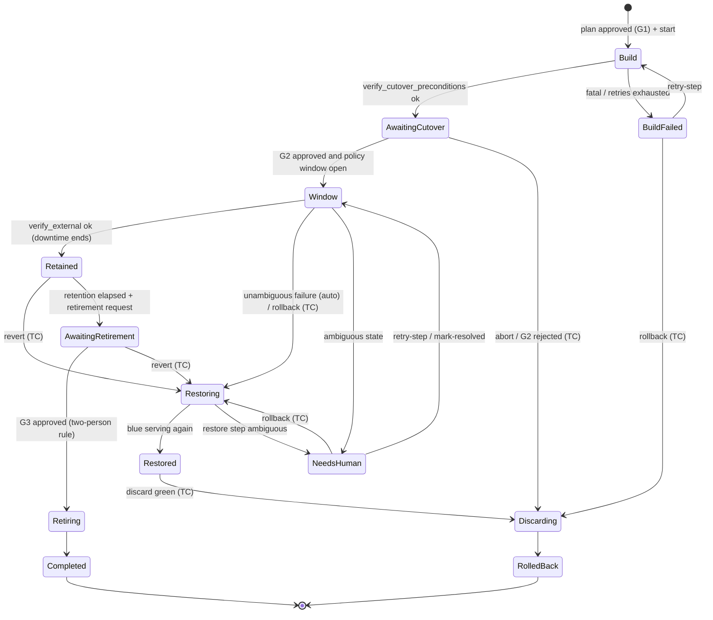

# Renewal workflow — MVP strategy `bluegreen_fip_v1`

| Field | Value |
|---|---|
| Owner | Agent 2 — Chief Architect |
| Status | **Designed** (Phase 1 proposal; nothing implemented, nothing lab-validated) |
| Last updated | 2026-11-04 |

Decision record: [ADR-0004](decisions/ADR-0004-mvp-renewal-strategy.md). Engine semantics (leases, fencing, waits):
[ADR-0003](decisions/ADR-0003-workflow-engine.md). Ownership: [ADR-0005](decisions/ADR-0005-ownership-and-idempotency.md).
Host keys: [ADR-0006](decisions/ADR-0006-guest-ssh-host-key-trust.md). Security controls (ownership guard, approvals,
typed confirmation, credentials): [security-model.md](security-model.md). OpenStack facts carry Agent 3's tags
(openstack-integration.md = "OSI"): SV = SOURCE-VERIFIED, DU = DOCUMENTED-UNVERIFIED, AS = ASSUMPTION.
Ansible phases: [automation-contract.md](automation-contract.md) ("AC").

Names: **blue** = current (old) VM, **green** = replacement. All timeouts are config keys; **defaults TBD in lab**.

## 1. Strategy preconditions (readiness blockers for this strategy)

Checked by readiness (FR-RDY) and re-checked live by `preflight` and `verify_cutover_preconditions`.

| Precondition | Source |
|---|---|
| Blue `ACTIVE`, no task in progress, not in a minimal-construct cell state | OSI §4 (SV), §1 (DU for 2.69) |
| Blue not locked (an admin lock cannot be undone by OVLM) | OSI §7 (SV) |
| Exactly one data volume (or `stateless_service: true`), attached only to blue, not multiattach, not blue's root disk | ADR-0004; OSI §4, §5 (SV) |
| Data attachment `delete_on_termination == false` (mv ≥ 2.79 read). If true: blocker, recommendation shows the PUT fix (mv ≥ 2.85) for the workload owner | OSI §4 (SV) |
| Data volume mounted on blue by UUID/LABEL with `nofail` (probed read-only over SSH) | OSI §4 device naming (SV/DU); needed for revert |
| A floating IP associated with blue's port; green's subnet (= blue's) has a router interface and the router has a gateway on the FIP's external network | OSI §6.1 (SV). Router read by `reader` is AS (not in OSI §1 table) — lab to confirm |
| Quota headroom: instances +1, cores/RAM +flavor (Nova limits, reader). Neutron port headroom advisory only | OSI §7, §9 (SV); Neutron quota needs manager (SV) |
| OVLM can SSH to blue with a confirmed host key; automation SHA pinned and allowlisted | security-model.md §6; AC §1 |
| Green flavor has `disk > 0` (image boot) | ADR-0004; zero-disk image boot is admin-only, OSI §7 (SV) |

## 2. State machine and steps

`NeedsHuman` is an overlay: the run keeps its phase and all resource locks. Locks (service, blue, green, volume, FIP)
are held from run creation until `Completed` or `RolledBack`.

### 2.1 Step table — build phase (no service impact)

Every step follows **probe → decide → act → verify** (ADR-0003). "Lookup" = how a retry finds earlier work.
Every mutating call passes the ownership guard (security-model.md §4.3) first. Retry class = class on exhaustion.

| # | Step | Purpose / action | Precondition probe | Idempotency / lookup | Success verification | Timeout key | Retry class | Destr. | Compensation |
|---|---|---|---|---|---|---|---|---|---|
| B1 | `preflight` | Re-validate plan live (read credential): §1 table, plan hash = approval hash, approval not expired, resolved image/flavor IDs still exist | — | read-only | all checks pass; evidence stored | `timeouts.preflight` | retryable (API errors) / fatal (check fails) | no | none |
| B2 | `claim_resources` | Add `ovlm:managed` tag to blue and FIP, metadata `ovlm.managed` on volume (ADR-0005) | IDs equal plan; resources exist | set-semantics (re-adding a tag is a no-op) | markers read back | `timeouts.claim_resources` | retryable | no | none (markers stay) |
| B3 | `create_green` | Nova create: image, flavor, port on blue's subnet, SGs, AZ = volume AZ, user-data (`ovlm` user public key), tags `ovlm:managed`, `ovlm:run:<id>` (mv ≥ 2.52) | quota still sufficient | ledger row `intended` committed first; lookup `tags=ovlm:run:<id>` + `^name$` (OSI §3, SV): 0 → create, 1 → adopt, >1 → needs_human | server id recorded in ledger | `timeouts.green_create_call` | retryable (5xx, timeout) / fatal (`OverQuota`, 400) | no | delete green (Discarding) |
| B4 | `wait_green_active` | Poll server status | server exists in ledger | poll only | `ACTIVE`; `ERROR` → evidence `fault.message` (e.g. NoValidHost, OSI §7 SV) | `timeouts.green_build` | ERROR → fatal for this attempt; see §6 capacity | no | delete green |
| B5 | `wait_green_ssh` | Read console log for host-key fingerprints, keyscan via guest-access path, pin (ADR-0006) | green ACTIVE | fingerprint stored in step evidence; re-run re-reads | SSH login with `StrictHostKeyChecking=yes` | `timeouts.green_host_key`, `timeouts.green_ssh` | retryable → needs_human ("host key unverifiable") | no | delete green |
| B6 | `green_preflight` | AC §3.1 `preflight.yml` on green (if present) | SSH ok | read-only playbook | result `ok` | `automation.timeout.preflight` | retryable | no | delete green |
| B7 | `configure_green` | AC §3.2 `configure.yml` on green, no data | green ACTIVE | idempotent playbook; rerun safe (AC §4) | exit 0 + `ovlm.result/1` ok | `automation.timeout.configure` | per AC §6 (retryable / fatal) | no | delete green |
| B8 | `verify_cutover_preconditions` | Re-probe §1 live + green port has fixed IP on the subnet + external baseline probe of the service via FIP (blue serving) | — | read-only | all pass | `timeouts.preflight` | retryable / fatal | no | delete green |
| G2 | `await_cutover` | Wait for cutover approval (if policy requires) **and** policy window open | approval bound hash = plan hash | waiting step | approval valid at the moment W1 is claimed | `approval.validity.cutover` | expired → stays waiting, new request needed | — | abort → Discarding |

### 2.2 Step table — downtime window

Downtime starts when W1 is first claimed. No human gate inside the window.

| # | Step | Purpose / action | Precondition probe | Idempotency / lookup | Success verification | Timeout key | Retry class | Destr. | Compensation |
|---|---|---|---|---|---|---|---|---|---|
| W1 | `quiesce_old` | AC §3.4 on blue: stop units, unmount, `sync`; **fstab entry kept**; returns marker checksum | blue ACTIVE, volume attached to blue, G2 valid | idempotent playbook ("already unmounted → ok") | result ok + marker checksum stored | `automation.timeout.quiesce` | **needs_human** on any failure (AC §6) | **yes** (outage) | restore (S6–S9) |
| W2 | `stop_old` | Nova stop blue (OSI §7, SV) | W1 ok; blue ACTIVE or already SHUTOFF | skip if SHUTOFF | status `SHUTOFF`, no task | `timeouts.server_stop` | retryable → needs_human | **yes** | restore |
| W3 | `detach_volume` | `DELETE /servers/{blue}/os-volume_attachments/{vol}` (202, OSI §4 SV) | blue SHUTOFF, unlocked; volume `in-use` on blue only | skip if volume `available` with no attachment; if `detaching` → wait | volume `available`, no attachments | `timeouts.volume_detach` | `in-use` again (rolled back, OSI §4 SV) → retryable once → needs_human; stuck `detaching` → needs_human (§6) | **yes** | restore (S5) |
| W4 | `snapshot_volume` (optional) | Cinder snapshot of the `available` volume | volume `available` | ledger + name lookup (ADR-0005) | snapshot `available` | `timeouts.snapshot` | retryable → needs_human | no | none (kept until retirement) |
| W5 | `attach_volume_green` | `POST /servers/{green}/os-volume_attachments` (hot attach) | volume `available`; green ACTIVE, ours | read `os-volume_attachments` first; "already attached to green" = success (OSI §3, SV) | volume `in-use`, attachment to green | `timeouts.volume_attach` | `error_attaching` / stuck `reserved` → needs_human (OSI §4, SV) | **yes** | restore (S4–S5) |
| W6 | `data_attach_green` | AC §3.3 on green: locate by-id device, `blkid` decision table, mount by UUID | volume attached to green | playbook decision table never reformats existing fs | result ok, `fs_uuid` = profile, marker checksum = W1 value | `automation.timeout.data_attach` | **needs_human** on any failure (AC §6) | no | restore (S2–S5) |
| W7 | `start_service_green` | AC §3.5 | W6 ok | idempotent | result ok | `automation.timeout.start_service` | retryable → restore | no | restore |
| W8 | `healthcheck_green` | AC §3.6 on green (internal), repeated with backoff | W7 ok | read-only | exit 0 and marker checksum equal | `healthcheck.max_attempts`, `healthcheck.interval`, `automation.timeout.healthcheck` | exhausted → auto restore | no | restore |
| W9 | `move_fip` | `PUT /floatingips/{id} {port_id: green_port}` (+`fixed_ip_address` if several, OSI §6.1 SV) | FIP on blue's port **or** already on green's | pure state set; repeat-safe (OSI §3, SV). Map 404 `ExternalGatewayForFloatingIPNotFound` text explicitly | FIP `port_id` = green port; FIP `status` ACTIVE (DU) | `timeouts.fip_status` | 404 gateway / 409 / 403 → auto restore (nothing changed, OSI §6.1 SV) | **yes** (cutover) | restore (S8) |
| W10 | `verify_external` | HTTP probe of `health_check.external` via the FIP from the worker; response must come from green (marker/identity field) | W9 ok | read-only | probe ok `external_verify.required_successes` times | `timeouts.external_verify` | exhausted → auto restore | no | restore |

W10 success commit (one transaction): `downtime_ended_at`, managed VM roles (green `current`, blue `retained`), audit.

### 2.3 Retention and retirement

| # | Step | Action | Probe | Idempotency | Verification | Timeout key | Retry class | Destr. | Compensation |
|---|---|---|---|---|---|---|---|---|---|
| R1 | `retain_old` | Lock blue, `locked_reason='ovlm:retained:<run>'` (mv ≥ 2.73) | blue SHUTOFF, no volumes but root | skip if locked by OVLM | `locked=true`, reason matches | `timeouts.server_lock` | retryable → needs_human | no | unlock (S1) |
| R2 | `await_retention` | Timer until `retention_period` elapsed; revert available | — | waiting step | — | policy `retention_period` | — | — | revert |
| G3 | `await_retirement` | Retirement request + approval (two-person rule, TC of blue) | bound hash includes blue ID and run | waiting | valid approval | `approval.validity.retirement` | — | — | — |
| X1 | `retire_old` | Unlock (own lock), re-read attachments (only root; `delete_on_termination` known), delete blue, delete optional snapshot | blue SHUTOFF, locked by OVLM, no data volume attached | `404` on probe = already deleted | server gone (404) | `timeouts.server_delete` | retryable → needs_human | **yes** (irreversible) | none (data volume untouched; leftover BFV root volume reported, not deleted) |

## 3. Approval gates and downtime

| Gate | Position | Required when | Who | Bound to |
|---|---|---|---|---|
| G1 plan | before run start | policy `approvals.plan` | approver ≠ requester | plan hash |
| G2 cutover | after B8, before W1 (start of downtime) | policy `approvals.cutover`; if not required, the operator's cutover request still needs a TC of blue in a human session | approver ≠ requester, step-up, TC | plan hash (+ run id) |
| G3 retirement | after retention | always (two-person rule) | approver ≠ requester ≠ plan approver | plan hash + blue ID |

Rationale for G2's position: downtime begins at quiesce; approving at the FIP move would approve after the outage began
and stretch it while waiting for a human (ADR-0004). W1 is only claimed when G2 is valid **and** now is inside an allowed
policy window; a G2 approved outside a window waits.

**Downtime (OVLM-measured)** = `downtime_ended_at − downtime_started_at`, from the first claim of W1 to the first
successful W10 (or to S9 success on restore). B8's external baseline proves blue served just before. Precision is bounded
by `external_probe.interval`. It is OVLM's view, not user-perceived: established connections through the old NAT are
lost (OSI §6.1, AS) and FIP propagation is asynchronous (DU). Exported as `ovlm_renewal_downtime_seconds` and stored on
the run; the window budget `renewal.max_window_duration` (policy, optional) only triggers an alert, never an automatic
action.

## 4. Restore sequence (rollback in window, revert after cutover)

One convergent sequence; each step probes and is **skipped if already satisfied**. Target: volume attached to blue,
blue ACTIVE and healthy, FIP on blue's port, green SHUTOFF. Used by in-window auto rollback, operator rollback and revert.

| # | Step | Action | Skip if | Failure |
|---|---|---|---|---|
| S1 | `unlock_old` | unlock blue (own lock) | not locked | locked by admin → needs_human (§6) |
| S2 | `quiesce_green` | AC `quiesce.yml` on green (role `new`) | volume not attached to green or green not ACTIVE | needs_human |
| S3 | `stop_green` | Nova stop green | green SHUTOFF / gone | retryable → needs_human |
| S4 | `detach_from_green` | detach volume from green | volume not attached to green | as W3 |
| S5 | `attach_to_old` | attach volume to **stopped** blue (allowed in STOPPED, OSI §4 SV) | attached to blue | as W5 |
| S6 | `start_old` | Nova start blue; fstab remounts, enabled units start | blue ACTIVE | retryable → needs_human |
| S7 | `recover_old_service` | AC `rollback_hooks.yml` on blue if present, then `healthcheck.yml` (role `old`) | — | exhausted → needs_human |
| S8 | `move_fip_to_old` | FIP → blue's port | FIP already on blue | needs_human |
| S9 | `verify_external_old` | external probe via FIP | — | needs_human |

Auto restore in window (`renewal.auto_rollback_in_window`, default `true`) runs only when every resource's state is
known and expected; otherwise needs_human. After W10 success, restore runs only on operator `revert` (TC). After
restore, green stays SHUTOFF for diagnosis until the operator discards it (TC). Restore carries data **forward**: what
green wrote stays on the volume (ADR-0004 consequences).

## 5. Interruption and resume

| Event | Behaviour |
|---|---|
| Worker crash (SIGKILL / host loss) | Steps keep their lease until expiry; then another (or the restarted) worker claims with attempt+1 and a new fencing token. OpenStack steps re-probe and continue waiting or act. `create_green` resumes by ledger + tag lookup. Ansible steps: their lease is claimed as `automation.timeout.<phase>` + kill grace + `worker.fence_margin`, so no second Ansible run can start on the same VM while an orphan might still run (a killed container kills its children; the startup sweeper removes run dirs). Non-data phases (preflight, configure, start_service, healthcheck) rerun. **Data phases (W1 quiesce, W6 data_attach, S2) → needs_human** with an automatic read-only probe (attachment state from OpenStack, `findmnt` over SSH) attached as evidence (AC §6). |
| Worker SIGTERM (graceful) | Stop claiming; waiting steps simply stay waiting; non-data Ansible gets SIGTERM → attempt `interrupted` (retryable); data phases may finish within `worker.shutdown_grace`, else as crash. |
| DB restart / outage | Worker cannot heartbeat or commit; it self-fences non-data steps at lease end − margin; data-phase subprocesses run to completion (bounded by their timeout, which their lease covers). On reconnect the fenced commit succeeds if the token is still current, else the result is discarded and the next attempt re-probes. Nothing is committed twice (ADR-0003). |
| OpenStack API outage mid-step | Connection errors / 5xx are retryable with backoff inside the step deadline; poll steps keep polling. Deadline reached → needs_human (state unknown), never fatal. No automatic restore while the API is unreachable (restore also needs it). |
| Keystone token expiry | SDK re-authenticates; credential expired → needs_human, run blocked (security-model.md §4.4). |
| Operator abort | Build / awaiting cutover: honoured at step boundary (configure is SIGTERMed) → Discarding (green deleted, TC given with abort). Window: current step finishes (data phases are not interrupted), then restore. After W10: not offered — use revert. During restore: refused. |
| Approval expires while waiting | G2 stays waiting; new request. Expiry is re-checked when W1 is claimed. |
| Stale worker after takeover | Its commit fails on fencing token; its in-flight OpenStack call may still land — the next attempt's probe sees it and skips or verifies (ADR-0003). |

## 6. States that need an OpenStack admin

OVLM's write credential is `member`: it cannot force-detach, reset volume or server state, unlock an admin lock,
detach from a VM on a down compute host, or evacuate (OSI §4, §7, §8, §9, all SV). OVLM stops with `needs_human`, keeps
locks, and shows: the stuck resource, its status, server action list (reader), OpenStack request IDs, and the admin action
needed. After the admin acts, an operator uses `mark-resolved` (TC; approver if the next step is destructive); the
engine re-probes before continuing.

| Stuck state | Detected by | Admin action (outside OVLM) |
|---|---|---|
| Volume `detaching` / `reserved` / `attaching` past deadline; attachment `error_attaching` | W3, W5, S4, S5 | Cinder force-detach / reset-status |
| Detach refused because blue's compute host is down | W3 (409/error text) | fix host or evacuate |
| Blue locked by admin | B1, S1 | unlock |
| Server in `ERROR` with task state; delete stuck | B4, X1, Discarding | reset-state / force-delete |
| FIP stays `DOWN` after association | W9 | L3/OVN agent investigation |

## 7. Failure scenarios (mission list)

| Scenario | Expected behaviour |
|---|---|
| Interrupted workflow | §5. No duplicate green (ledger + tag), no duplicate attach (Nova refuses, OSI §4 SV), data phases go to needs_human. |
| Insufficient capacity | B1 quota pre-check refuses early (advisory: cannot see host capacity, OSI §7 SV). `OverQuota` at create → fatal, BuildFailed. `NoValidHost` (server `ERROR`) → green deleted and B3 retried up to `retry.max_attempts.create_green`, then BuildFailed. Blue untouched. |
| Failed provisioning (bad image/flavor, ERROR) | B3/B4 fatal → BuildFailed with fault evidence; green kept until operator rollback (TC) deletes it (only `ovlm:run:<this run>` resources). Blue untouched. |
| Failed Ansible configuration | B7 per AC §6: retryable bounded, fatal → BuildFailed. Volume never left blue. |
| Failed health check | W8 exhausted → auto restore S2–S9 (FIP never moved). Recorded downtime includes restore. |
| Failed cutover | W9 error: FIP unchanged (single transaction, OSI §6.1 SV) → auto restore. W10 failure → restore including S8. Unknown FIP state → needs_human. |
| DB or worker restart | §5. Resumes from persisted step; fenced commits; waits are timers, not threads. |
| Detach refused / stuck (extra) | W3 needs_human; blue stays stopped; operator may roll back (S6 start blue) or call an admin (§6). |
| Blank or wrong filesystem on green (extra) | W6 needs_human, no mkfs (AC §3.3); operator rollback. |

## 8. Agent 6 assumptions — confirmed / rejected

| # | Assumption (source) | Verdict |
|---|---|---|
| 1 | Profile is a DB/JSON document owned by the architect (AC §1) | **Confirmed**: `profile_version.spec` jsonb, immutable versions (data-model.md §5). |
| 2 | ansible-runner as subprocess, worker owns the step and can kill the process group (AC §2) | **Confirmed**; runs as `ovlm-ansible` OS user with scrubbed env (security-model.md §6.5). |
| 3 | Engine provides per-VM lock (AC §2, test-env §7.2) | **Confirmed**: `resource_lock` for service, server, volume, FIP, port, held by the run; plus Ansible lease rule in §5. |
| 4 | Workflow state persisted and re-derivable after crash (AC §8, test-env §7.1) | **Confirmed**: ADR-0003; truth re-derived from OpenStack + read-only probe. |
| 5 | Result via `ovlm_result_path` file route (AC §3.7) | **Confirmed, clarified**: path is on the **controller** (`<run_dir>/artifacts/ovlm-result.json`); playbooks write it with `delegate_to: localhost`, `run_once: true`. `set_stats` not used in MVP. Validated as untrusted input: size ≤ `automation.result_max_bytes`, strict `ovlm.result/1` schema (security-model.md §6.4). |
| 6 | Host-key trust: console log or `accept-new` (AC §2, test-env §7.5) | **Decided**: console-log fingerprint by default, TOFU only as audited per-profile opt-in (ADR-0006, security-model.md §6.2). Blue: fingerprint confirmed at registration. |
| 7 | `quiesce` removes the fstab line only after OVLM confirms handover (AC §3.4) | **Rejected**: quiesce never edits fstab in MVP; blue's mount must be by UUID/LABEL with `nofail` so revert works by attach-while-stopped + start (§4). Contract change requested. |
| 8 | Human go before `quiesce` and before cutover (AC §3.4, §10) | **Confirmed as one gate**: G2 before W1 covers both; no gate inside the window. |
| 9 | OVLM's own rollback comes first; `rollback_hooks` optional (AC §3.8) | **Confirmed**: restore sequence §4; hooks run in S7 if present. |
| 10 | Exit-code classification and data-phase needs_human (AC §6) | **Confirmed**; worker-crash during data phase → needs_human with automatic read-only probe evidence. |
| 11 | Timeout values in AC §6 | **Rejected as defaults**: they become config keys `automation.timeout.<phase>`, defaults TBD in lab (TCG timings not representative, ADR-0001). |
| 12 | `expected_serial` = volume ID prefix (AC §3.3) | **Interface confirmed** (OVLM passes the full volume ID; playbook prefix-matches); behaviour is AS (OSI §4) → lab item. |
| 13 | Unverified profiles need human override to run (AC §9) | **Confirmed**: MVP never auto-starts runs; an `unverified` reproducibility verdict is a readiness warning; starting needs G1 regardless. |
| 14 | Who cleans up OVLM-created unreferenced resources (test-env §7.3) | **OVLM detects** (orphan report); deletes only ledger resources of its own runs as defined run steps; other orphans are manual, confirmed actions (ADR-0005). |
| 15 | Where OVLM runs in the lab (test-env §7.4) | On the quick-lab VM (Compose). Guest SSH to fixed IPs needs `guest_access`: a route to the tenant subnet or a jump host — **Agent 6 to verify which works in the lab**. |
| 16 | Failure-injection expectations rows 1–11 (test-env §5) | **Confirmed** as mapped in §7, with two changes: row 3/4 green is deleted by operator rollback, not automatically; row 2 `OverQuota` is fatal (not retryable). |

## 9. Lab validation items added by this design

Console-output role and Ubuntu 24.04 fingerprint printing (ADR-0006); router read by `reader`; FIP `status` transition
and real downtime; detach/attach timings on LVM/iSCSI; behaviour of `tags=` lookup for a server in `BUILD`
(OSI open question 6); attach to a `SHUTOFF` server and remount at boot (S5/S6).
