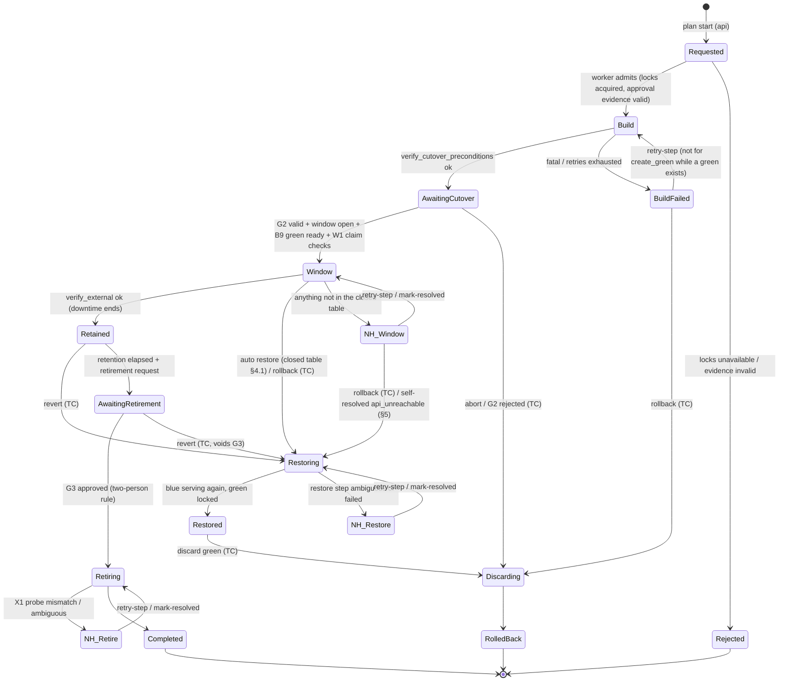

# Renewal workflow — MVP strategy `bluegreen_fip_v1`

| Field | Value |
|---|---|
| Owner | Agent 2 — Chief Architect |
| Status | **Designed** (Phase 1 proposal; nothing implemented; partly lab-observed by EXP-01 and EXP-01b, see §10) |
| Last updated | 2026-11-04 |

> **Revision 2026-11-04** (after the SRE review, the security review and EXP-01). Addressed: SRE-R-1 (S6 boot-cycle,
> units-enabled precondition), SRE-R-2 (fence gate, via ADR-0003), SRE-R-3 (`first_use` hard-wired `false`), SRE-R-5,
> -6, -7, -8, -9, -10, -11, -12, -13, -14, -15, -16, -17, -18; SEC-R-1 (approval evidence re-validated by the worker),
> SEC-R-2 (requester set), SEC-R-8, SEC-R-23, SEC-R-24, SEC-R-26, SEC-R-29, SEC-R-30 (closed auto-restore table, §4.1),
> SEC-R-33; testing-strategy open point 1 (`NoValidHost` is fatal, §7); EXP-01 results (§10). Maintainer decision
> **D-1 = option B** (2026-11-04, relayed by Agent 1): no automatic restore after the service ran on green unless a
> pre-handoff snapshot was taken (§4.1).
>
> **Revision 2026-11-04 (round 2)** (delta reviews, EXP-01b, maintainer decisions M9). Addressed: host-key fallback
> after an empty console (ADR-0006, B3/B5); green proven ready before T0 (B9 `verify_green_ready`, EXP-01b finding 2);
> FIP move time recorded (§10); SEC-R-2/-10/-11 (self-approval flag, action-bound TOTP step-up, solo installs, §3.1);
> SEC-R-28 (readiness never runs repo code on blue by default); SEC-R-34 with SRE-R-26 (bounded self-resolution,
> precedence, §5.1); SEC-R-36 (2) (probe command list); SRE-R-23 (evidence-invalid row), SRE-R-24 (signal semantics,
> ADR-0003), SRE-R-25, -27, -28, -29, -30, -31; D-1 conditions 3 and 4 (rollback consequence text, snapshot honesty).
>
> **Revision 2026-11-04 (image/docs alignment)**: X1 **keeps** the pre-handoff snapshot (§4, X1 row); OVLM never deletes
> snapshots, orphans are only reported. B8/W10/S9 reference the external-probe identity contract
> ([automation-contract.md §3.6.1](automation-contract.md)).

Decision record: [ADR-0004](decisions/ADR-0004-mvp-renewal-strategy.md). Engine semantics (leases, fencing, waits):
[ADR-0003](decisions/ADR-0003-workflow-engine.md). Ownership: [ADR-0005](decisions/ADR-0005-ownership-and-idempotency.md).
Host keys: [ADR-0006](decisions/ADR-0006-guest-ssh-host-key-trust.md). Security controls (ownership guard, approvals,
typed confirmation, credentials): [security-model.md](security-model.md). OpenStack facts carry Agent 3's tags
(openstack-integration.md = "OSI"): SV = SOURCE-VERIFIED, DU = DOCUMENTED-UNVERIFIED, AS = ASSUMPTION, plus
**LO = LAB-OBSERVED** (EXP-01/EXP-01b, Felcloud, member-equivalent credential, 2026-11-04; one cloud, few runs).
Ansible phases: [automation-contract.md](automation-contract.md) ("AC").

Names: **blue** = current (old) VM, **green** = replacement. All timeouts are config keys; **defaults TBD in lab**.
EXP-01 times (§10) inform documentation only; they are not defaults.

## 1. Strategy preconditions (readiness blockers for this strategy)

Checked by readiness (FR-RDY) and re-checked live by `preflight` and `verify_cutover_preconditions`.

| Precondition | Source |
|---|---|
| Blue `ACTIVE`, no task in progress, not in a minimal-construct cell state | OSI §4 (SV), §1 (DU for 2.69) |
| Blue `locked == false` (mv 2.73). Whether a lock is an admin lock is not observable to `member`; an admin lock is detected only when unlock fails (SEC-R-6) | OSI §1, §7 (SV) |
| Exactly one data volume (or `stateless_service: true`), attached only to blue, not multiattach, not blue's root disk | ADR-0004; OSI §4, §5 (SV) |
| Data attachment `delete_on_termination == false` (mv ≥ 2.79 read). If true: blocker, recommendation shows the PUT fix (mv ≥ 2.85) for the workload owner | OSI §4 (SV); EXP-01: cloud offers mv 2.100 (LO) |
| Data volume mounted on blue by UUID/LABEL with `nofail` (probed read-only over SSH) | OSI §4 device naming (SV/DU); needed for revert |
| Every unit in `service_units` is **enabled** on blue (`systemctl is-enabled`, read-only), so a boot restarts it. Quiesce stops units and never disables them (SRE-R-1) | AS (Linux/systemd) |
| A floating IP associated with blue's port; green's subnet (= blue's) has a router interface and the router has a gateway on the FIP's external network | OSI §6.1 (SV). Router read by `reader` is AS (not in OSI §1 table) — lab to confirm |
| Quota headroom: instances +1, cores/RAM +flavor (Nova limits, reader). Neutron port headroom advisory only. When `snapshot_before_handoff` is on: Cinder `snapshots` +1 and `gigabytes` + volume size (SRE-R-7) | OSI §7, §9 (SV); Neutron quota needs manager (SV) |
| OVLM can SSH to blue with a confirmed host key; automation SHA pinned and allowlisted; automation lint passed or waived (SEC-R-3) | security-model.md §6; AC §1 |
| Green flavor has `disk > 0` (image boot). OVLM creates **no Cinder volume** in MVP (EXP-01: no working default volume type, §10) | ADR-0004; zero-disk image boot is admin-only, OSI §7 (SV) |

## 2. State machine and steps

`NH_*` are the `needs_human` overlay drawn per phase: **`retry-step` retries the current step in the current phase;
the overlay never changes phase** (SRE-R-18). The run keeps all resource locks while in the overlay. Locks (service,
blue, volume, FIP; green's server and port once known, SRE-R-16) are held from admission until `Completed`,
`RolledBack` or `Rejected`. The `api` only inserts a run in state `Requested`; the worker admits it (ADR-0003,
data-model.md §12).

Operator actions on a parked run (`needs_human`; api-design.md §4 lists every endpoint):

| Action | Who | Effect |
|---|---|---|
| `retry-step` | operator (TC where the step is destructive) | re-queues the parked step; the new attempt starts with a probe |
| `mark-resolved` | operator (+ approver if the current or next step is destructive), TC, attestation | records the manual fix; re-queues the step, which must reach Done from its own probe |
| `reprepare-automation` | **approver, never the run's requester** (run starter, plan creator), human session, password+TOTP step-up, TC of blue | Only when the parked step stopped on `automation_checkout_lost` or `automation_checkout_unverifiable` (the run's verified checkout is gone or its cached copy does not match B6's tree digest; also the older `automation_error` "verified checkout is gone" message). Records **one** authorization (`automation_reprepare`, audited `automation.reprepare.authorized` with run, step, pinned SHA, approver) and re-queues the step as retry-step does. The guest port consumes it before cloning: the normal B6 clone at the pinned SHA (verify, lint, waivers, cache copy), whose tree digest must equal B6's recorded one; outcome on the row and audited `automation.reprepare.used` / `.refused`. A different tree is discarded and parks `automation_reprepare_digest_mismatch` (no further exit: a human checks the repository). A failed clone also consumes the authorization; a new one is needed. Refused (outcome on the signal): wrong role, requester, step-up/TC invalid, another refusal reason, one already pending. |
| `rollback` / `abort` / `revert` / `discard` | operator + TC (phase rules in §5) | see §4.1 and §5 |

### 2.1 Step table — build phase (no service impact)

Every step follows **probe → decide → act → verify** (ADR-0003). "Lookup" = how a retry finds earlier work.
Every mutating call passes the fence gate (ADR-0003), the write-session allowlist and the ownership guard
(security-model.md §4.3). Retry class = class on exhaustion.

| # | Step | Purpose / action | Precondition probe | Idempotency / lookup | Success verification | Timeout key | Retry class | Destr. | Compensation |
|---|---|---|---|---|---|---|---|---|---|
| B1 | `preflight` | Re-validate plan live: §1 table; plan hash recomputed = approval hash; **G1 approval evidence re-validated** (§3.1); resolved IDs still exist; image re-read: `owner`, `visibility`, hash fields unchanged (SEC-R-29, field names AS); security-group IDs exist; write-credential `expires_at` recorded | — | read-only | all checks pass; evidence stored | `timeouts.preflight` | retryable (API errors) / fatal (check fails) | no | none |
| B2 | `claim_resources` | Add `ovlm:managed` tag to blue and FIP, metadata `ovlm.managed` on volume (ADR-0005). **Per-tag add and metadata merge forms only, never replace-all**; read back and verify every pre-existing tag/key intact (SEC-R-24, SRE-R-15; verb semantics AS → lab) | IDs equal plan; resources exist; server tag count < 50 and metadata items < 128 (OSI §2 SV) | set-semantics (re-adding a tag is a no-op) | markers present and foreign markers unchanged | `timeouts.claim_resources` | retryable / **fatal** on tag or metadata limit, or on foreign marker loss | no | none (markers stay) |
| B3 | `create_green` | Nova create: image ID, flavor ID, port on blue's subnet, SG **IDs**, AZ = volume AZ, user-data (`ovlm` user public key and, under `host_key_policy: injected`, an OVLM-generated **bootstrap** host key pair, ADR-0006), tags `ovlm:managed`, `ovlm:run:<id>` (mv ≥ 2.52; LO) | quota still sufficient; no `present` green in ledger for this run | ledger row `intended` committed first; lookup `tags=ovlm:run:<id>` + `^name$` (OSI §3 SV; tag filter LO): 0 → create, 1 → **adopt only if** image ID and flavor equal `resolved`, `created` ≥ ledger commit time, no attached volumes, and `user_id` = OVLM write user (field visibility AS → lab); any mismatch → needs_human "adoption refused" (SEC-R-23); >1 → needs_human | server id recorded in ledger | `timeouts.green_create_call` | retryable (5xx, timeout) / fatal (`OverQuota`, 400) | no | delete green (Discarding) |
| B4 | `wait_green_active` | Poll server status; on `ACTIVE` lock green's port in the success transaction (SRE-R-16) | server exists in ledger | poll only | `ACTIVE`; `ERROR` → evidence `fault.message` (e.g. NoValidHost, OSI §7 SV) | `timeouts.green_build` | **`ERROR` → fatal** (any fault, incl. `NoValidHost`); green kept for diagnosis (§7) | no | delete green (operator rollback) |
| B5 | `wait_green_ssh` | Pin green's host key per `host_key_policy` (ADR-0006): **`injected` (default)**: connect with `StrictHostKeyChecking=yes` against the bootstrap public key, then over that authenticated session regenerate the host keys on green, read the new public keys back, pin them, reconnect, and remove the bootstrap key from the guest; `console`: read fingerprints from the console log (store only the extracted lines + SHA-256 of the console, SEC-R-19); `tofu`: audited opt-in. SSH waits on reachability, never on ACTIVE (EXP-01b: ~85 s after ACTIVE) | green ACTIVE | evidence: pinned fingerprints, policy used, bootstrap key id; re-run re-checks the pin; if rotation was interrupted, the bootstrap key or the new key is accepted only if it matches the evidence | SSH login with `StrictHostKeyChecking=yes` on the rotated key | `timeouts.green_ssh`, `timeouts.green_host_key` | retryable → needs_human ("host key unverifiable") | no | delete green |
| B6 | `prepare_automation` + `green_preflight` | Clone the automation repo **once per run** (submodules disabled), verify `HEAD == SHA`, collections from the repo or the image only (no Galaxy at run time; SEC-R-12), re-run the lint, store as a read-only run-level checkout; window phases copy from it locally (SRE-R-8). Then AC §3.1 `preflight.yml` on green (if present) | SSH ok | checkout re-verified by SHA on rerun | SHA verified; result `ok` | `automation.timeout.preflight` | retryable / fatal (SHA mismatch, lint failed without waiver) | no | delete green |
| B7 | `configure_green` | AC §3.2 `configure.yml` on green, no data | green ACTIVE | idempotent playbook; rerun safe (AC §4) | exit 0 + `ovlm.result/1` ok | `automation.timeout.configure` | per AC §6 (retryable / fatal) | no | delete green |
| B8 | `verify_cutover_preconditions` | Re-probe §1 live + green port has fixed IP on the subnet + **no FIP on green's port** (SRE-R-13) + external baseline probe of the service via FIP (blue serving; identity per [automation-contract §3.6.1](automation-contract.md): the answer must prove it is blue) | — | read-only | all pass | `timeouts.preflight` | retryable / fatal | no | delete green |
| B9 | `verify_green_ready` | **Green proven ready without data** (EXP-01b finding 2: ACTIVE ≠ reachable). Runs after G2 is valid and the policy window is open, immediately before the W1 claim, with no outage: green ACTIVE, no task; SSH login on the pinned key; OVLM-owned read-only probe (`cloud-init status` done, `systemctl is-system-running` not `starting`, AS); AC `preflight.yml` (role `new`) ok. Its success must be younger than `green_ready.max_age` when W1 is claimed, else B9 reruns | G2 valid, window open | read-only | all pass | `timeouts.green_ready` | retryable → stays before T0; exhausted → needs_human (no outage started) | no | delete green |
| G2 | `await_cutover` | Wait for cutover approval (or operator cutover request with TC) **and** policy window open | approval bound hash = plan hash | waiting step | see W1 claim checks | `approval.validity.cutover` | expired → stays waiting, new request needed | — | abort → Discarding |

### 2.2 Step table — downtime window

**W1 claim checks** (in the claim transaction, SRE-R-8, SRE-R-14): G2 approval valid now and its evidence re-validated
(§3.1); policy window open; **B9 succeeded within `green_ready.max_age`**; write-credential `expires_at` > now +
worst-case window (§3); a Keystone token valid beyond the worst-case window, obtained **before** the transaction opens
(only its expiry is checked inside, SRE-R-28 b); `downtime_started_at` written in **this** transaction (first claim
only). G2 expiry is evaluated here only; later
destructive steps re-validate the evidence's integrity, not its expiry, so an approval never expires mid-outage.

**Window budget** (SRE-R-6): before claiming each of W2–W8, if `now − downtime_started_at > max_window_duration`
(policy) and the state is known → auto restore (trigger `budget`). From W9 on the run finishes forward.

| # | Step | Purpose / action | Precondition probe | Idempotency / lookup | Success verification | Timeout key | Retry class | Destr. | Compensation |
|---|---|---|---|---|---|---|---|---|---|
| W1 | `quiesce_old` | AC §3.4 on blue: stop units (never disable), unmount, `sync`; **fstab entry kept**; returns marker checksum (`facts.marker_sha256`, AC §3.7) | blue ACTIVE, volume attached to blue | idempotent playbook ("already unmounted → ok") | result ok + marker checksum stored; with a data volume, an ok result **without** a marker is refused needs_human `quiesce_no_marker` (never skipped) | `automation.timeout.quiesce` | **needs_human** on any failure (AC §6) | **yes** (outage) | restore (S6 boot-cycle) |
| W2 | `stop_old` | Nova stop blue (OSI §7, SV) | W1 ok; blue ACTIVE or already SHUTOFF | skip if SHUTOFF | status `SHUTOFF`, no task | `timeouts.server_stop` | 409 "locked" → needs_human directly (admin lock, §6); other exhaustion → auto restore if blue has no task, else needs_human (SRE-R-29) | **yes** | restore |
| W3 | `detach_volume` | `DELETE /servers/{blue}/os-volume_attachments/{vol}` (202, OSI §4 SV) | blue SHUTOFF, unlocked; volume `in-use` on blue only | skip if volume `available` with no attachment; if `detaching` → wait | volume `available`, no attachments | `timeouts.volume_detach` | `in-use` on blue again (rolled back, OSI §4 SV) → retryable once → auto restore; stuck `detaching` → needs_human (§6) | **yes** | restore (S5) |
| W4 | `snapshot_volume` (optional) | Cinder snapshot of the `available` volume | volume `available` | ledger + name lookup (ADR-0005) | snapshot `available` | `timeouts.snapshot` | failure or deadline → **auto restore** "snapshot failed" (SRE-R-7); a snapshot stuck `creating` is reported as orphan candidate, never deleted | no | none (kept; never deleted by OVLM) |
| W5 | `attach_volume_green` | `POST /servers/{green}/os-volume_attachments` (hot attach; transitions reserved → attaching → in-use, LO) | volume `available`; green ACTIVE, ours | read `os-volume_attachments` first; "already attached to green" = success (OSI §3, SV; 400 "already attached" LO) | volume `in-use`, attachment to green | `timeouts.volume_attach` | volume `available` with no attachment → auto restore; `error_attaching` / stuck `reserved`/`attaching` → needs_human (OSI §4, SV) | **yes** | restore (S4–S5) |
| W6 | `data_attach_green` | AC §3.3 on green: locate by-id device (20-char volume-ID prefix, LO), `blkid` decision table, mount by UUID. **`first_use = false` always** (SRE-R-3): this strategy cannot pass `true`; evidence records the value passed | volume attached to green | playbook decision table never reformats existing fs; blank fs → needs_human | result ok, `fs_uuid` = profile, marker checksum = W1 value (evidence `marker_comparison`) | `automation.timeout.data_attach` | **needs_human** on any failure (AC §6) | no | restore (S2–S5) |
| W7 | `start_service_green` | AC §3.5 | W6 ok | idempotent | result ok | `automation.timeout.start_service` | retryable → needs_human + page, or auto restore if a W4 snapshot exists (§4.1, D-1) | no | restore |
| W8 | `healthcheck_green` | AC §3.6 on green (internal), repeated with backoff; waits on the check, never on a fixed delay (EXP-01: ~10 s to listen on 1 vCPU) | W7 ok | read-only | exit 0 and marker checksum equal (OVLM compares itself and also passes `expected_marker_checksum`; evidence `marker_comparison`; a different marker is retried like unhealthy, then exhausted) | `healthcheck.max_attempts`, `healthcheck.interval`, `automation.timeout.healthcheck` | exhausted → needs_human + page, or auto restore if a W4 snapshot exists (§4.1, D-1) | no | restore |
| W9 | `move_fip` | `PUT /floatingips/{id} {port_id: green_port}` (+`fixed_ip_address` if several, OSI §6.1 SV) | FIP on blue's port **or** already on green's | pure state set; repeat-safe (OSI §3, SV). Map 404 `ExternalGatewayForFloatingIPNotFound` text explicitly | FIP `port_id` = green port; FIP `status` ACTIVE (DU) | `timeouts.fip_status` | 4xx and a GET shows `port_id` unchanged → needs_human + page, or auto restore if a W4 snapshot exists (§4.1, D-1); FIP state unreadable → needs_human | **yes** (cutover) | restore (S8) |
| W10 | `verify_external` | HTTP probe of `health_check.external` via the FIP from the worker, starting **immediately** after W9 (no settle delay: EXP-01b FIP move 1.1–1.3 s, effective at once, LO); response must prove it comes from green: `X-OVLM-Server-Id`, else JSON `server_id`, else JSON `hostname` ([automation-contract §3.6.1](automation-contract.md)); a plain TCP check cannot pass | W9 ok | read-only | probe ok `external_verify.required_successes` times | `timeouts.external_verify` | exhausted → needs_human + page, or auto restore if a W4 snapshot exists (§4.1, D-1) | no | restore |

W10 success commit (one transaction): `downtime_ended_at`, managed VM roles (green `current`, blue `retained`), audit.

### 2.3 Retention and retirement

| # | Step | Action | Probe | Idempotency | Verification | Timeout key | Retry class | Destr. | Compensation |
|---|---|---|---|---|---|---|---|---|---|
| R1 | `retain_old` | Lock blue, `locked_reason='ovlm:retained:<run>'` (mv ≥ 2.73; own lock refuses stop/detach for member, LO) | blue SHUTOFF, no volumes but root | skip if locked by OVLM | `locked=true`, reason matches | `timeouts.server_lock` | retryable → needs_human | no | unlock (S1) |
| R2 | `await_retention` | Timer until `retention_period` elapsed; revert available | — | waiting step | — | policy `retention_period` | — | — | revert |
| G3 | `await_retirement` | Retirement request + approval (two-person rule, TC of blue). A revert voids every open or granted G3 approval of the run (SEC-R-8) | bound hash includes blue ID and run | waiting | valid approval | `approval.validity.retirement` | — | — | — |
| X1 | `retire_old` | Re-validate G3 evidence (§3.1); unlock (own lock), re-read attachments (only root; `delete_on_termination` known), delete blue (the optional snapshot is **kept**, never deleted) | **All of** (SRE-R-10, SEC-R-8, SEC-R-33): blue SHUTOFF, locked by OVLM; no data volume attached to blue; service FIP not on any port of blue; data volume `in-use` attached to green; green `ACTIVE`; `managed_vm.role` = `retained` for blue and `current` for green; the run never entered `Restoring`; a fresh `healthcheck.yml` (role `new`) ok within `retire.health_max_age`. Any mismatch → needs_human, G3 voided | `404` on probe = already deleted | server gone (404) | `timeouts.server_delete` | retryable → needs_human | **yes** (irreversible) | none (data volume untouched; leftover BFV root volume reported, not deleted) |

The G3 approval page and its `blast_radius` show the X1 probe evidence (green health age, volume attachment, FIP port).

## 3. Approval gates and downtime

| Gate | Position | Required when | Who | Bound to |
|---|---|---|---|---|
| G1 plan | before run start | policy `approvals.plan` | approver ∉ requester set (§3.1), unless the installation allows self-approval (then flagged `self_approved`) | plan hash |
| G2 cutover | after B8, before B9/W1 (start of downtime) | policy `approvals.cutover`; if not required, the operator's cutover request still needs a TC of blue in a human session with TOTP step-up | approver ∉ requester set (same self-approval rule), TOTP step-up, TC | plan hash (+ run id) |
| G3 retirement | after retention | always (two-person rule) | a **second human**: ∉ requester set and ≠ G1 approver; self-approval never allowed | plan hash + blue ID |

**Self-approval and solo installations (maintainer decision M9, SEC-R-2, SEC-R-11).** Holding `operator` and
`approver` in the same scope is forbidden by default. An admin may allow it **per installation** (setting
`auth.allow_operator_approver`, audited); then a user in the requester set may approve G1 and G2, and each such
approval is audited and flagged `self_approved` on the approval, the run and every later page that shows it. G3
never allows it. A solo installation therefore retires old VMs only with a **second human account** holding
`approver`: the admin creates it without choosing its password (one-time enrolment link, forced password change,
TOTP enrolled by that user in their own session; SEC-R-11), and the G3 approval page shows the account's provenance
("created by X on D; last credential reset by Y on D"). One person holding both accounts defeats the rule; OVLM
cannot prevent that and records the provenance so an auditor can see it. Without a second account, runs stay in
`AwaitingRetirement` and blue stays stopped and locked (no data risk; quota cost only).

Rationale for G2's position: downtime begins at quiesce; approving at the FIP move would approve after the outage began
and stretch it while waiting for a human (ADR-0004). W1 is only claimed when G2 is valid **and** now is inside an allowed
policy window; a G2 approved outside a window waits. A policy window that closes while the run is inside the downtime
window does not stop the run; restore may run outside the window (SRE-R-14; restore is recovery, SEC-R-30 cond. 6).

**What G2 approves** (SEC-R-30 cond. 1, SRE-R-6): the G2 approval text, the `blast_radius` object and the audit row
state, in this order: the outage start; the worst-case window = Σ deadlines(W1–W10) + Σ deadlines(S1–S10), computed
from the effective config; the `max_window_duration` budget; whether a pre-handoff snapshot is taken (if not:
"revert carries green's writes forward"); and the policy's automatic-restore setting with its consequence: "on a
failure listed in the closed table OVLM automatically restores service to blue (stop green, move volume and FIP back,
start blue)", plus, per D-1, either "after the service starts on green a failure stops and pages an operator" (no
snapshot) or "… is restored automatically; the pre-handoff snapshot is kept" (snapshot on). The approver approves both
directions.

### 3.1 Approval evidence re-validated by the worker (SEC-R-1, SEC-R-2)

The worker never trusts an `approval` row as a flag. At B1 (G1), at the W1 claim and before W2, W3, W5, W9 (G2),
at the start of an operator-triggered restore (the operator's TC signal), and at X1 (G3), it re-derives and checks:

| # | Check |
|---|---|
| 1 | `bound_hash` equals the plan hash the worker recomputes from `renewal_plan`, `profile_version`, the policy version and the resolved IDs. |
| 2 | Decider ∉ **requester set**, recomputed by the worker: {author of the bound `profile_version`, plan creator, run starter, last editor of the policy version in effect, requester of the approval} — unless the installation allowed self-approval **at `decided_at`** and the approval is flagged `self_approved` (G1/G2 only). |
| 3 | Decider held `approver` in this scope at `decided_at` (role-binding history) and is a human principal (`auth_method` interactive). |
| 4 | A **TOTP step-up** record of the decider exists, bound to (session, action type, target id), consumed by exactly this approval or TC, created ≤ 5 min before `decided_at` (SEC-R-10, M9). |
| 5 | TC (G2, G3, operator actions) equals the target's name + last 6 ID characters as they were at `decided_at` (the worker re-reads them; a later rename is reported, not a failure). |
| 6 | Default SoD: the decider did not also hold `operator` in the same scope at `decided_at`, unless the installation allowed it then (recorded, flagged `self_approved` when it applied). |
| 7 | G3 only: decider ≠ G1 decider, never `self_approved`; no revert happened after the approval; approval not expired. |

All seven checks are **historical**: they evaluate the facts as of `decided_at` (history tables, the consumed step-up
record), so a legitimate later change (role revoked, user disabled, audit retention) can never trip the check during
an outage (SRE-R-23). Records the checks depend on are retained at least as long as the run is non-terminal.

Mismatch → `needs_human(reason=approval_evidence_invalid)`, a security audit event, a log line and a page while
`phase=window`; never proceed **forward**. Inside the window the known-state rows of §4.1 restore (recovery of the prior
state needs no approval, security-model.md §7.1). The
evidence used is stored in the step evidence. Residual (stated honestly): a compromised `api` that can write approvals,
step-up records and role bindings coherently can still forge a set that passes; the DB role split (data-model.md §12)
removes its ability to change run and step state, and the audit log-stream mirror makes forgeries visible after the
fact. Approvals signed with a key the api does not hold (e.g. WebAuthn over the bound hash) are V1.

**Downtime (OVLM-measured)** = `downtime_ended_at − downtime_started_at`, from the first claim of W1 to the first
successful W10 (or to S9 success on restore). B8's external baseline proves blue served just before. Precision is bounded
by `external_probe.interval`. It is OVLM's view, not user-perceived: established connections through the old NAT are
lost (OSI §6.1, AS) and FIP propagation is asynchronous (DU; EXP-01b measured 1.1–1.3 s API time and the first good
probe ≤ 0.6 s later on a hairpin path, LO, §10). Exported as
`ovlm_renewal_downtime_seconds` and stored on the run. The window budget `max_window_duration` is a **policy** field,
**required**, enforced as above (SRE-R-6); its suggested value is set after the lab measures real windows.

## 4. Restore sequence (rollback in window, revert after cutover)

One convergent sequence; each step probes and is **skipped if already satisfied**. Target: volume attached to blue,
blue ACTIVE and serving, FIP on blue's port, green SHUTOFF and locked. Used by in-window auto restore, operator rollback
and revert. Restore runs S2 (quiesce green) before any detach.

| # | Step | Action | Skip if | Failure |
|---|---|---|---|---|
| S1 | `unlock_old` | unlock blue (own lock) | not locked | unlock refused (admin lock) → needs_human (§6) |
| S2 | `quiesce_green` | AC `quiesce.yml` on green (role `new`) with `ovlm.quiesce_allow_unmounted: true` (S2 only, never W1; [automation-contract §3.4](automation-contract.md)): green holding the volume without ever having mounted it (worker died after W5, before W6; lab finding AA) is ok, `was_mounted: false`, no marker checksum; evidence `green_was_mounted: false`, `marker_comparison: skipped` (restore compares no marker; W1's value from blue stands) | volume not attached to green or green not ACTIVE | needs_human |
| S3 | `stop_green` | Nova stop green | green SHUTOFF / gone | retryable → needs_human |
| S4 | `detach_from_green` | detach volume from green | volume not attached to green | as W3 (no auto restore inside restore) → needs_human |
| S5 | `attach_to_old` | attach volume to **stopped** blue (allowed in STOPPED, OSI §4 SV) | attached to blue | as W5 → needs_human |
| S6 | `boot_old` | **Ensure blue has booted since quiesce** (SRE-R-1): blue SHUTOFF → Nova start. Blue ACTIVE → read-only probe (`findmnt <mount_point>`, `systemctl is-active <service_units>`): mounted and all active → skip; otherwise Nova stop, wait `SHUTOFF`, Nova start. fstab (UUID, `nofail`) remounts, enabled units start | blue ACTIVE, mounted, units active | SSH probe fails while ACTIVE → needs_human; stop/start retryable → needs_human. Guest-shutdown behaviour of Nova stop on a quiesced guest is AS → lab |
| S7 | `recover_old_service` | AC `rollback_hooks.yml` on blue if present (defence in depth, optional), then `start_service.yml` on blue (idempotent; skipped only for a stateless profile), then `healthcheck.yml` (role `old`) | — | exhausted → needs_human |
| S8 | `move_fip_to_old` | FIP → blue's port | FIP already on blue | needs_human |
| S9 | `verify_external_old` | external probe via FIP; the identity must equal **blue** (SRE-R-13; `X-OVLM-Server-Id` / `server_id` / `hostname`, [automation-contract §3.6.1](automation-contract.md)) | — | needs_human |
| S10 | `lock_green` | lock green, `locked_reason='ovlm:restored:<run>'` (own lock, OSI §7 SV) so nobody starts it by hand on its empty mount point (SRE-R-17) | locked by OVLM | retryable → needs_human (service already restored; reported, not paged) |

`Discarding` unlocks green (own lock), checks it has no volume attached, and deletes it (ledger + tag + guard). Green
should be discarded promptly after a restore. Restore carries data **forward**: what green wrote stays on the volume
(ADR-0004 consequences).

**The pre-handoff snapshot is a manual way back, not something OVLM restores from** (SRE-R-30). OVLM creates no Cinder
volume in MVP; using the snapshot means a human with Cinder rights creates a volume from it and re-attaches it by hand.
An automatic restore always starts blue on the data as green left it. The snapshot id is recorded in
`current_truth`, in the `restore.auto` audit row and in the run's final summary. After a restore the snapshot is
**kept**, shown as "pre-handoff copy of volume X, taken at T; release it manually once blue is confirmed healthy",
and excluded from the orphan report until the policy's `snapshot_retain_after_restore` expires (default: until the
next successful renewal of the service); then it is reported as an orphan candidate. Never deleted automatically
(SRE-R-31). After a successful renewal X1 **keeps** it too: it stays the manual way back until a human releases it;
OVLM never deletes snapshots, it only reports orphan candidates.

### 4.1 Automatic restore in the window — closed table (SEC-R-30, SRE Q5)

The switch is the **policy** field `auto_restore_in_window` (default `true`), bound through the policy version in the
plan hash and copied into `renewal_plan.resolved` at plan creation, shown at G2 (§3). It is not a config key.
Automatic restore runs only for a row marked "yes", only when a **fresh** probe has read volume `status`, the attachment
list and the FIP `port_id`, and never while the OpenStack API is unreachable. Anything not in this table → needs_human.

| Trigger (failure at) | State proven by fresh probe | Auto restore |
|---|---|---|
| W1 `quiesce_old` (any) | mount state unknown | **no** → needs_human |
| W2 `stop_old` exhausted (not 409 locked) | volume on blue; blue has no `task_state` | yes. The restore will most likely fail at S6 for the same reason and end in `NH_Restore`; `available_actions` shows retry-step (S6) and the admin cause (SRE-R-29) |
| W3 detach rolled back | volume `in-use` on blue only | yes |
| W3 stuck `detaching` | — | **no** → needs_human |
| W4 snapshot failed / deadline | volume `available`, blue SHUTOFF | yes (SRE-R-7); no snapshot exists, so later rows treat the run as "no snapshot" |
| W5 attach not done | volume `available`, no attachment | yes |
| W5 `error_attaching` / stuck `reserved`/`attaching` | — | **no** → needs_human |
| W6 `data_attach_green` (any) | — | **no** → needs_human |
| W7 `start_service_green` exhausted | volume on green; service may have written | **needs_human + page**, unless a W4 snapshot was taken (then: yes) |
| W8 `healthcheck_green` exhausted | volume on green; service has run | **needs_human + page**, unless a W4 snapshot was taken (then: yes) |
| W9 4xx with FIP `port_id` unchanged by GET | FIP on blue; volume on green; service has run | **needs_human + page**, unless a W4 snapshot was taken (then: yes) |
| W10 exhausted | FIP on green; service has run and may have served users | **needs_human + page**, unless a W4 snapshot was taken (then: yes) |
| Budget exceeded before W2–W8 | as for that step's precondition probe | yes (W2–W6); W7/W8: **needs_human + page**, unless a W4 snapshot was taken (then: yes) |
| `approval_evidence_invalid` before W2–W8 (SRE-R-23) | as for that step's precondition probe | yes (W2–W6); W7/W8: as the W7/W8 rows |
| `approval_evidence_invalid` before W9 | service has run on green | as the W9 row (D-1) |
| `api_unreachable` self-resolved | §5.1 precedence | §5.1 |

Rules: **exactly one** automatic restore per run; a restore failure is needs_human; the engine never re-enters the
window automatically (no such edge; tested invariant). Audit row: `principal_type=system`, `auth_method=none`,
`action=restore.auto`, failing step, error class, and the G2 approval id as the authority. After W10 success, restore
runs only on operator `revert` (TC).

**D-1 — decided by the maintainer, 2026-11-04: option B** (ADR-0004). After W7 starts, the service has run on the
data volume on green, so an automatic restore could start blue on data a half-working green changed. Therefore a
failure at W7–W10 (or a budget breach before W7/W8) stops in `needs_human(reason=post_start_failure)`: the run keeps
all locks and the current state (no further OpenStack call), the current-truth panel is refreshed, and the alert
`OvlmPostStartFailure` **pages** an operator (architecture.md §6). The operator chooses retry-step, rollback (TC;
restore S1–S10) or a manual fix. **Exception:** if a snapshot of this run reached `available` in W4 and the policy has
`auto_restore_in_window = true`, the row is "yes": OVLM restores automatically and keeps the snapshot as a **manual**
way back (§4, SRE-R-30). In the `needs_human` case, `available_actions` shows `rollback` with the consequence text
"blue will start on data the new VM may have changed; no snapshot exists" (or the snapshot id when one exists). The G2 text states which of the two applies
to the run. All other §4.1 rules (one attempt, fresh probe, audit) are unchanged.

## 5. Interruption and resume

| Event | Behaviour |
|---|---|
| Worker crash (SIGKILL / host loss) | Steps keep their lease until expiry; then another (or the restarted) worker claims with attempt+1 and a new fencing token. A takeover of a `destructive` step, or of any step in phase `window` or `restore`, **first** waits `worker.takeover_delay` (≥ SDK request timeout + `fence_margin`), **then** probes, then acts, so an in-flight stale request has landed before the probe reads state (SEC-R-26, SRE-R-27). OpenStack steps re-probe and continue waiting or act. `create_green` resumes by ledger + tag lookup with the adoption checks of B3. Ansible steps: their lease covers `automation.timeout.<phase>` + kill grace + `worker.fence_margin`. **Data phases (W1 quiesce, W6 data_attach, S2) → needs_human** with an automatic read-only probe (attachment state from OpenStack, `findmnt` over SSH) attached as evidence (AC §6). |
| Worker process dies, container lives (OOM-kill, `kill -9` of the Python process) | `ansible-runner` runs in its own process group with its own `--timeout` and a parent-death signal (`PR_SET_PDEATHSIG`, AS Linux; it fires on exit of the spawning **thread**, so each subprocess is spawned from a dedicated thread that lives as long as the child, SRE-R-28 a); the worker runs under a minimal init that forwards signals and reaps. The startup sweeper kills every process group recorded in a run-dir marker **before** the restarted worker claims any step (SRE-R-5). |
| Worker paused (SIGSTOP, VM freeze, swap storm) | The fence gate (ADR-0003) refuses any mutating call, subprocess spawn or commit after the local monotonic fence deadline; a heartbeat returning 0 rows stops the step at once (SRE-R-2). |
| Worker container restart inside the window or restore (tmpfs `automation.run_root` emptied; lab finding Z) | The run-level checkout B6 verified is gone from `run_root`. With `automation.checkout_cache` (compose default) the worker re-adopts B6's copy from that persistent, worker-only volume if its tree digest equals the `prepared.tree_digest` B6 recorded, re-runs lint, pins and collection checks, and continues (W6, W7, W8 and S2/S7 still possible). Nothing contacts the git host. Digest mismatch, no recorded digest, or no cache → `needs_human` (`automation_checkout_unverifiable` / `automation_checkout_lost`, AC §2); the exit is an approver's `reprepare-automation` (§2, one authorized re-clone). |
| Worker SIGTERM (graceful) | Stop claiming; waiting steps simply stay waiting; non-data Ansible gets SIGTERM → attempt `interrupted` (retryable); data phases may finish within `worker.shutdown_grace`, else as crash. |
| DB restart / outage | Worker cannot heartbeat or commit; it self-fences at its local fence deadline; data-phase subprocesses run to completion (bounded by their timeout, which their lease covers). On reconnect the worker treats ownership as unknown until a heartbeat guarded by token **and** `lease_owner` returns 1 row. Nothing is committed twice (ADR-0003). DB HA posture: architecture.md §11 (SRE-R-4). |
| OpenStack API outage mid-step | Connection errors / 5xx are retryable with backoff inside the step deadline; poll steps keep polling. Deadline reached → `needs_human(reason=api_unreachable)`. The scheduler re-probes such runs every `poll.max_interval` with the read credential; when a probe succeeds, §5.1 decides. Other needs_human reasons stay manual. No automatic action while the API is unreachable. |
| Keystone token expiry | SDK re-authenticates; credential expired → needs_human, run blocked (security-model.md §4.4). The W1 claim refuses to start the window if the credential would expire within the worst-case window. |
| Operator abort | Build / awaiting cutover: honoured at step boundary (configure is SIGTERMed) → Discarding (green deleted, TC given with abort). Window: current step finishes (data phases are not interrupted), then restore. After W10: not offered — use revert. During restore: refused. |
| Approval expires while waiting | G2 stays waiting; new request. Expiry is re-checked when W1 is claimed and not later in the window. |
| Stale worker after takeover | Its commit fails on fencing token and `lease_owner`; a mutating call after its fence deadline is refused locally; a call sent before it may still land — the takeover delay and the next attempt's probe cover it (ADR-0003). |

### 5.1 Self-resolution of `api_unreachable` (SEC-R-34, SRE-R-26)

When the scheduler's re-probe succeeds, it applies the first matching rule, then audits `principal_type=system`,
`action=resume.auto` with the outage duration (metric `ovlm_auto_restore_total{trigger="api_unreachable"}` for
restores):

| # | Condition | Action |
|---|---|---|
| 0 | `now − downtime_started_at > max_window_duration` (the budget the approver saw), or the run is outside the window phase | stay `needs_human`, page. Past the budget nothing happens without a human |
| 1 | The fresh probe equals the failed step's **expected post-state** exactly (e.g. W3: volume `available`, no attachment, blue SHUTOFF, FIP unchanged) and the failed step is not W9/W10 | mark the step succeeded and continue forward; the budget check applies before the next step. Rationale: the call already landed under G2 inside the approved window; nothing new is sent for the failed step |
| 2 | The fresh probe equals the **last recorded** `current_truth` (nothing changed during the outage) and that state matches a "yes" row of §4.1 | automatic restore (counts as the one per run) |
| 3 | Anything else, including any difference from both states (a human may have acted by hand), and every W9/W10 case | stay `needs_human` with the probe attached; forward progress needs an operator `retry-step` (TC where the step is destructive) |

No destructive call of the failed step is ever re-sent automatically. Rule 1 is a deliberate, bounded deviation
from SEC-R-34 item (2) (see ADR-0004 revision note): it applies only inside the budget and on an exact state match.

## 6. States that need an OpenStack admin

OVLM's write credential is `member`: it cannot force-detach, reset volume or server state, unlock an admin lock,
detach from a VM on a down compute host, or evacuate (OSI §4, §7, §8, §9, all SV). OVLM stops with `needs_human`, keeps
locks, refreshes the run's **current-truth panel** (§6.1) and shows: the stuck resource, its status, server action list
(reader), OpenStack request IDs, and the admin action needed. After the admin acts, an operator uses `mark-resolved`
(TC; approver if the next step is destructive); the engine re-probes before continuing.

| Stuck state | Detected by | Admin action (outside OVLM) |
|---|---|---|
| Volume `detaching` / `reserved` / `attaching` past deadline; attachment `error_attaching` | W3, W5, S4, S5 | Cinder force-detach / reset-status |
| Detach refused because blue's compute host is down (not observable before the call, SEC-R-6) | W3 (409/error text) | fix host or evacuate |
| Blue locked by admin (not observable before unlock fails) | S1, X1 | unlock |
| Server in `ERROR` with task state; delete stuck | B4, X1, Discarding | reset-state / force-delete |
| FIP stays `DOWN` after association | W9 | L3/OVN agent investigation |

### 6.1 Operator view at 3 a.m. (SRE-R-9)

| Element | Content |
|---|---|
| Current-truth panel (`workflow_run.current_truth`) | blue/green status + task + lock, volume status + attachment target, mount state (last `findmnt`), service units state, FIP `port_id`/`status`, probe time, OpenStack request IDs. Refreshed on every phase change, on entering needs_human, and on demand. |
| Read-only re-probe | `POST /runs/{id}/actions/probe` (operator, no TC): read credential + a **fixed, OVLM-owned** read-only command list over SSH (`findmnt`, `systemctl is-active`, `systemctl is-enabled`, `cloud-init status`), never repo content (SEC-R-36); refreshes the panel. |
| `available_actions[]` | Each action with its concrete effect from the current state, e.g. "rollback will: stop green, attach volume to blue, start blue, keep FIP on blue"; after a W7–W10 failure: "blue will start on data the new VM may have changed; no snapshot exists". A run in `requested` shows "waiting for worker admission; last worker heartbeat T" (SRE-R-25). |
| Pending signals | An unconsumed `run_signal` shows as "signal pending: rollback requested by X at T" in the run body and the panel (SRE-R-24). |
| Liveness of running steps | `lease_owner`, `lease_expires_at`, `heartbeat_at`, the worker's `last_seen_at`; UI flags "worker not seen for X, takeover at T". |
| Alerts | Sample Prometheus rules shipped with the release (architecture.md §6). Notification channel is V1 (SRE-R-20). |

## 7. Failure scenarios (mission list)

| Scenario | Expected behaviour |
|---|---|
| Interrupted workflow | §5. No duplicate green (ledger + tag + adoption checks), no duplicate attach (Nova refuses, OSI §4 SV; LO), data phases go to needs_human. |
| Insufficient capacity | B1 quota pre-check refuses early (advisory: cannot see host capacity, OSI §7 SV). `OverQuota` at create → fatal, BuildFailed. `NoValidHost` (server `ERROR` with fault) → **fatal**, BuildFailed, green **kept** for diagnosis; operator rollback (TC) deletes it. OVLM never deletes a green automatically and never retries `create_green` while a green of the run exists. Blue untouched. |
| Failed provisioning (bad image/flavor, ERROR) | B3/B4 fatal → BuildFailed with fault evidence; green kept until operator rollback (TC) deletes it (only `ovlm:run:<this run>` resources). Blue untouched. |
| Failed Ansible configuration | B7 per AC §6: retryable bounded, fatal → BuildFailed. Volume never left blue. |
| Green ACTIVE but not reachable yet (EXP-01b) | B5/B9 wait on SSH and readiness, never on ACTIVE; T0 is not reached until B9 passes, so the outage is not extended by green's boot. |
| Console output empty (EXP-01b) | Default `injected` host-key policy does not need the console; under `console`, B5 times out → needs_human "host key unverifiable" before any outage. |
| Failed health check | W8 exhausted → needs_human + page (D-1 = B); auto restore S2–S10 only if a W4 snapshot was taken. Recorded downtime includes the wait and any restore. |
| Failed cutover | W9 4xx with FIP unchanged (single transaction, OSI §6.1 SV) → needs_human + page, or auto restore if a W4 snapshot was taken (D-1 = B). W10 failure → same rule; a restore includes S8. Unknown FIP state → needs_human. |
| Quiesced but still ACTIVE (W1 ok, W2 refused / abort / crash then rollback) | S6 boot-cycles blue (stop, start); fstab remounts; enabled units start; S7 health. Converges without `rollback_hooks` (SRE-R-1). |
| W1 parked after stopping the units, before the unmount (blue ACTIVE, volume mounted) | S6 sees the units down only when the profile names them (`inventory_vars.service_units`); otherwise it reports blue healthy. S7 runs `start_service` on blue before the health check, so the restore converges either way (lab bug X, 2026-11-07). |
| DB or worker restart | §5. Resumes from persisted step; fenced commits; waits are timers, not threads. |
| Detach refused / stuck (extra) | W3 needs_human; blue stays stopped; operator may roll back (S6 start blue) or call an admin (§6). |
| Blank or wrong filesystem on green (extra) | W6 needs_human, no mkfs (`first_use` is always false in this strategy); operator rollback. |
| Floating IP pool exhausted (extra, EXP-01) | Not reachable in MVP: OVLM never allocates a FIP (ADR-0004); the service FIP pre-exists. A future strategy that allocates one must treat allocation failure as its own error path; quota "unlimited" does not imply an address is free (LO). |

## 8. Agent 6 assumptions — confirmed / rejected

| # | Assumption (source) | Verdict |
|---|---|---|
| 1 | Profile is a DB/JSON document owned by the architect (AC §1) | **Confirmed**: `profile_version.spec` jsonb, immutable versions (data-model.md §5). |
| 2 | ansible-runner as subprocess, worker owns the step and can kill the process group (AC §2) | **Confirmed**; runs as `ovlm-ansible` OS user with scrubbed env (security-model.md §6.5), own process group, parent-death signal (§5). |
| 3 | Engine provides per-VM lock (AC §2, test-env §7.2) | **Confirmed**: `resource_lock` for service, server, volume, FIP, port, held by the run; plus Ansible lease rule in §5. |
| 4 | Workflow state persisted and re-derivable after crash (AC §8, test-env §7.1) | **Confirmed**: ADR-0003; truth re-derived from OpenStack + read-only probe. |
| 5 | Result via `ovlm_result_path` file route (AC §3.7) | **Confirmed, clarified**: path is on the **controller** (`<run_dir>/artifacts/ovlm-result.json`); playbooks write it with `delegate_to: localhost`, `run_once: true`. `set_stats` not used in MVP. Validated as untrusted input: size ≤ `automation.result_max_bytes`, strict `ovlm.result/1` schema (security-model.md §6.4). |
| 6 | Host-key trust: console log or `accept-new` (AC §2, test-env §7.5) | **Revised**: injected bootstrap host key, rotated over the pinned session, by default; console log as an option (LO: worked in EXP-01, empty in EXP-01b); TOFU only as audited per-profile opt-in (ADR-0006). Blue: fingerprint confirmed at registration. |
| 7 | `quiesce` removes the fstab line only after OVLM confirms handover (AC §3.4) | **Rejected**: quiesce never edits fstab and never disables units; blue's mount must be by UUID/LABEL with `nofail` so revert works by attach-while-stopped + boot (§4 S6). Contract change requested again (SRE-R-1 d). |
| 8 | Human go before `quiesce` and before cutover (AC §3.4, §10) | **Confirmed as one gate**: G2 before W1 covers both; no gate inside the window. |
| 9 | OVLM's own rollback comes first; `rollback_hooks` optional (AC §3.8) | **Confirmed**: restore sequence §4 converges without hooks (S6); hooks run in S7 if present. |
| 10 | Exit-code classification and data-phase needs_human (AC §6) | **Confirmed**; worker-crash during data phase → needs_human with automatic read-only probe evidence. |
| 11 | Timeout values in AC §6 | **Rejected as defaults**: they become config keys `automation.timeout.<phase>`, defaults TBD in lab (TCG timings not representative, ADR-0001). |
| 12 | `expected_serial` = volume ID prefix (AC §3.3) | **Confirmed, LO**: OVLM passes the full volume ID; the guest shows `/dev/disk/by-id/virtio-<first 20 characters>`; the playbook prefix-matches 20 characters (EXP-01 Q2). |
| 13 | Unverified profiles need human override to run (AC §9) | **Confirmed**: MVP never auto-starts runs; an `unverified` reproducibility verdict is a readiness warning; starting needs G1 regardless. |
| 14 | Who cleans up OVLM-created unreferenced resources (test-env §7.3) | **OVLM detects** (orphan report, **report-only** in MVP, SEC-R-25); deletes only ledger resources of its own runs as defined run steps (ADR-0005). |
| 15 | Where OVLM runs in the lab (test-env §7.4) | On the quick-lab VM (Compose). Guest SSH to fixed IPs: `direct` mode worked from a host on the project network (EXP-01 Q8, LO). |
| 16 | Failure-injection expectations rows 1–11 (test-env §5) | **Confirmed** as mapped in §7, with two changes: row 3/4 green is deleted by operator rollback, not automatically; row 2 `OverQuota` is fatal (not retryable). |
| 17 | Per-run, per-attempt fresh `git clone` (AC §2) | **Changed**: one verified clone per run in B6, copied locally per attempt (SRE-R-8); collections vendored or in the image (SEC-R-12). Contract change requested. |
| 18 | `first_use` set by OVLM "from its own records" (AC §3) | **Changed**: `bluegreen_fip_v1` always passes `false` (SRE-R-3); `true` is reserved for a future initial-provisioning strategy with its own gate. Contract change requested. |

## 9. Lab validation items added by this design

Still open: router read by `reader`; FIP `status` transition seen from the internet (EXP-01b used a hairpin path);
cloud-init `ssh_keys` injection and in-session rotation on Ubuntu 24.04 (ADR-0006, AS); `cloud-init status` as a
readiness signal (B9, AS); approval evidence made invalid at W3 → restore (SRE-R-23); worker killed between signal
read and commit → signal re-applied (SRE-R-24); API outage across the W3 deadline, then volume `available` → run
continues (SRE-R-26); no worker running → run stays `requested`, alert fires (SRE-R-25); detach/attach
timings on LVM/iSCSI; `tags=` lookup for a server in `BUILD` (OSI open question 6); attach to a `SHUTOFF` server and
remount at boot (S5/S6); Nova stop on a quiesced guest and boot-cycle restore from "quiesced but ACTIVE" without
`rollback_hooks` (SRE-R-1); server `user_id` visible to a member (SEC-R-23); metadata merge vs replace verbs on Nova and
Cinder with pre-existing foreign metadata (SEC-R-24); image hash fields (SEC-R-29); paused worker `kill -STOP` past the
lease during W9 → no second PUT (SRE-R-2); `kill -9` of the worker process mid-`configure`/`quiesce` → process group gone
before takeover (SRE-R-5); snapshot quota 0 with snapshot on → W4 auto restore (SRE-R-7); git host unreachable after B8
→ window completes (SRE-R-8); budget below detach time → restore at the W4/W5 boundary (SRE-R-6).

Closed by EXP-01b (LO): FIP move time; ACTIVE ≠ SSH-ready. Changed by EXP-01b: console output can be empty (HTTP 200,
`output: ""`, still empty 14 min after boot), so console host keys are **sometimes unavailable** on this cloud.
Closed by EXP-01 (LO): console-output read by a non-admin and Ubuntu 24.04 fingerprint printing (ADR-0006); tag at
create and tag filter; metadata filter ignored; lock refuses stop and detach; duplicate attach refused; by-id
20-character prefix; direct SSH to fixed IPs.

## 10. Lab observations (EXP-01 and EXP-01b, Felcloud, 2026-11-04)

EXP-01: one run; EXP-01b: three windows (R1–R3). One cloud, 1 vCPU guest, `NVMe` volume type. **These are observations for documentation, not defaults**; all
timeout defaults stay TBD from the lab campaign.

| Segment | Observed |
|---|---|
| Stop → `SHUTOFF` | 13.4 s |
| Detach → `available` | 5.0 s |
| Attach → `in-use` | 9.3 s (6.7 s for the first attach) |
| Mount by UUID + service start | 6.0 s |
| Service answering HTTP after start | 10.4 s later |
| Best-case outage, unmount → green serving, excluding the FIP move and host-key pinning | ~45 s |
| Console host-key block present after `server create` | ~190 s (build phase, no outage impact) |
| FIP move (EXP-01b) | API time 1.06–1.26 s; first good probe ≤ 0.6 s after the update; effective at once, no flapping. Probe path: hairpin from the project network, not the internet |
| Total outage seen through the FIP (EXP-01b) | R1 40.6 s, R2 (revert) 46.1 s, R3 94.9 s because green was not yet SSH-reachable at T0 (+55 s) — the reason for B9 |
| Nova ACTIVE → SSH answering (EXP-01b R3) | ~85 s |

Consequences: no settle delay after the FIP move (W10 starts at once); B9 proves green ready before T0. Other
findings that change the design: console output can be empty (ADR-0006 fallback); no working default volume type (OVLM creates no volume in MVP; any future
strategy that does passes an explicit type and preflight checks it, ADR-0004); the FIP pool can be empty while the
quota is unlimited (§7 last row); the metadata filter returns other users' servers with HTTP 200 (ADR-0005 confirmed).
