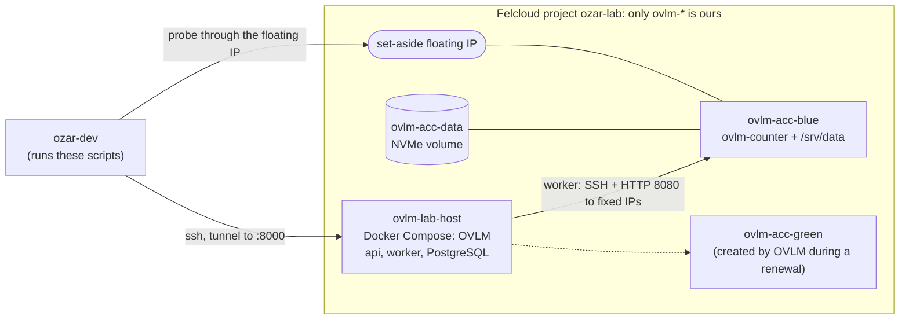

# OVLM lab kit for Felcloud (backlog E5-6)

| Field | Value |
|---|---|
| Owner | Agent 6 — Automation Engineer |
| Status | **Designed, not run.** The scripts pass `shellcheck` and `--dry-run`, and were exercised against a fake `openstack` command. **No script has touched a real cloud.** |
| Runs where | The `ozar-dev` session (cloud entry `ozar-lab`, `openstack` CLI 5.8, Python 3.10, no Docker) |
| Decision | [ADR-0007](../../docs/decisions/ADR-0007-lab-on-felcloud.md): Felcloud, current `ozar-lab` project, `ovlm-*` resources only, before/after snapshot |
| Scenarios | [scenarios.md](scenarios.md) |
| Last updated | 2026-11-04 |

## 1. Purpose

Run OVLM's acceptance scenario and failure scenarios ([testing-strategy.md](../../docs/testing-strategy.md) §7) on a real
cloud, and prove two things at the end of every run:

1. what OVLM did (an evidence bundle with no addresses, hostnames or secrets), and
2. what it did **not** do: no resource outside `ovlm-*` changed (the ADR-0007 guard, `diff-snapshots.sh`).

Nothing here may say "lab validated". Only a human who reviews a complete evidence bundle can (testing-strategy §7.3).

## 2. What the kit builds



| Resource (all `ovlm-*`) | Created by | Notes |
|---|---|---|
| `ovlm-lab-key` (keypair) | `base` | operator's public key, for the lab host |
| `ovlm-lab-sg` | `base` | SSH from the operator's CIDR only. OVLM's API is reached through an SSH tunnel, never published |
| `ovlm-acc-sg`, `ovlm-acc-sg-green` | `base` | SSH and 8080 from the lab host and the operator's CIDR. Blue and the renewal profile's green use **separate** groups so a fault can hit green only |
| `ovlm-lab-host` | `host` | Ubuntu 24.04 (`OVLM_LAB_IMAGE`, default `Ubuntu 24.04 LTS - Noble Numbat`), cloud-init installs Docker and Compose from the Ubuntu archive (over HTTPS, through the proxy if one is set); same network as the targets |
| `ovlm-lab-target-key` | `workload` | public half of a key generated **on the lab host**; its private half never leaves the host |
| `ovlm-acc-data` | `workload` | volume with an **explicit** type (`NVMe`): the cloud has no working default type |
| `ovlm-acc-blue` | `workload` | `G0.basic.1c1g`, tagged `ovlm-lab`; the data volume is attached after boot |
| `ovlm-inventory`, `ovlm-renewal` | `credentials` | application credentials (read = `reader`, write = `member`) |
| green VM, snapshots | OVLM, during scenarios | the profile **must** name green `ovlm-*`; `destroy-lab.sh` stops on anything tagged for OVLM but not named `ovlm-*` |

## 3. Files

| File | Purpose | Changes the cloud? |
|---|---|---|
| `lib.sh` | shared helpers: name guard, `--dry-run`, redaction, typed confirmation | — |
| `lab.env.example` | settings template; copy to `lab.env` (git-ignored) | — |
| `snapshot.sh LABEL` | full project inventory to JSON (every resource, not only `ovlm-*`) | no |
| `diff-snapshots.sh BEFORE AFTER` | proves nothing outside `ovlm-*` changed; exit 1 and a list if it did | no (local) |
| `create-lab.sh STAGE` | `preflight`, `base`, `host`, `host-setup`, `workload`, `configure`, `fip`, `credentials`, `all` | ⚠️ yes |
| `destroy-lab.sh` | deletes only `ovlm-*`, refuses anything else, proves none is left | 🛑 yes |
| `collect-evidence.sh SCENARIO PHASE` | redacted evidence bundle with a canary scan | no |
| `probe.sh --url URL` | external downtime probe (CSV, outage streaks) | no |
| `inject.sh KIND RUN STEP` | waits for a workflow step, then kills the worker or stops PostgreSQL **on the lab host** | ⚠️ lab host only |

Every script has `--dry-run` (prints the commands, runs none) and `-h`. Outputs go to `$OVLM_LAB_WORKDIR`
(default `~/.ovlm-lab`, mode 0700, **outside this repository**). Snapshots and credential files contain addresses and
secrets: never commit or paste them.

## 4. Before you start (who must provide what)

| # | Item | From | Why |
|---|---|---|---|
| 1 | Written go-ahead and the **cost** estimate (§9) | maintainer | EXP-01 rule: show the hourly cost before creating anything |
| 2 | One free floating IP address, set aside for the lab, **not** the one `ozar-dev` uses | maintainer | the pool can be empty (EXP-01); the cutover reuses this address |
| 3 | A flavor for the lab host with at least 2 vCPU and 4 GB | `openstack flavor list` | `G0.basic.1c1g` is too small for Docker builds plus PostgreSQL |
| 4 | **Human approvers with a TOTP authenticator** | maintainer (+ a second human) | gates G1, G2 and G3 cannot be approved by a token or an agent. Approver ≠ requester, and the G3 approver ≠ the plan approver. With one human, the policy `self-approval` setting is needed; its approvals are flagged `self_approved`, and the evidence must say so |
| 5 | The `openstack` CLI authenticated on `ozar-dev` (`OS_CLOUD=ozar-lab`), **`jq`** (needed by every script, also in `--dry-run`), `ssh`, `perl`, `curl`, `sha256sum`, `base64` | `ozar-dev` | the scripts check and stop if one is missing |
| 5a | **If the project network has no direct Internet:** the URL of an operator-provided **HTTPS-only** proxy (`CONNECT` 443 only), and the hosts it allows (see §4a) | maintainer / network operator | the lab host and the worker cannot work without it |
| 6 | The repository URL and the ref (commit SHA) of OVLM under test | maintainer | `host-setup` clones it **detached** at that ref |
| 7 | Permission to push a throw-away branch (LAB-04 only) | maintainer | an outward-facing action: not done without a yes |

The kit **does not** use `sudo` on `ozar-dev`, install anything on `ozar-dev`, or run Ansible there (Python 3.10 is too
old for the pinned ansible-core). Ansible runs on the lab host (Python 3.12).

### 4a. Behind an HTTPS-only egress proxy

Set `OVLM_LAB_HTTPS_PROXY=http://host:port` (no user name or password in it: the scripts refuse that) in `lab.env`, and
add other guest networks to `OVLM_LAB_NO_PROXY` if needed. When it is set, the kit does the following and nothing
else (read it with `--dry-run`, and the generated first-boot script is `$OVLM_LAB_WORKDIR/lab-host.user-data`):

| Where | What |
|---|---|
| Lab host (cloud-init) | apt sources rewritten to `https://` mirrors (`OVLM_LAB_APT_MIRROR`, `OVLM_LAB_APT_SECURITY_MIRROR`), `Acquire::https::Proxy`, `/etc/environment` proxy variables, a systemd drop-in so the **Docker daemon** pulls through the proxy, and `~/.docker/config.json` so **Docker builds** get it (HTTPS only) |
| Blue (`workload`) | apt over HTTPS through the proxy (user-data is added only when a proxy is set) |
| `host-setup` | git, pip and the Docker CLI get the proxy; writes `~/ovlm/.env` with `HTTPS_PROXY` and `NO_PROXY` for Compose |
| OVLM worker | gets `HTTPS_PROXY`/`NO_PROXY` from that `.env` (`compose.yaml`): the **OpenStack APIs go through the proxy; the guests do not**. `NO_PROXY` = loopback, the Compose services, the subnet CIDRs of `OVLM_LAB_NETWORK` (read from the cloud) and `OVLM_LAB_NO_PROXY`. SSH never uses a proxy, and OVLM's own health probe ignores proxy variables. See `docs/install-guide.md` §5a |
| `Dockerfile` | apt uses `https://` by default, so `docker compose up --build` works without a hand-built base image |

The proxy must allow at least: the Ubuntu archive and security mirrors, the Debian archive (`deb.debian.org`,
`security.debian.org`), `pypi.org`, `files.pythonhosted.org`, `github.com`, Docker Hub (`registry-1.docker.io`,
`auth.docker.io`, `production.cloudflare.docker.com`) and the OpenStack API endpoints. The worker's git clone of the
*automation repository* runs with a scrubbed environment, but `HTTPS_PROXY`/`NO_PROXY` (and their lowercase forms)
are passed through to it, so an `https://` repository host works through the proxy; an `ssh://` one does not. Not verified against a real proxy until the first run reports back.

## 5. Rules that never bend

- Every name is `ovlm-*`. The scripts refuse anything else (`assert_ovlm`), and `destroy-lab.sh` re-reads each object
  before deleting it.
- The shared project also holds `ozar-dev` and other resources. The write credential can technically reach them
  (ADR-0007, accepted risk). Never run an `openstack` command that names, lists with `--long`, or changes anything that
  is not `ovlm-*`, except through `snapshot.sh` (read-only).
- Never touch the floating IP that `ozar-dev` itself uses. Never touch the router, the network, the default security
  group, quotas or flavors. (This is why LAB-06 never removes the router gateway.)
- No real address, hostname or credential in a file of this repository, in a commit message or in a report.
- Take a snapshot **before** and **after** every run, and run the diff. A violation voids the run: stop, do not
  "fix" it, tell the maintainer.

## 6. Runbook

Legend: ⚠️ changes state, 🛑 destructive, ◻︎ read-only. Run from `lab/felcloud/` on `ozar-dev`. Append `--dry-run` to
any command first and read what it prints.

### Step 0 — settings and read-only checks ◻︎

```bash
cp lab.env.example lab.env && chmod 600 lab.env       # fill it in; never commit it
./create-lab.sh preflight                              # settings, flavors (vcpus / ram_MiB / disk_GB), image, network, volume type, limits, floating IP free?
./create-lab.sh preflight --dry-run                    # prints every command, runs none
./snapshot.sh before-<date>                            # the ADR-0007 baseline; keep this file
```
If the image is not found, preflight lists the images whose name contains the first word of `OVLM_LAB_IMAGE`: copy the
exact name (for example `Ubuntu 24.04 LTS - Noble Numbat`) into `lab.env`.
**Stop if:** preflight fails; the set-aside floating IP is already associated (it may be `ozar-dev`'s); the limits
leave room for fewer than 3 instances or 3 volumes; the snapshot lists a required type as unavailable.

### Step 1 — network access and keys ⚠️

```bash
./create-lab.sh base
```
Creates `ovlm-lab-key`, `ovlm-lab-sg`, `ovlm-acc-sg`, `ovlm-acc-sg-green` and their rules. Safe to repeat (it reports
what exists). **Stop if** a rule would open a port to `0.0.0.0/0`: this kit never does, so something is wrong with `lab.env`.

### Step 2 — the lab host ⚠️

```bash
./create-lab.sh host
```
Creates `ovlm-lab-host` (Ubuntu 24.04, cloud-init installs `docker.io`, `docker-compose-v2`, `git`, `make`, `jq`),
waits for ACTIVE, then for SSH and for `/var/lib/ovlm-lab-ready`. ACTIVE is not ready (EXP-01b). SSH trusts the host
key on first use (a VM we just created on a private network; the console log is unreliable, so it is not used).
**Stop if** ready is not reached in 15 minutes: `ssh ... cloud-init status --long`, and do not retry blindly.

### Step 3 — OVLM from a git ref ⚠️

```bash
./create-lab.sh host-setup          # clone at OVLM_LAB_REF (detached), make secrets, docker compose up -d --build --wait, readyz
```
This is the repository's **development** Compose stack: `OVLM_DEVELOPMENT_MODE=true`, no TLS, API on the host's
loopback only. That is acceptable for a lab behind an SSH tunnel, and not for anything else. It records the exact commit
in `~/ovlm-commit.txt` on the host (evidence needs it). Then create the first administrator and open the API:

```bash
ssh ubuntu@<lab-host> 'cd ovlm && docker compose exec api ovlm admin create --username <name> --enrol-link'
ssh -L 8000:127.0.0.1:8000 ubuntu@<lab-host>       # keep open; the UI and API are now on http://127.0.0.1:8000
```
Open the enrolment link, set up TOTP (a human does this). The link is a single-use secret: do not paste it anywhere.

### Step 4 — credentials ⚠️ (two paths)

```bash
./create-lab.sh credentials
```
Tries `openstack application credential create --role reader ovlm-inventory` and `--role member ovlm-renewal`, with a
14-day expiry. Secrets are written to `$OVLM_LAB_WORKDIR/credentials/*.json` (0600) and never printed.
- **If the cloud refuses** (for example the user lacks the role, or application credentials are disabled), the script
  says so and creates nothing. The maintainer must create two application credentials in this project with these
  names and roles, and hand over the secrets out of band.
- Upload each secret: `PUT /api/v1/projects/{id}/credentials/read` and `.../write` (admin session + TOTP), then
  `POST .../credentials/{kind}/test`. **Delete the credential files** afterwards (`shred -u`).
- The credentials belong to the same Keystone user as `ozar-dev`'s session: the security model prefers a dedicated
  service user. This is part of the residual risk the maintainer accepted in ADR-0007.

### Step 5 — the initial workload ⚠️

```bash
./create-lab.sh workload       # target key, volume ovlm-acc-data (explicit type), server ovlm-acc-blue, attach, wait for SSH
./create-lab.sh configure      # prints the volume id and the confirmation to type; changes nothing
```
🛑 Formatting is destructive and happens **once**, on a blank volume, and only after you type the confirmation:

```bash
./create-lab.sh configure --confirm FORMAT-<volume id printed above>
```
It runs on the lab host, in this order: `lab/bootstrap_data.yml` (the only playbook that formats; it refuses any volume
that has a signature and finds the device by `virtio-<first 20 characters of the id>`; it creates the mount point,
mounts by UUID and hands the volume to the service uid), **then** `configure.yml` (which, finding `/srv/data` already
mounted, leaves it alone), `start_service.yml` and `healthcheck.yml`, then five increments and `POST /marker`.
The order matters: `configure` on an unmounted `/srv/data` makes it immutable, and the bootstrap's mount point step
then fails with `Operation not permitted`. Results go to `~/lab-work/results/` on the host (never `/tmp`: the result
role sets mode 0700 on the directory that holds the file). `ANSIBLE_ROLES_PATH` is set by the kit.

**Repeating the stage.** Before it changes anything, `configure` looks at blue:

| State of `/srv/data` on blue | What `configure --confirm` does |
|---|---|
| mounted (an earlier run got that far) | does **not** format again; runs `configure`, `start_service`, `healthcheck`; writes the marker **only if there is none** (the recorded value is never replaced) |
| blank (never touched) | the full sequence above |
| immutable and not mounted (the **old order** failed here: the volume already has ext4) | stops, changes nothing, prints the reset below |

**Record** the printed marker SHA-256, `fs_uuid` and counter in your notes (not in the repository): scenarios compare
against them. If a step fails, **stop** and report; do not edit playbooks on the lab host.

**Recovering from the old-order failure** (`Create the empty mount point: Operation not permitted`). The volume has a
filesystem, so the bootstrap rightly refuses a rerun. Delete the workload and make a new one (the host, OVLM and its
database stay; the lab data volume is empty, nothing is lost):

```bash
./destroy-lab.sh --keep-host --keep-credentials      # 🛑 types DESTROY-OVLM-LAB; deletes ovlm-acc-blue and ovlm-acc-data
./create-lab.sh base && ./create-lab.sh workload     # a new blue and a new, blank volume (a recreated blue's SSH host key is forgotten)
./create-lab.sh configure                            # prints the NEW volume id
./create-lab.sh configure --confirm FORMAT-<new id>
```

### Step 6 — the floating IP ⚠️

```bash
./create-lab.sh fip            # refuses if OVLM_LAB_FIP is not free or is held by something that is not ovlm-acc-blue
```
Then, in a second terminal, check it from `ozar-dev`: `./probe.sh --url http://<fip>:8080/health --duration 10`
(expect `failure_streaks=0`). Leave `probe.sh` for the scenario steps.

### Step 7 — baseline and scenarios

```bash
./snapshot.sh baseline-<date>           # after the lab exists: the "before" of the scenarios
```
Follow [scenarios.md](scenarios.md). Per scenario: snapshot, `collect-evidence.sh <ID> before`, probe, run,
`collect-evidence.sh <ID> after`, snapshot, `diff-snapshots.sh`. A completed renewal retires blue, so the next
scenario needs a fresh blue: use the **reset** below.

**Reset between scenarios** (keeps the host, OVLM and its database; deletes the targets and the data volume):
```bash
./destroy-lab.sh --keep-host --keep-credentials      # 🛑 types DESTROY-OVLM-LAB; also deletes ovlm-acc-data
./create-lab.sh base && ./create-lab.sh workload && ./create-lab.sh configure --confirm FORMAT-<new id> && ./create-lab.sh fip
```
Then re-sync inventory in OVLM and re-register the new blue (scenarios.md, step A1–A2).

## 7. Stop conditions (any one: stop, collect evidence, tell the maintainer)

| Condition | Why |
|---|---|
| `diff-snapshots.sh` reports a violation | something outside `ovlm-*` changed: the run is void and the cause must be understood |
| A command output names a resource that is not `ovlm-*` and you did not list it on purpose | scope leak |
| The data volume is attached to two servers, or `ovlm-acc-data` shows an unexpected status | data safety |
| The marker SHA-256 or the counter on the surviving VM differs from the recorded values | data loss: **do not retry the scenario**, preserve the state |
| A step needs `--force`, an admin action, or a quota change | out of scope for `member`; ask the maintainer |
| `destroy-lab.sh` exits 3 or 4, or reports `LEFT:` | refused delete, a look-alike, or leftovers: do not delete by hand |
| The cost estimate is exceeded, or a VM you did not intend is ACTIVE (for example green after LAB-02) | roll back and delete at once |
| The same step fails twice without a new cause | do not loop; collect evidence |

## 8. Cleanup 🛑 and proof

```bash
./destroy-lab.sh                          # 🛑 --yes and the typed word DESTROY-OVLM-LAB; deletes ovlm-* only
./snapshot.sh after-<date>
./diff-snapshots.sh before-<date> after-<date>
```
`destroy-lab.sh` disassociates the floating IP from `ovlm-*` servers and **never deletes it**; it deletes servers, then
volumes (including `ovlm-acc-data`, which is lab data), images, leftover ports, security groups, keypairs and the
`ovlm-*` application credentials, then lists everything again and fails if any `ovlm-*` object remains. The diff
must pass with the set-aside floating IP back to its original (unassociated) state: pass `--allow-fip` only if you
expect that address to differ, and report why. Remove `$OVLM_LAB_WORKDIR/credentials/` and, when the campaign is over,
the whole workdir after the evidence is archived.

## 9. Cost note

I do not know Felcloud's prices, so no figure is given here. Estimate before asking for approval:

```
hourly cost ≈ price(host flavor) + price(blue flavor) + price(green flavor, during a renewal)
              + volume GB-hours (data volume, 2 GB) + one floating IP (already allocated by the maintainer)
```
A session is normally 3–6 hours; a complete primary scenario, with the retention wait, adds a few hours more (the
**retention period** in the policy is configurable: use the shortest the policy allows for the lab). The expensive
items are the lab host (largest flavor) and, in LAB-02, a very large flavor: that scenario needs a separate cost yes.
Delete what you are not using: `destroy-lab.sh` at the end of every working session, and never leave `ovlm-lab-host`
overnight without the maintainer's agreement.

## 10. After a run

`collect-evidence.sh` produces a *draft* bundle. For a "lab validated" claim a human still has to: read the bundle,
confirm the commit and the cloud (Felcloud, real KVM, `NVMe` volume type, this one cloud only), write `REVIEW.md`
(name and date), and keep the diff report. Until then the status stays "Designed" or "lab-observed", per the
vocabulary in [agent-team.md](../../docs/agent-team.md).

## 11. Known gaps and assumptions

- **First real run: steps 0–3 passed on Felcloud; step 5 failed in the old order and was fixed here (not yet re-run).**
  The `openstack` output formats (`-f json` column names, `Port Range` strings, `versions show`)
  follow CLI 5.x as I know it; `snapshot.sh` and `create-lab.sh` fail loudly rather than guess, and the first real run
  is expected to need small fixes.
- `server create --tag` needs compute microversion ≥ 2.52, and the scripts export `OS_COMPUTE_API_VERSION=2.85`
  (EXP-01: the cloud offers 2.100).
- How OVLM's worker reaches the guests (the `guest_access` setting of a project, the worker's SSH key) is configured in
  OVLM per api-design §3.1; this kit does not automate it, and nothing here has verified that the Compose stack
  exposes it. Ask the Agent 1 / security owner for the lab value.
- `compose.yaml` has no `restart:` policy, so a killed worker stays down until `inject.sh worker-start`.
- The cloud's own limits (50 instances, 128 cores) are far above what the lab uses, so an *OverQuota* cannot be
  provoked by a `member`; see LAB-02 in scenarios.md.
